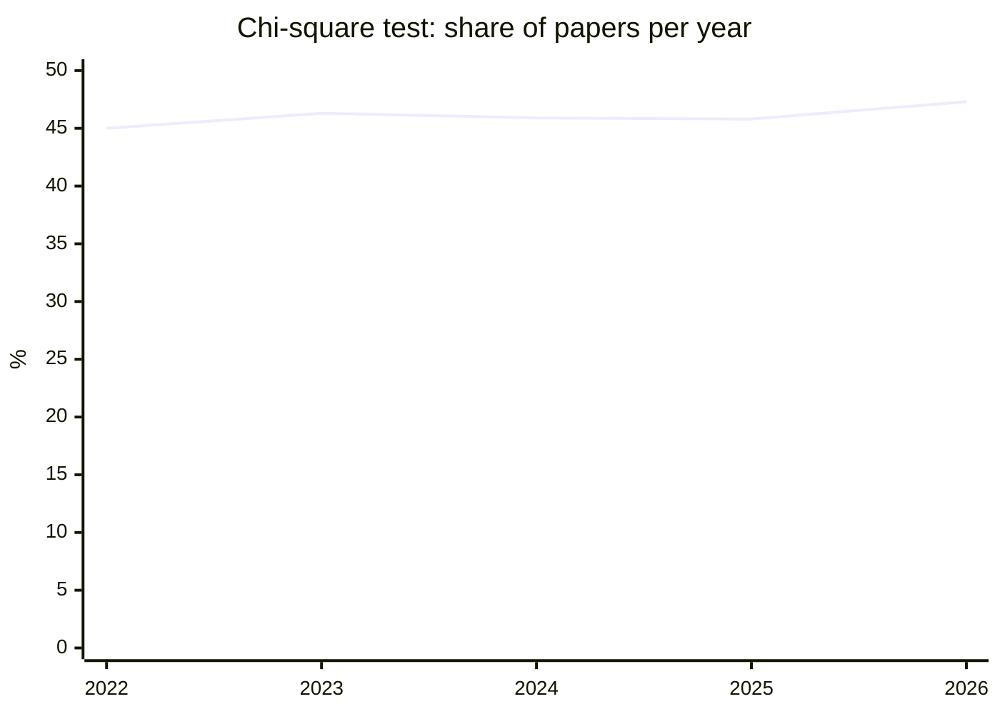
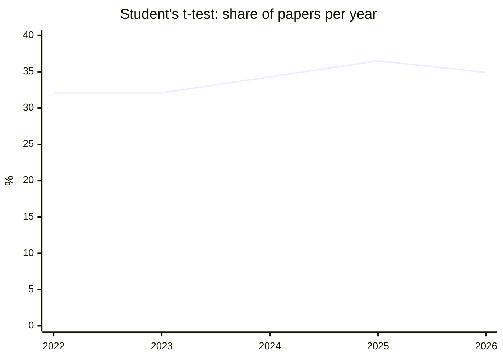
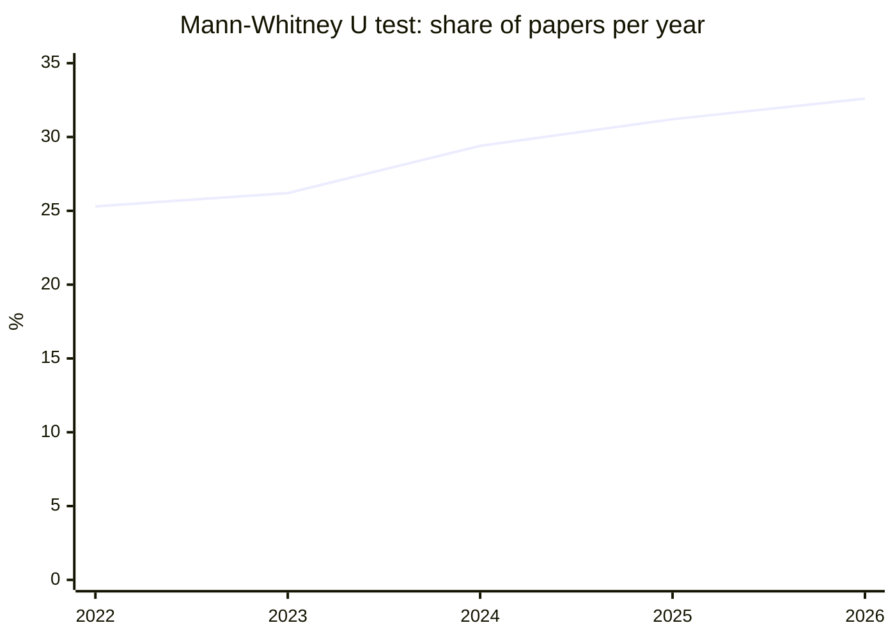
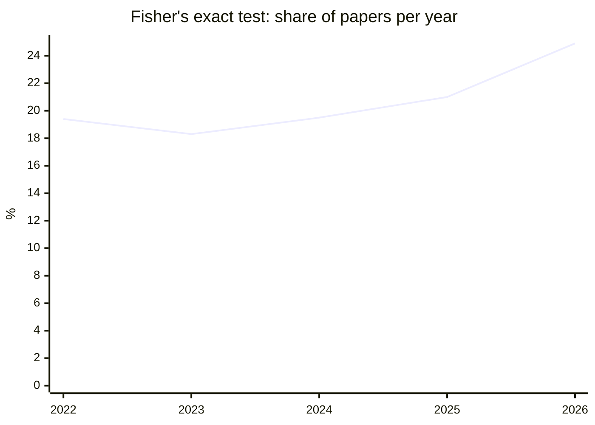

# Literature watch

Updated 2026-11-25. Round: 25 papers per field and publication month, 2016-10 to 2026-09.

Which statistical methods epidemiological research uses, from a random sample of open-access research articles in PubMed and PMC per field and month (no reviews). Claude lists each paper's methods from its abstract and methods section; only IDs, titles and the methods are stored.

## Progress

| Field | Months complete | Papers read |
|---|---|---|
| cardiovascular | 55 / 120 | 1375 / 3000 |
| metabolic | 55 / 120 | 1375 / 3000 |
| mental-health | 55 / 120 | 1375 / 3000 |
| cancer | 54 / 120 | 1372 / 3000 |
| respiratory-allergy | 54 / 120 | 1350 / 3000 |
| infections | 54 / 120 | 1350 / 3000 |
| pregnancy-child | 54 / 120 | 1350 / 3000 |
| environment | 54 / 120 | 1350 / 3000 |
| nutrition | 54 / 120 | 1350 / 3000 |
| omics | 54 / 120 | 1345 / 2995 |
| lifestyle | 54 / 120 | 1350 / 3000 |
| **all** | 597 / 1320 | 14942 / 32995 |

## All fields

Papers read: 12228, 11963 of them usable (7970 of these in the last 36 months, which the order below is based on).

| Method | Share, last 3 years | Papers | 2016 | 2017 | 2018 | 2019 | 2020 | 2021 | 2022 | 2023 | 2024 | 2025 | 2026 | Trend | In DataSHIELD |
|---|---|---|---|---|---|---|---|---|---|---|---|---|---|---|---|
| Chi-square test | 47% | 3716 | – | – | – | – | – | – | 45% | 46% | 46% | 46% | 47% | steady | – |
| Student's t-test | 35% | 2803 | – | – | – | – | – | – | 32% | 32% | 34% | 36% | 35% | rising | – |
| Logistic regression | 31% | 2483 | – | – | – | – | – | – | 30% | 31% | 30% | 32% | 32% | steady | – |
| Mann-Whitney U test | 31% | 2457 | – | – | – | – | – | – | 25% | 26% | 29% | 31% | 33% | rising | – |
| Fisher's exact test | 21% | 1710 | – | – | – | – | – | – | 19% | 18% | 20% | 21% | 25% | rising | – |
| Linear regression | 17% | 1379 | – | – | – | – | – | – | 16% | 16% | 16% | 17% | 20% | rising | – |
| Analysis of variance (ANOVA) | 15% | 1229 | – | – | – | – | – | – | 15% | 15% | 16% | 15% | 15% | steady | – |
| Cox proportional hazards regression | 14% | 1155 | – | – | – | – | – | – | 13% | 15% | 14% | 14% | 16% | steady | – |
| ROC curve analysis | 14% | 1108 | – | – | – | – | – | – | 10% | 9% | 12% | 16% | 15% | rising | – |
| Spearman's rank correlation | 12% | 946 | – | – | – | – | – | – | 9% | 10% | 10% | 13% | 14% | rising | – |
| Kruskal-Wallis test | 12% | 944 | – | – | – | – | – | – | 11% | 10% | 12% | 11% | 13% | rising | – |
| Kaplan-Meier estimator | 11% | 912 | – | – | – | – | – | – | 11% | 11% | 11% | 11% | 12% | steady | – |
| Pearson correlation | 11% | 898 | – | – | – | – | – | – | 8% | 10% | 11% | 13% | 11% | rising | – |
| Shapiro-Wilk test | 10% | 813 | – | – | – | – | – | – | 7% | 6% | 8% | 12% | 12% | rising | – |
| Subgroup analysis | 9% | 692 | – | – | – | – | – | – | 5% | 7% | 8% | 9% | 9% | rising | – |
| false-discovery-rate-correction | 8% | 651 | – | – | – | – | – | – | 5% | 5% | 6% | 7% | 12% | rising | – |
| Log-rank test | 8% | 610 | – | – | – | – | – | – | 7% | 8% | 8% | 7% | 8% | steady | – |
| Kolmogorov-Smirnov test | 7% | 524 | – | – | – | – | – | – | 5% | 6% | 7% | 7% | 5% | steady | – |
| Variance inflation factor | 6% | 491 | – | – | – | – | – | – | 4% | 3% | 3% | 6% | 11% | rising | – |
| Multiple imputation | 6% | 472 | – | – | – | – | – | – | 4% | 5% | 5% | 6% | 8% | rising | – |
| *papers read* | | | 0 | 0 | 0 | 0 | 0 | 0 | 2062 | 2591 | 2583 | 2619 | 2108 | | |

**Variants named in at least 2 papers** (DataSHIELD may have the method but not the variant):

| Method | Variant | Papers | In DataSHIELD |
|---|---|---|---|
| Analysis of variance (ANOVA) | One-way ANOVA | 713 | – |
| Student's t-test | Independent samples | 710 | – |
| false-discovery-rate-correction | Benjamini-Hochberg procedure | 587 | – |
| Student's t-test | Paired samples | 431 | – |
| Multiple imputation | Multiple imputation by chained equations | 335 | – |
| Linear mixed model | Random intercept | 270 | – |
| Logistic regression | Survey-weighted | 248 | – |
| Mediation analysis | Bootstrap confidence intervals | 178 | – |
| Propensity score matching | Nearest-neighbor matching | 172 | – |
| Analysis of variance (ANOVA) | Analysis of covariance | 166 | – |
| Cox proportional hazards regression | Stratified baseline hazards | 166 | – |
| Propensity score matching | Caliper matching | 151 | – |
| Student's t-test | Welch unequal variances | 149 | – |
| Poisson regression | Robust standard errors | 148 | – |
| ROC curve analysis | Youden optimal cutoff | 148 | – |
| Generalized linear mixed model | Random intercept | 135 | – |
| Cox proportional hazards regression | Time-varying covariates | 129 | – |
| Analysis of variance (ANOVA) | Repeated measures ANOVA | 128 | – |
| gradient-boosting | XGBoost | 115 | – |
| Linear regression | Survey-weighted regression | 102 | – |

## cardiovascular

Papers read: 1107, 1082 of them usable (713 of these in the last 36 months, which the order below is based on).

| Method | Share, last 3 years | Papers | 2016 | 2017 | 2018 | 2019 | 2020 | 2021 | 2022 | 2023 | 2024 | 2025 | 2026 | Trend | In DataSHIELD |
|---|---|---|---|---|---|---|---|---|---|---|---|---|---|---|---|
| Chi-square test | 57% | 403 | – | – | – | – | – | – | 58% | 59% | 56% | 56% | 60% | steady | – |
| Mann-Whitney U test | 42% | 303 | – | – | – | – | – | – | 37% | 33% | 37% | 47% | 45% | rising | – |
| Student's t-test | 41% | 291 | – | – | – | – | – | – | 44% | 38% | 39% | 44% | 40% | steady | – |
| Logistic regression | 36% | 259 | – | – | – | – | – | – | 34% | 32% | 35% | 35% | 39% | steady | – |
| Fisher's exact test | 32% | 228 | – | – | – | – | – | – | 26% | 26% | 30% | 32% | 36% | rising | – |
| Cox proportional hazards regression | 25% | 175 | – | – | – | – | – | – | 23% | 24% | 29% | 20% | 25% | steady | – |
| Kaplan-Meier estimator | 21% | 148 | – | – | – | – | – | – | 18% | 24% | 22% | 21% | 19% | steady | – |
| ROC curve analysis | 20% | 141 | – | – | – | – | – | – | 14% | 13% | 19% | 19% | 23% | rising | – |
| Analysis of variance (ANOVA) | 16% | 113 | – | – | – | – | – | – | 14% | 21% | 16% | 14% | 15% | steady | – |
| Linear regression | 14% | 100 | – | – | – | – | – | – | 12% | 13% | 15% | 11% | 18% | steady | – |
| *papers read* | | | 0 | 0 | 0 | 0 | 0 | 0 | 194 | 229 | 231 | 234 | 194 | | |

**Variants named in at least 2 papers** (DataSHIELD may have the method but not the variant):

| Method | Variant | Papers | In DataSHIELD |
|---|---|---|---|
| Analysis of variance (ANOVA) | One-way ANOVA | 72 | – |
| Student's t-test | Independent samples | 64 | – |
| Student's t-test | Paired samples | 52 | – |
| Multiple imputation | Multiple imputation by chained equations | 38 | – |
| Propensity score matching | Nearest-neighbor matching | 22 | – |
| ROC curve analysis | Youden optimal cutoff | 20 | – |
| Logistic regression | Survey-weighted | 19 | – |
| Propensity score matching | Caliper matching | 18 | – |
| false-discovery-rate-correction | Benjamini-Hochberg procedure | 16 | – |
| Mediation analysis | Bootstrap confidence intervals | 16 | – |
| Student's t-test | Welch unequal variances | 16 | – |
| Cox proportional hazards regression | Stratified baseline hazards | 15 | – |
| Generalized linear mixed model | Random intercept | 14 | – |
| gradient-boosting | XGBoost | 14 | – |
| Linear mixed model | Random intercept | 14 | – |
| Analysis of variance (ANOVA) | Analysis of covariance | 13 | – |
| Cox proportional hazards regression | Time-varying covariates | 11 | – |
| Bootstrap | Optimism-corrected internal validation | 10 | – |
| Cox proportional hazards regression | Survey-weighted | 10 | – |
| Linear regression | Stepwise selection | 10 | – |

## metabolic

Papers read: 1146, 1127 of them usable (736 of these in the last 36 months, which the order below is based on).

| Method | Share, last 3 years | Papers | 2016 | 2017 | 2018 | 2019 | 2020 | 2021 | 2022 | 2023 | 2024 | 2025 | 2026 | Trend | In DataSHIELD |
|---|---|---|---|---|---|---|---|---|---|---|---|---|---|---|---|
| Chi-square test | 55% | 404 | – | – | – | – | – | – | 54% | 55% | 53% | 57% | 55% | steady | – |
| Student's t-test | 45% | 331 | – | – | – | – | – | – | 38% | 40% | 44% | 48% | 46% | rising | – |
| Logistic regression | 36% | 267 | – | – | – | – | – | – | 36% | 31% | 36% | 37% | 37% | steady | – |
| Mann-Whitney U test | 33% | 246 | – | – | – | – | – | – | 27% | 32% | 31% | 34% | 35% | steady | – |
| Analysis of variance (ANOVA) | 21% | 157 | – | – | – | – | – | – | 25% | 17% | 20% | 23% | 22% | steady | – |
| Linear regression | 21% | 151 | – | – | – | – | – | – | 18% | 16% | 17% | 22% | 25% | rising | – |
| Fisher's exact test | 20% | 146 | – | – | – | – | – | – | 23% | 16% | 20% | 20% | 23% | steady | – |
| ROC curve analysis | 16% | 115 | – | – | – | – | – | – | 11% | 13% | 13% | 16% | 17% | steady | – |
| Cox proportional hazards regression | 15% | 113 | – | – | – | – | – | – | 11% | 18% | 13% | 15% | 16% | steady | – |
| Kruskal-Wallis test | 14% | 105 | – | – | – | – | – | – | 14% | 13% | 12% | 15% | 17% | steady | – |
| *papers read* | | | 0 | 0 | 0 | 0 | 0 | 0 | 212 | 238 | 242 | 246 | 189 | | |

**Variants named in at least 2 papers** (DataSHIELD may have the method but not the variant):

| Method | Variant | Papers | In DataSHIELD |
|---|---|---|---|
| Analysis of variance (ANOVA) | One-way ANOVA | 98 | – |
| Student's t-test | Independent samples | 67 | – |
| Student's t-test | Paired samples | 65 | – |
| Logistic regression | Survey-weighted | 40 | – |
| Multiple imputation | Multiple imputation by chained equations | 33 | – |
| Analysis of variance (ANOVA) | Analysis of covariance | 29 | – |
| false-discovery-rate-correction | Benjamini-Hochberg procedure | 29 | – |
| Propensity score matching | Nearest-neighbor matching | 28 | – |
| Propensity score matching | Caliper matching | 25 | – |
| Analysis of variance (ANOVA) | Repeated measures ANOVA | 22 | – |
| Linear mixed model | Random intercept | 22 | – |
| Mediation analysis | Bootstrap confidence intervals | 17 | – |
| Poisson regression | Robust standard errors | 17 | – |
| ROC curve analysis | Youden optimal cutoff | 15 | – |
| Logistic regression | Stratified analysis | 14 | – |
| gradient-boosting | XGBoost | 13 | – |
| Linear regression | Stratified regression | 13 | – |
| Segmented (piecewise) regression | Two-piecewise threshold effect | 13 | – |
| Student's t-test | Survey-weighted | 13 | – |
| Linear regression | Survey-weighted regression | 12 | – |

## mental-health

Papers read: 1117, 1099 of them usable (733 of these in the last 36 months, which the order below is based on).

| Method | Share, last 3 years | Papers | 2016 | 2017 | 2018 | 2019 | 2020 | 2021 | 2022 | 2023 | 2024 | 2025 | 2026 | Trend | In DataSHIELD |
|---|---|---|---|---|---|---|---|---|---|---|---|---|---|---|---|
| Chi-square test | 45% | 330 | – | – | – | – | – | – | 44% | 38% | 46% | 44% | 46% | steady | – |
| Student's t-test | 35% | 254 | – | – | – | – | – | – | 29% | 26% | 32% | 36% | 36% | rising | – |
| Logistic regression | 29% | 211 | – | – | – | – | – | – | 32% | 26% | 31% | 27% | 29% | steady | – |
| Mann-Whitney U test | 21% | 157 | – | – | – | – | – | – | 19% | 19% | 23% | 19% | 24% | steady | – |
| Linear regression | 21% | 154 | – | – | – | – | – | – | 19% | 18% | 20% | 20% | 24% | steady | – |
| Analysis of variance (ANOVA) | 17% | 125 | – | – | – | – | – | – | 14% | 13% | 18% | 19% | 14% | steady | – |
| Pearson correlation | 15% | 111 | – | – | – | – | – | – | 7% | 12% | 15% | 18% | 12% | rising | – |
| Fisher's exact test | 13% | 96 | – | – | – | – | – | – | 10% | 12% | 11% | 11% | 18% | steady | – |
| ROC curve analysis | 11% | 78 | – | – | – | – | – | – | 7% | 4% | 8% | 13% | 13% | rising | – |
| Spearman's rank correlation | 11% | 78 | – | – | – | – | – | – | 7% | 7% | 12% | 10% | 11% | steady | – |
| *papers read* | | | 0 | 0 | 0 | 0 | 0 | 0 | 191 | 240 | 234 | 240 | 194 | | |

**Variants named in at least 2 papers** (DataSHIELD may have the method but not the variant):

| Method | Variant | Papers | In DataSHIELD |
|---|---|---|---|
| Student's t-test | Independent samples | 85 | – |
| Analysis of variance (ANOVA) | One-way ANOVA | 54 | – |
| false-discovery-rate-correction | Benjamini-Hochberg procedure | 47 | – |
| Multiple imputation | Multiple imputation by chained equations | 45 | – |
| Mediation analysis | Bootstrap confidence intervals | 39 | – |
| Student's t-test | Paired samples | 36 | – |
| Analysis of variance (ANOVA) | Analysis of covariance | 34 | – |
| Linear mixed model | Random intercept | 32 | – |
| Linear mixed model | Random slopes | 24 | – |
| Cox proportional hazards regression | Stratified baseline hazards | 21 | – |
| Analysis of variance (ANOVA) | Repeated measures ANOVA | 20 | – |
| Cox proportional hazards regression | Time-varying covariates | 20 | – |
| Poisson regression | Robust standard errors | 19 | – |
| Propensity score matching | Nearest-neighbor matching | 19 | – |
| Linear regression | Interaction terms | 16 | – |
| Logistic regression | Survey-weighted | 16 | – |
| Propensity score matching | Caliper matching | 16 | – |
| Cox proportional hazards regression | Robust standard errors | 15 | – |
| Generalized linear mixed model | Random intercept | 14 | – |
| Student's t-test | Welch unequal variances | 13 | – |

## cancer

Papers read: 1108, 1066 of them usable (716 of these in the last 36 months, which the order below is based on).

| Method | Share, last 3 years | Papers | 2016 | 2017 | 2018 | 2019 | 2020 | 2021 | 2022 | 2023 | 2024 | 2025 | 2026 | Trend | In DataSHIELD |
|---|---|---|---|---|---|---|---|---|---|---|---|---|---|---|---|
| Chi-square test | 49% | 353 | – | – | – | – | – | – | 44% | 49% | 52% | 46% | 49% | steady | – |
| Kaplan-Meier estimator | 35% | 252 | – | – | – | – | – | – | 38% | 39% | 40% | 33% | 35% | steady | – |
| Mann-Whitney U test | 34% | 244 | – | – | – | – | – | – | 23% | 32% | 35% | 31% | 35% | rising | – |
| Student's t-test | 32% | 232 | – | – | – | – | – | – | 31% | 35% | 34% | 31% | 30% | steady | – |
| Fisher's exact test | 31% | 221 | – | – | – | – | – | – | 22% | 28% | 32% | 27% | 35% | rising | – |
| Logistic regression | 30% | 214 | – | – | – | – | – | – | 23% | 27% | 26% | 33% | 30% | steady | – |
| Cox proportional hazards regression | 29% | 206 | – | – | – | – | – | – | 28% | 34% | 31% | 24% | 33% | steady | – |
| Log-rank test | 27% | 192 | – | – | – | – | – | – | 23% | 28% | 32% | 25% | 25% | steady | – |
| ROC curve analysis | 21% | 151 | – | – | – | – | – | – | 19% | 14% | 18% | 25% | 20% | steady | – |
| Kruskal-Wallis test | 9% | 62 | – | – | – | – | – | – | 11% | 8% | 7% | 8% | 11% | steady | – |
| *papers read* | | | 0 | 0 | 0 | 0 | 0 | 0 | 185 | 225 | 230 | 227 | 199 | | |

**Variants named in at least 2 papers** (DataSHIELD may have the method but not the variant):

| Method | Variant | Papers | In DataSHIELD |
|---|---|---|---|
| Analysis of variance (ANOVA) | One-way ANOVA | 41 | – |
| Student's t-test | Independent samples | 40 | – |
| Student's t-test | Paired samples | 35 | – |
| Propensity score matching | Caliper matching | 26 | – |
| ROC curve analysis | Youden optimal cutoff | 26 | – |
| false-discovery-rate-correction | Benjamini-Hochberg procedure | 24 | – |
| Propensity score matching | Nearest-neighbor matching | 24 | – |
| Cox proportional hazards regression | Stratified baseline hazards | 19 | – |
| gradient-boosting | XGBoost | 18 | – |
| Cross-validation | K-fold cross-validation | 15 | – |
| Multiple imputation | Multiple imputation by chained equations | 15 | – |
| Concordance index (C-index) | harrell's | 11 | – |
| Cox proportional hazards regression | Time-varying covariates | 11 | – |
| Kaplan-Meier estimator | reverse (follow-up time) | 11 | – |
| Linear mixed model | Random intercept | 11 | – |
| Bootstrap | Optimism-corrected internal validation | 9 | – |
| Cox proportional hazards regression | Cause-specific hazards | 9 | – |
| Direct standardization | age | 9 | – |
| gradient-boosting | LightGBM | 9 | – |
| Stepwise variable selection | Backward elimination | 9 | – |

## respiratory-allergy

Papers read: 1113, 1088 of them usable (736 of these in the last 36 months, which the order below is based on).

| Method | Share, last 3 years | Papers | 2016 | 2017 | 2018 | 2019 | 2020 | 2021 | 2022 | 2023 | 2024 | 2025 | 2026 | Trend | In DataSHIELD |
|---|---|---|---|---|---|---|---|---|---|---|---|---|---|---|---|
| Chi-square test | 53% | 393 | – | – | – | – | – | – | 50% | 54% | 52% | 55% | 50% | steady | – |
| Student's t-test | 39% | 285 | – | – | – | – | – | – | 35% | 38% | 40% | 39% | 38% | steady | – |
| Mann-Whitney U test | 37% | 274 | – | – | – | – | – | – | 31% | 31% | 36% | 43% | 35% | rising | – |
| Logistic regression | 32% | 236 | – | – | – | – | – | – | 30% | 27% | 30% | 34% | 35% | steady | – |
| Fisher's exact test | 30% | 223 | – | – | – | – | – | – | 32% | 28% | 27% | 31% | 35% | steady | – |
| Kaplan-Meier estimator | 25% | 181 | – | – | – | – | – | – | 29% | 28% | 26% | 24% | 22% | steady | – |
| Cox proportional hazards regression | 22% | 161 | – | – | – | – | – | – | 21% | 26% | 23% | 20% | 22% | steady | – |
| ROC curve analysis | 21% | 151 | – | – | – | – | – | – | 20% | 14% | 19% | 24% | 21% | steady | – |
| Log-rank test | 16% | 117 | – | – | – | – | – | – | 20% | 19% | 19% | 15% | 13% | falling | – |
| Analysis of variance (ANOVA) | 14% | 105 | – | – | – | – | – | – | 12% | 11% | 12% | 16% | 13% | steady | – |
| *papers read* | | | 0 | 0 | 0 | 0 | 0 | 0 | 177 | 236 | 240 | 238 | 197 | | |

**Variants named in at least 2 papers** (DataSHIELD may have the method but not the variant):

| Method | Variant | Papers | In DataSHIELD |
|---|---|---|---|
| Student's t-test | Independent samples | 65 | – |
| Analysis of variance (ANOVA) | One-way ANOVA | 53 | – |
| Student's t-test | Paired samples | 46 | – |
| Propensity score matching | Caliper matching | 31 | – |
| Propensity score matching | Nearest-neighbor matching | 28 | – |
| Multiple imputation | Multiple imputation by chained equations | 25 | – |
| false-discovery-rate-correction | Benjamini-Hochberg procedure | 19 | – |
| gradient-boosting | XGBoost | 19 | – |
| ROC curve analysis | Youden optimal cutoff | 18 | – |
| Logistic regression | Survey-weighted | 14 | – |
| Cross-validation | K-fold cross-validation | 13 | – |
| Bootstrap | Optimism-corrected internal validation | 12 | – |
| Cox proportional hazards regression | Stratified baseline hazards | 12 | – |
| Student's t-test | Welch unequal variances | 12 | – |
| Linear mixed model | Random intercept | 11 | – |
| Analysis of variance (ANOVA) | Analysis of covariance | 10 | – |
| Analysis of variance (ANOVA) | Repeated measures ANOVA | 10 | – |
| Stepwise variable selection | Backward elimination | 10 | – |
| Cox proportional hazards regression | Time-varying covariates | 8 | – |
| Generalized linear mixed model | Random intercept | 8 | – |

## infections

Papers read: 1127, 1094 of them usable (740 of these in the last 36 months, which the order below is based on).

| Method | Share, last 3 years | Papers | 2016 | 2017 | 2018 | 2019 | 2020 | 2021 | 2022 | 2023 | 2024 | 2025 | 2026 | Trend | In DataSHIELD |
|---|---|---|---|---|---|---|---|---|---|---|---|---|---|---|---|
| Chi-square test | 49% | 362 | – | – | – | – | – | – | 51% | 50% | 44% | 50% | 51% | steady | – |
| Logistic regression | 35% | 256 | – | – | – | – | – | – | 27% | 35% | 33% | 36% | 37% | steady | – |
| Mann-Whitney U test | 31% | 227 | – | – | – | – | – | – | 25% | 27% | 27% | 30% | 35% | rising | – |
| Fisher's exact test | 29% | 212 | – | – | – | – | – | – | 27% | 23% | 21% | 30% | 38% | rising | – |
| Student's t-test | 28% | 206 | – | – | – | – | – | – | 30% | 33% | 26% | 30% | 28% | steady | – |
| ROC curve analysis | 12% | 87 | – | – | – | – | – | – | 8% | 6% | 9% | 13% | 15% | rising | – |
| Analysis of variance (ANOVA) | 10% | 74 | – | – | – | – | – | – | 12% | 10% | 9% | 10% | 11% | steady | – |
| Cox proportional hazards regression | 10% | 73 | – | – | – | – | – | – | 9% | 7% | 8% | 12% | 10% | steady | – |
| Kaplan-Meier estimator | 10% | 73 | – | – | – | – | – | – | 8% | 6% | 9% | 10% | 11% | steady | – |
| Linear regression | 10% | 73 | – | – | – | – | – | – | 8% | 12% | 8% | 12% | 10% | steady | – |
| *papers read* | | | 0 | 0 | 0 | 0 | 0 | 0 | 180 | 236 | 239 | 250 | 189 | | |

**Variants named in at least 2 papers** (DataSHIELD may have the method but not the variant):

| Method | Variant | Papers | In DataSHIELD |
|---|---|---|---|
| Student's t-test | Independent samples | 49 | – |
| Analysis of variance (ANOVA) | One-way ANOVA | 45 | – |
| Student's t-test | Paired samples | 31 | – |
| false-discovery-rate-correction | Benjamini-Hochberg procedure | 21 | – |
| Poisson regression | Robust standard errors | 20 | – |
| Generalized linear mixed model | Random intercept | 19 | – |
| Multiple imputation | Multiple imputation by chained equations | 19 | – |
| Propensity score matching | Nearest-neighbor matching | 18 | – |
| ROC curve analysis | Youden optimal cutoff | 18 | – |
| Logistic regression | Survey-weighted | 13 | – |
| Phylogenetic analysis | maximum likelihood | 13 | – |
| Segmented (piecewise) regression | Interrupted time series | 13 | – |
| Stepwise variable selection | Backward elimination | 12 | – |
| Poisson regression | Modified Poisson regression | 11 | – |
| Propensity score matching | Caliper matching | 11 | – |
| Generalized linear mixed model | Binomial logit link | 10 | – |
| Linear mixed model | Random intercept | 10 | – |
| Cox proportional hazards regression | Stratified baseline hazards | 9 | – |
| Analysis of variance (ANOVA) | Repeated measures ANOVA | 8 | – |
| Logistic regression | Interaction terms | 8 | – |

## pregnancy-child

Papers read: 1125, 1101 of them usable (733 of these in the last 36 months, which the order below is based on).

| Method | Share, last 3 years | Papers | 2016 | 2017 | 2018 | 2019 | 2020 | 2021 | 2022 | 2023 | 2024 | 2025 | 2026 | Trend | In DataSHIELD |
|---|---|---|---|---|---|---|---|---|---|---|---|---|---|---|---|
| Chi-square test | 46% | 338 | – | – | – | – | – | – | 51% | 52% | 45% | 50% | 41% | falling | – |
| Logistic regression | 37% | 270 | – | – | – | – | – | – | 42% | 46% | 33% | 39% | 39% | steady | – |
| Student's t-test | 35% | 257 | – | – | – | – | – | – | 34% | 36% | 32% | 39% | 32% | steady | – |
| Mann-Whitney U test | 29% | 216 | – | – | – | – | – | – | 25% | 27% | 29% | 32% | 26% | steady | – |
| Fisher's exact test | 24% | 179 | – | – | – | – | – | – | 26% | 24% | 22% | 27% | 24% | steady | – |
| Linear regression | 15% | 112 | – | – | – | – | – | – | 14% | 12% | 16% | 14% | 17% | steady | – |
| Analysis of variance (ANOVA) | 13% | 98 | – | – | – | – | – | – | 11% | 13% | 13% | 15% | 13% | steady | – |
| ROC curve analysis | 13% | 96 | – | – | – | – | – | – | 12% | 10% | 13% | 16% | 11% | steady | – |
| Shapiro-Wilk test | 10% | 74 | – | – | – | – | – | – | 7% | 6% | 9% | 12% | 9% | steady | – |
| Kruskal-Wallis test | 10% | 73 | – | – | – | – | – | – | 10% | 10% | 9% | 11% | 11% | steady | – |
| *papers read* | | | 0 | 0 | 0 | 0 | 0 | 0 | 186 | 248 | 231 | 234 | 202 | | |

**Variants named in at least 2 papers** (DataSHIELD may have the method but not the variant):

| Method | Variant | Papers | In DataSHIELD |
|---|---|---|---|
| Analysis of variance (ANOVA) | One-way ANOVA | 66 | – |
| Student's t-test | Independent samples | 57 | – |
| Multiple imputation | Multiple imputation by chained equations | 33 | – |
| false-discovery-rate-correction | Benjamini-Hochberg procedure | 28 | – |
| Poisson regression | Robust standard errors | 28 | – |
| Student's t-test | Paired samples | 25 | – |
| Poisson regression | Modified Poisson regression | 19 | – |
| Linear mixed model | Random intercept | 18 | – |
| Student's t-test | Welch unequal variances | 15 | – |
| Generalized estimating equations | Exchangeable working correlation | 13 | – |
| Propensity score matching | Nearest-neighbor matching | 13 | – |
| Logistic regression | Stratified analysis | 12 | – |
| Cox proportional hazards regression | Robust standard errors | 11 | – |
| Generalized estimating equations | Robust sandwich standard errors | 10 | – |
| Generalized linear mixed model | Binomial logit link | 10 | – |
| ROC curve analysis | Youden optimal cutoff | 10 | – |
| Cox proportional hazards regression | Time-varying covariates | 9 | – |
| Generalized linear mixed model | Random intercept | 9 | – |
| Linear mixed model | Random slopes | 9 | – |
| Logistic regression | Interaction terms | 9 | – |

## environment

Papers read: 1136, 1121 of them usable (747 of these in the last 36 months, which the order below is based on).

| Method | Share, last 3 years | Papers | 2016 | 2017 | 2018 | 2019 | 2020 | 2021 | 2022 | 2023 | 2024 | 2025 | 2026 | Trend | In DataSHIELD |
|---|---|---|---|---|---|---|---|---|---|---|---|---|---|---|---|
| Chi-square test | 36% | 271 | – | – | – | – | – | – | 30% | 35% | 39% | 32% | 36% | steady | – |
| Logistic regression | 30% | 226 | – | – | – | – | – | – | 31% | 34% | 29% | 28% | 32% | steady | – |
| Student's t-test | 26% | 191 | – | – | – | – | – | – | 20% | 21% | 26% | 27% | 22% | steady | – |
| Linear regression | 23% | 170 | – | – | – | – | – | – | 21% | 22% | 20% | 24% | 28% | steady | – |
| Mann-Whitney U test | 20% | 149 | – | – | – | – | – | – | 14% | 12% | 18% | 22% | 22% | rising | – |
| Subgroup analysis | 16% | 120 | – | – | – | – | – | – | 20% | 16% | 15% | 18% | 15% | steady | – |
| Spearman's rank correlation | 16% | 117 | – | – | – | – | – | – | 10% | 9% | 13% | 18% | 19% | rising | – |
| Cox proportional hazards regression | 14% | 103 | – | – | – | – | – | – | 14% | 15% | 13% | 13% | 15% | steady | – |
| Pearson correlation | 13% | 98 | – | – | – | – | – | – | 8% | 13% | 14% | 12% | 12% | steady | – |
| Fisher's exact test | 12% | 90 | – | – | – | – | – | – | 10% | 10% | 10% | 12% | 14% | steady | – |
| *papers read* | | | 0 | 0 | 0 | 0 | 0 | 0 | 187 | 249 | 248 | 245 | 192 | | |

**Variants named in at least 2 papers** (DataSHIELD may have the method but not the variant):

| Method | Variant | Papers | In DataSHIELD |
|---|---|---|---|
| Multiple imputation | Multiple imputation by chained equations | 62 | – |
| Linear mixed model | Random intercept | 51 | – |
| Student's t-test | Independent samples | 51 | – |
| false-discovery-rate-correction | Benjamini-Hochberg procedure | 42 | – |
| Analysis of variance (ANOVA) | One-way ANOVA | 39 | – |
| Cox proportional hazards regression | Time-varying covariates | 37 | – |
| Cox proportional hazards regression | Stratified baseline hazards | 34 | – |
| Cox proportional hazards regression | Age as time scale | 32 | – |
| Logistic regression | Survey-weighted | 32 | – |
| Student's t-test | Paired samples | 26 | – |
| Generalized linear mixed model | Random intercept | 20 | – |
| Poisson regression | Robust standard errors | 19 | – |
| Mediation analysis | Bootstrap confidence intervals | 14 | – |
| Meta-analysis | random-effects | 14 | – |
| Linear regression | Survey-weighted regression | 13 | – |
| Interaction analysis | interaction terms | 12 | – |
| Interaction analysis | stratified | 12 | – |
| Mediation analysis | Counterfactual causal mediation | 12 | – |
| Cox proportional hazards regression | Robust standard errors | 11 | – |
| Generalized linear mixed model | Binomial logit link | 11 | – |

## nutrition

Papers read: 1159, 1148 of them usable (764 of these in the last 36 months, which the order below is based on).

| Method | Share, last 3 years | Papers | 2016 | 2017 | 2018 | 2019 | 2020 | 2021 | 2022 | 2023 | 2024 | 2025 | 2026 | Trend | In DataSHIELD |
|---|---|---|---|---|---|---|---|---|---|---|---|---|---|---|---|
| Chi-square test | 51% | 392 | – | – | – | – | – | – | 48% | 44% | 48% | 49% | 59% | rising | – |
| Student's t-test | 35% | 268 | – | – | – | – | – | – | 26% | 26% | 34% | 34% | 41% | rising | – |
| Logistic regression | 35% | 267 | – | – | – | – | – | – | 37% | 37% | 35% | 36% | 33% | steady | – |
| Linear regression | 27% | 204 | – | – | – | – | – | – | 24% | 25% | 24% | 25% | 33% | steady | – |
| Mann-Whitney U test | 25% | 192 | – | – | – | – | – | – | 17% | 18% | 25% | 24% | 28% | rising | – |
| Analysis of variance (ANOVA) | 21% | 162 | – | – | – | – | – | – | 24% | 21% | 20% | 20% | 24% | steady | – |
| Fisher's exact test | 16% | 124 | – | – | – | – | – | – | 9% | 12% | 16% | 17% | 17% | rising | – |
| Cox proportional hazards regression | 15% | 115 | – | – | – | – | – | – | 9% | 14% | 13% | 17% | 16% | rising | – |
| Kruskal-Wallis test | 15% | 112 | – | – | – | – | – | – | 12% | 10% | 14% | 15% | 16% | steady | – |
| Shapiro-Wilk test | 14% | 105 | – | – | – | – | – | – | 6% | 7% | 12% | 15% | 18% | rising | – |
| *papers read* | | | 0 | 0 | 0 | 0 | 0 | 0 | 193 | 259 | 239 | 254 | 203 | | |

**Variants named in at least 2 papers** (DataSHIELD may have the method but not the variant):

| Method | Variant | Papers | In DataSHIELD |
|---|---|---|---|
| Analysis of variance (ANOVA) | One-way ANOVA | 91 | – |
| Student's t-test | Independent samples | 83 | – |
| Logistic regression | Survey-weighted | 54 | – |
| false-discovery-rate-correction | Benjamini-Hochberg procedure | 37 | – |
| Student's t-test | Paired samples | 34 | – |
| Analysis of variance (ANOVA) | Analysis of covariance | 32 | – |
| Multiple imputation | Multiple imputation by chained equations | 30 | – |
| Principal component analysis | varimax rotation | 26 | – |
| Linear regression | Survey-weighted regression | 25 | – |
| Linear mixed model | Random intercept | 22 | – |
| Cox proportional hazards regression | Stratified baseline hazards | 21 | – |
| Poisson regression | Robust standard errors | 19 | – |
| Mediation analysis | Bootstrap confidence intervals | 17 | – |
| Cox proportional hazards regression | Age as time scale | 16 | – |
| ROC curve analysis | Youden optimal cutoff | 16 | – |
| Cox proportional hazards regression | Time-varying covariates | 15 | – |
| Exploratory factor analysis | varimax rotation | 14 | – |
| Linear regression | Interaction terms | 13 | – |
| Stepwise variable selection | Backward elimination | 13 | – |
| Generalized linear mixed model | Binomial logit link | 12 | – |

## omics

Papers read: 1110, 1079 of them usable (724 of these in the last 36 months, which the order below is based on).

| Method | Share, last 3 years | Papers | 2016 | 2017 | 2018 | 2019 | 2020 | 2021 | 2022 | 2023 | 2024 | 2025 | 2026 | Trend | In DataSHIELD |
|---|---|---|---|---|---|---|---|---|---|---|---|---|---|---|---|
| Mann-Whitney U test | 50% | 359 | – | – | – | – | – | – | 46% | 48% | 48% | 46% | 54% | steady | – |
| false-discovery-rate-correction | 44% | 315 | – | – | – | – | – | – | 38% | 37% | 36% | 42% | 54% | rising | – |
| Student's t-test | 41% | 295 | – | – | – | – | – | – | 41% | 34% | 39% | 43% | 39% | steady | – |
| Chi-square test | 34% | 245 | – | – | – | – | – | – | 31% | 35% | 32% | 33% | 33% | steady | – |
| PERMANOVA | 32% | 229 | – | – | – | – | – | – | 38% | 39% | 29% | 28% | 35% | steady | – |
| Spearman's rank correlation | 29% | 208 | – | – | – | – | – | – | 22% | 25% | 24% | 30% | 33% | rising | – |
| Principal coordinates analysis | 27% | 192 | – | – | – | – | – | – | 37% | 32% | 24% | 25% | 27% | falling | – |
| Kruskal-Wallis test | 26% | 188 | – | – | – | – | – | – | 30% | 25% | 24% | 26% | 26% | steady | – |
| ROC curve analysis | 26% | 186 | – | – | – | – | – | – | 12% | 15% | 22% | 30% | 28% | rising | – |
| Fisher's exact test | 22% | 159 | – | – | – | – | – | – | 24% | 19% | 22% | 17% | 25% | steady | – |
| *papers read* | | | 0 | 0 | 0 | 0 | 0 | 0 | 189 | 223 | 241 | 236 | 190 | | |

**Variants named in at least 2 papers** (DataSHIELD may have the method but not the variant):

| Method | Variant | Papers | In DataSHIELD |
|---|---|---|---|
| false-discovery-rate-correction | Benjamini-Hochberg procedure | 315 | – |
| Analysis of variance (ANOVA) | One-way ANOVA | 89 | – |
| Student's t-test | Independent samples | 45 | – |
| Student's t-test | Welch unequal variances | 45 | – |
| Alpha diversity analysis | shannon index | 42 | – |
| Student's t-test | Paired samples | 42 | – |
| Linear mixed model | Random intercept | 41 | – |
| Principal coordinates analysis | bray-curtis distance | 24 | – |
| DESeq2 differential expression analysis | differential abundance | 22 | – |
| Cross-validation | Repeated cross-validation | 19 | – |
| Cross-validation | K-fold cross-validation | 17 | – |
| Analysis of variance (ANOVA) | Factorial multi-way ANOVA | 16 | – |
| PERMANOVA | pairwise | 16 | – |
| Principal coordinates analysis | bray-curtis dissimilarity | 16 | – |
| Beta diversity analysis | bray-curtis | 15 | – |
| Analysis of variance (ANOVA) | Repeated measures ANOVA | 14 | – |
| Cross-validation | Leave-one-out cross-validation | 14 | – |
| gradient-boosting | XGBoost | 14 | – |
| Network analysis (graphical models) | co-occurrence | 14 | – |
| Mann-Whitney U test | pairwise | 13 | – |

## lifestyle

Papers read: 1149, 1121 of them usable (746 of these in the last 36 months, which the order below is based on).

| Method | Share, last 3 years | Papers | 2016 | 2017 | 2018 | 2019 | 2020 | 2021 | 2022 | 2023 | 2024 | 2025 | 2026 | Trend | In DataSHIELD |
|---|---|---|---|---|---|---|---|---|---|---|---|---|---|---|---|
| Chi-square test | 38% | 280 | – | – | – | – | – | – | 34% | 38% | 40% | 34% | 39% | steady | – |
| Student's t-test | 31% | 233 | – | – | – | – | – | – | 24% | 27% | 30% | 31% | 35% | rising | – |
| Logistic regression | 29% | 214 | – | – | – | – | – | – | 26% | 31% | 27% | 31% | 29% | steady | – |
| Linear regression | 24% | 176 | – | – | – | – | – | – | 22% | 21% | 24% | 21% | 26% | steady | – |
| Analysis of variance (ANOVA) | 17% | 129 | – | – | – | – | – | – | 14% | 15% | 19% | 17% | 16% | steady | – |
| Mann-Whitney U test | 17% | 129 | – | – | – | – | – | – | 15% | 15% | 14% | 19% | 20% | steady | – |
| Pearson correlation | 13% | 98 | – | – | – | – | – | – | 10% | 12% | 10% | 14% | 16% | steady | – |
| Spearman's rank correlation | 11% | 82 | – | – | – | – | – | – | 5% | 9% | 8% | 13% | 13% | rising | – |
| Shapiro-Wilk test | 10% | 78 | – | – | – | – | – | – | 7% | 5% | 9% | 12% | 13% | rising | – |
| Subgroup analysis | 10% | 77 | – | – | – | – | – | – | 3% | 5% | 11% | 10% | 10% | rising | – |
| *papers read* | | | 0 | 0 | 0 | 0 | 0 | 0 | 192 | 247 | 242 | 251 | 189 | | |

**Variants named in at least 2 papers** (DataSHIELD may have the method but not the variant):

| Method | Variant | Papers | In DataSHIELD |
|---|---|---|---|
| Student's t-test | Independent samples | 110 | – |
| Analysis of variance (ANOVA) | One-way ANOVA | 73 | – |
| Logistic regression | Survey-weighted | 45 | – |
| Mediation analysis | Bootstrap confidence intervals | 45 | – |
| Student's t-test | Paired samples | 43 | – |
| Linear mixed model | Random intercept | 41 | – |
| Multiple imputation | Multiple imputation by chained equations | 32 | – |
| Generalized linear mixed model | Random intercept | 24 | – |
| Linear regression | Interaction terms | 20 | – |
| Analysis of variance (ANOVA) | Analysis of covariance | 19 | – |
| false-discovery-rate-correction | Benjamini-Hochberg procedure | 18 | – |
| Logistic regression | Stratified analysis | 18 | – |
| Poisson regression | Robust standard errors | 18 | – |
| Analysis of variance (ANOVA) | Repeated measures ANOVA | 17 | – |
| Linear regression | Survey-weighted regression | 17 | – |
| Generalized linear mixed model | Binomial logit link | 16 | – |
| Logistic regression | Complex survey design | 16 | – |
| Mediation analysis | Serial mediation | 16 | – |
| Cox proportional hazards regression | Stratified baseline hazards | 15 | – |
| Linear regression | Hierarchical blockwise entry | 14 | – |

## Searches

| Field | Version | Search |
|---|---|---|
| cardiovascular | `2b21c0b8` | `"Epidemiologic Studies"[MeSH Terms] AND ("Cardiovascular Diseases"[majr]) AND "pubmed pmc open access"[filter] NOT (review[pt] OR systematic review[pt] OR meta-analysis[pt])` |
| metabolic | `d26e1bd5` | `"Epidemiologic Studies"[MeSH Terms] AND ("Nutritional and Metabolic Diseases"[majr]) AND "pubmed pmc open access"[filter] NOT (review[pt] OR systematic review[pt] OR meta-analysis[pt])` |
| mental-health | `49157751` | `"Epidemiologic Studies"[MeSH Terms] AND ("Mental Disorders"[majr]) AND "pubmed pmc open access"[filter] NOT (review[pt] OR systematic review[pt] OR meta-analysis[pt])` |
| cancer | `3e24eb6c` | `"Epidemiologic Studies"[MeSH Terms] AND ("Neoplasms"[majr]) AND "pubmed pmc open access"[filter] NOT (review[pt] OR systematic review[pt] OR meta-analysis[pt])` |
| respiratory-allergy | `2b88ada3` | `"Epidemiologic Studies"[MeSH Terms] AND (("Respiratory Tract Diseases"[majr] OR "Hypersensitivity"[majr]) NOT "Respiratory Tract Infections"[majr]) AND "pubmed pmc open access"[filter] NOT (review[pt] OR systematic review[pt] OR meta-analysis[pt])` |
| infections | `5ffaa918` | `"Epidemiologic Studies"[MeSH Terms] AND ("Infections"[majr]) AND "pubmed pmc open access"[filter] NOT (review[pt] OR systematic review[pt] OR meta-analysis[pt])` |
| pregnancy-child | `7287be76` | `"Epidemiologic Studies"[MeSH Terms] AND ("Pregnancy Complications"[majr] OR "Prenatal Exposure Delayed Effects"[majr] OR "Child Development"[majr] OR "Infant, Newborn, Diseases"[majr]) AND "pubmed pmc open access"[filter] NOT (review[pt] OR systematic review[pt] OR meta-analysis[pt])` |
| environment | `5e248b92` | `"Epidemiologic Studies"[MeSH Terms] AND ("Environmental Exposure"[majr] OR "Environmental Pollutants"[majr] OR "Air Pollution"[majr] OR "Noise"[majr] OR "Built Environment"[majr]) AND "pubmed pmc open access"[filter] NOT (review[pt] OR systematic review[pt] OR meta-analysis[pt])` |
| nutrition | `e3ba59b3` | `"Epidemiologic Studies"[MeSH Terms] AND ("Diet"[majr] OR "Nutritional Status"[majr] OR "Feeding Behavior"[majr]) AND "pubmed pmc open access"[filter] NOT (review[pt] OR systematic review[pt] OR meta-analysis[pt])` |
| omics | `88c8ab9a` | `"Epidemiologic Studies"[MeSH Terms] AND ("Genomics"[majr] OR "Epigenomics"[majr] OR "Metabolomics"[majr] OR "Proteomics"[majr] OR "Multiomics"[majr] OR "Microbiota"[majr]) AND "pubmed pmc open access"[filter] NOT (review[pt] OR systematic review[pt] OR meta-analysis[pt])` |
| lifestyle | `d8a73a12` | `"Epidemiologic Studies"[MeSH Terms] AND ("Exercise"[majr] OR "Sedentary Behavior"[majr] OR "Smoking"[majr] OR "Alcohol Drinking"[majr] OR "Sleep"[majr]) AND "pubmed pmc open access"[filter] NOT (review[pt] OR systematic review[pt] OR meta-analysis[pt])` |

_Notes: shares are per year of publication; all fields dip in 2022-2023, most likely NLM's switch to automated MeSH indexing, so read changes around those years with care. Method names are merged by the vocabulary (`vocabulary.yml`, Claude); names not classified yet are shown as the papers gave them. "In DataSHIELD" is Claude's verdict against the functions' documentation in the package catalogue, with the function it found; "partly" means the plain method or only some of it, "no (in development)" a match only in a development package, "unconfirmed" an answer whose evidence didn't check out, "–" not checked yet (fewer papers than the threshold)._
