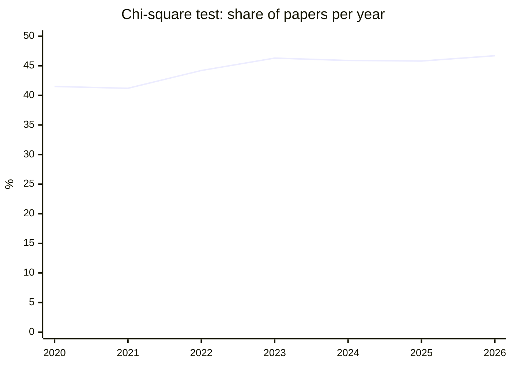
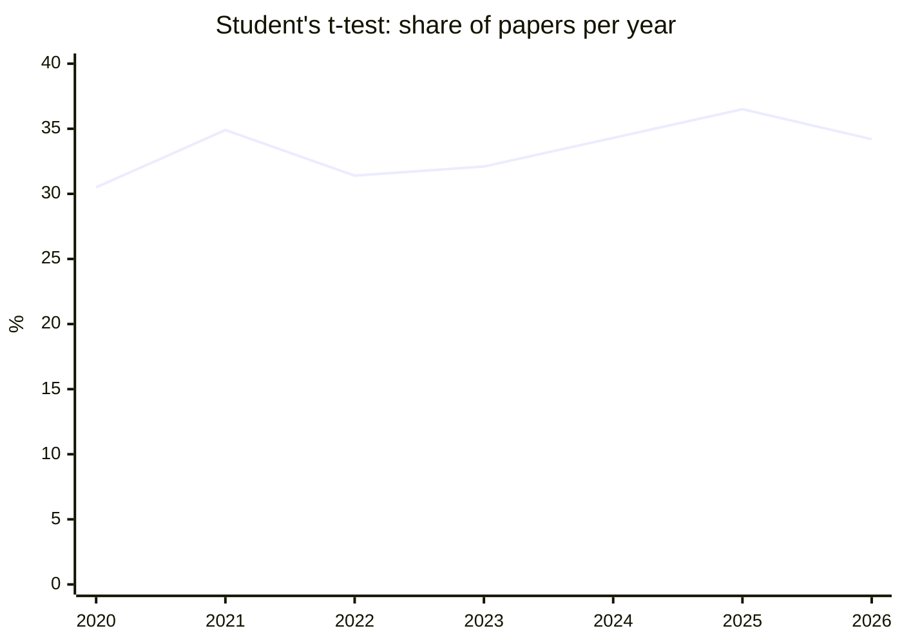
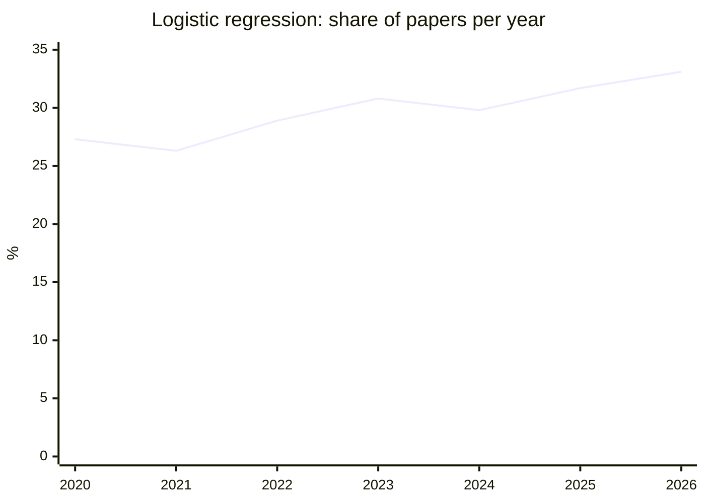
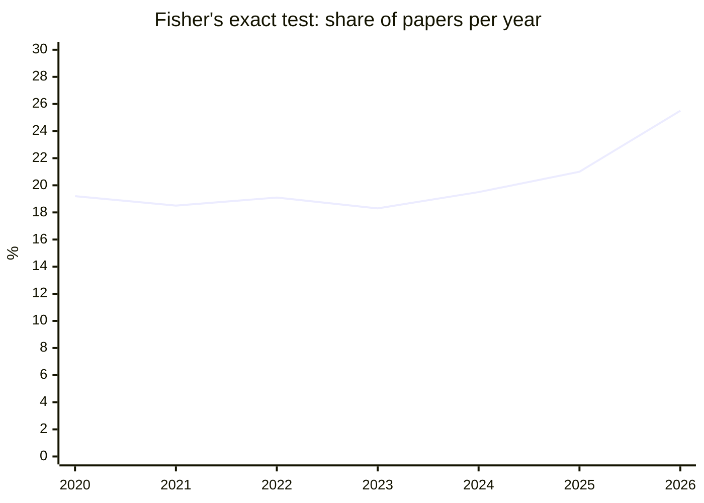

# Literature watch

Updated 2026-11-28. Round: 25 papers per field and publication month, 2016-12 to 2026-11.

Which statistical methods epidemiological research uses, from a random sample of open-access research articles in PubMed and PMC per field and month (no reviews). Claude lists each paper's methods from its abstract and methods section; only IDs, titles and the methods are stored.

## Progress

| Field | Months complete | Papers read |
|---|---|---|
| cardiovascular | 76 / 120 | 1900 / 3000 |
| metabolic | 75 / 120 | 1890 / 3000 |
| mental-health | 75 / 120 | 1875 / 3000 |
| cancer | 75 / 120 | 1875 / 3000 |
| respiratory-allergy | 75 / 120 | 1875 / 3000 |
| infections | 75 / 120 | 1875 / 3000 |
| pregnancy-child | 75 / 120 | 1875 / 3000 |
| environment | 75 / 120 | 1875 / 3000 |
| nutrition | 75 / 120 | 1875 / 3000 |
| omics | 75 / 120 | 1870 / 2995 |
| lifestyle | 75 / 120 | 1875 / 3000 |
| **all** | 826 / 1320 | 20660 / 32995 |

## All fields

Papers read: 16671, 16248 of them usable (7957 of these in the last 36 months, which the order below is based on).

| Method | Share, last 3 years | Papers | 2016 | 2017 | 2018 | 2019 | 2020 | 2021 | 2022 | 2023 | 2024 | 2025 | 2026 | Trend | In DataSHIELD |
|---|---|---|---|---|---|---|---|---|---|---|---|---|---|---|---|
| Chi-square test | 46% | 3683 | – | – | – | – | 41% | 41% | 44% | 46% | 46% | 46% | 47% | rising | yes (`dsBaseClient::ds.table`) |
| Student's t-test | 35% | 2792 | – | – | – | – | 30% | 35% | 31% | 32% | 34% | 36% | 34% | rising | unconfirmed |
| Logistic regression | 32% | 2507 | – | – | – | – | 27% | 26% | 29% | 31% | 30% | 32% | 33% | rising | yes (`dsBaseClient::ds.glm`) |
| Mann-Whitney U test | 31% | 2467 | – | – | – | – | 26% | 27% | 25% | 26% | 29% | 31% | 33% | rising | partly (`dsBaseClient::ds.ranksSecure`) |
| Fisher's exact test | 22% | 1743 | – | – | – | – | 19% | 19% | 19% | 18% | 20% | 21% | 26% | rising | no |
| Linear regression | 18% | 1400 | – | – | – | – | 17% | 18% | 16% | 16% | 16% | 17% | 20% | rising | yes (`dsBaseClient::ds.glm`) |
| Analysis of variance (ANOVA) | 15% | 1199 | – | – | – | – | 14% | 16% | 14% | 14% | 15% | 15% | 15% | steady | no |
| Cox proportional hazards regression | 15% | 1161 | – | – | – | – | 12% | 12% | 13% | 15% | 14% | 14% | 16% | rising | yes (`dsSurvivalClient::ds.coxph`) |
| ROC curve analysis | 14% | 1129 | – | – | – | – | 9% | 9% | 9% | 9% | 12% | 16% | 15% | rising | yes (`dsBinVal::dsROCGLM`) |
| Spearman's rank correlation | 12% | 978 | – | – | – | – | 11% | 10% | 9% | 10% | 10% | 13% | 14% | rising | unclear |
| Kaplan-Meier estimator | 12% | 920 | – | – | – | – | 10% | 11% | 11% | 11% | 11% | 11% | 12% | steady | yes (`dsSurvivalClient::ds.survfit`) |
| Kruskal-Wallis test | 12% | 920 | – | – | – | – | 9% | 10% | 11% | 10% | 11% | 11% | 13% | rising | no |
| Pearson correlation | 11% | 903 | – | – | – | – | 10% | 12% | 9% | 10% | 11% | 13% | 11% | rising | yes (`dsBaseClient::ds.cor`) |
| Shapiro-Wilk test | 11% | 857 | – | – | – | – | 7% | 6% | 7% | 6% | 8% | 12% | 13% | rising | unconfirmed |
| Subgroup analysis | 9% | 702 | – | – | – | – | 3% | 4% | 5% | 7% | 8% | 9% | 10% | rising | no |
| false-discovery-rate-correction | 9% | 693 | – | – | – | – | 5% | 6% | 5% | 5% | 6% | 7% | 13% | rising | no |
| Log-rank test | 8% | 618 | – | – | – | – | 7% | 8% | 7% | 8% | 8% | 7% | 8% | steady | no |
| Variance inflation factor | 7% | 531 | – | – | – | – | 2% | 3% | 4% | 3% | 3% | 6% | 11% | rising | no |
| Kolmogorov-Smirnov test | 6% | 510 | – | – | – | – | 4% | 6% | 5% | 6% | 7% | 7% | 5% | steady | – |
| Restricted cubic splines | 6% | 502 | – | – | – | – | 1% | 2% | 3% | 3% | 5% | 7% | 8% | rising | unconfirmed |
| *papers read* | | | 0 | 0 | 0 | 0 | 902 | 2507 | 2513 | 2591 | 2583 | 2619 | 2533 | | |

**Variants named in at least 2 papers** (DataSHIELD may have the method but not the variant):

| Method | Variant | Papers | In DataSHIELD |
|---|---|---|---|
| Student's t-test | Independent samples | 946 | unconfirmed |
| Analysis of variance (ANOVA) | One-way ANOVA | 904 | – |
| false-discovery-rate-correction | Benjamini-Hochberg procedure | 774 | – |
| Student's t-test | Paired samples | 610 | – |
| Multiple imputation | Multiple imputation by chained equations | 427 | – |
| Linear mixed model | Random intercept | 383 | – |
| Logistic regression | Survey-weighted | 313 | – |
| Analysis of variance (ANOVA) | Analysis of covariance | 242 | – |
| Cox proportional hazards regression | Stratified baseline hazards | 222 | – |
| Propensity score matching | Nearest-neighbor matching | 212 | – |
| Mediation analysis | Bootstrap confidence intervals | 211 | – |
| Student's t-test | Welch unequal variances | 211 | – |
| Poisson regression | Robust standard errors | 189 | – |
| Analysis of variance (ANOVA) | Repeated measures ANOVA | 184 | – |
| Propensity score matching | Caliper matching | 180 | – |
| Generalized linear mixed model | Random intercept | 179 | – |
| ROC curve analysis | Youden optimal cutoff | 177 | – |
| Cox proportional hazards regression | Time-varying covariates | 173 | – |
| Generalized linear mixed model | Binomial logit link | 138 | – |
| Linear regression | Survey-weighted regression | 137 | – |

## cardiovascular

Papers read: 1503, 1461 of them usable (717 of these in the last 36 months, which the order below is based on).

| Method | Share, last 3 years | Papers | 2016 | 2017 | 2018 | 2019 | 2020 | 2021 | 2022 | 2023 | 2024 | 2025 | 2026 | Trend | In DataSHIELD |
|---|---|---|---|---|---|---|---|---|---|---|---|---|---|---|---|
| Chi-square test | 57% | 407 | – | – | – | – | 43% | 56% | 57% | 59% | 56% | 56% | 59% | steady | yes (`dsBaseClient::ds.table`) |
| Mann-Whitney U test | 43% | 308 | – | – | – | – | 34% | 34% | 35% | 33% | 37% | 47% | 45% | rising | partly (`dsBaseClient::ds.ranksSecure`) |
| Student's t-test | 41% | 294 | – | – | – | – | 36% | 39% | 43% | 38% | 39% | 44% | 39% | steady | unconfirmed |
| Logistic regression | 37% | 267 | – | – | – | – | 24% | 32% | 35% | 32% | 35% | 35% | 41% | rising | yes (`dsBaseClient::ds.glm`) |
| Fisher's exact test | 33% | 238 | – | – | – | – | 26% | 27% | 26% | 26% | 30% | 32% | 38% | rising | no |
| Cox proportional hazards regression | 24% | 175 | – | – | – | – | 23% | 19% | 21% | 24% | 29% | 20% | 25% | steady | yes (`dsSurvivalClient::ds.coxph`) |
| ROC curve analysis | 21% | 147 | – | – | – | – | 10% | 12% | 14% | 13% | 19% | 19% | 24% | rising | yes (`dsBinVal::dsROCGLM`) |
| Kaplan-Meier estimator | 20% | 146 | – | – | – | – | 16% | 20% | 16% | 24% | 22% | 21% | 19% | steady | yes (`dsSurvivalClient::ds.survfit`) |
| Analysis of variance (ANOVA) | 15% | 106 | – | – | – | – | 8% | 15% | 16% | 19% | 16% | 14% | 15% | steady | no |
| Shapiro-Wilk test | 14% | 100 | – | – | – | – | 12% | 8% | 6% | 8% | 11% | 14% | 17% | rising | unconfirmed |
| *papers read* | | | 0 | 0 | 0 | 0 | 97 | 216 | 222 | 229 | 231 | 234 | 232 | | |

**Variants named in at least 2 papers** (DataSHIELD may have the method but not the variant):

| Method | Variant | Papers | In DataSHIELD |
|---|---|---|---|
| Analysis of variance (ANOVA) | One-way ANOVA | 87 | – |
| Student's t-test | Independent samples | 81 | unconfirmed |
| Student's t-test | Paired samples | 73 | – |
| Multiple imputation | Multiple imputation by chained equations | 45 | – |
| Propensity score matching | Nearest-neighbor matching | 26 | – |
| ROC curve analysis | Youden optimal cutoff | 26 | – |
| Logistic regression | Survey-weighted | 25 | – |
| Cox proportional hazards regression | Stratified baseline hazards | 21 | – |
| Propensity score matching | Caliper matching | 21 | – |
| Analysis of variance (ANOVA) | Analysis of covariance | 19 | – |
| false-discovery-rate-correction | Benjamini-Hochberg procedure | 19 | – |
| Student's t-test | Welch unequal variances | 19 | – |
| Generalized linear mixed model | Random intercept | 17 | – |
| Subgroup analysis | With interaction test | 17 | – |
| Cox proportional hazards regression | Time-varying covariates | 16 | – |
| Linear mixed model | Random intercept | 16 | – |
| Mediation analysis | Bootstrap confidence intervals | 16 | – |
| Linear regression | Stepwise selection | 14 | – |
| Analysis of variance (ANOVA) | Repeated measures ANOVA | 13 | – |
| gradient-boosting | XGBoost | 13 | – |

## metabolic

Papers read: 1543, 1514 of them usable (738 of these in the last 36 months, which the order below is based on).

| Method | Share, last 3 years | Papers | 2016 | 2017 | 2018 | 2019 | 2020 | 2021 | 2022 | 2023 | 2024 | 2025 | 2026 | Trend | In DataSHIELD |
|---|---|---|---|---|---|---|---|---|---|---|---|---|---|---|---|
| Chi-square test | 55% | 406 | – | – | – | – | 47% | 46% | 53% | 55% | 53% | 57% | 55% | rising | yes (`dsBaseClient::ds.table`) |
| Student's t-test | 45% | 332 | – | – | – | – | 47% | 43% | 37% | 40% | 44% | 48% | 45% | steady | unconfirmed |
| Logistic regression | 37% | 274 | – | – | – | – | 23% | 30% | 34% | 31% | 36% | 37% | 40% | rising | yes (`dsBaseClient::ds.glm`) |
| Mann-Whitney U test | 33% | 246 | – | – | – | – | 27% | 26% | 27% | 32% | 31% | 34% | 34% | rising | partly (`dsBaseClient::ds.ranksSecure`) |
| Analysis of variance (ANOVA) | 21% | 156 | – | – | – | – | 21% | 18% | 23% | 16% | 19% | 23% | 22% | steady | no |
| Fisher's exact test | 21% | 153 | – | – | – | – | 14% | 15% | 21% | 16% | 20% | 20% | 23% | rising | no |
| Linear regression | 20% | 151 | – | – | – | – | 28% | 19% | 17% | 16% | 17% | 22% | 24% | steady | yes (`dsBaseClient::ds.glm`) |
| Cox proportional hazards regression | 15% | 114 | – | – | – | – | 20% | 13% | 10% | 18% | 13% | 15% | 18% | steady | yes (`dsSurvivalClient::ds.coxph`) |
| ROC curve analysis | 15% | 114 | – | – | – | – | 6% | 10% | 11% | 13% | 13% | 16% | 18% | rising | yes (`dsBinVal::dsROCGLM`) |
| Shapiro-Wilk test | 14% | 104 | – | – | – | – | 6% | 6% | 5% | 10% | 11% | 17% | 15% | rising | unconfirmed |
| *papers read* | | | 0 | 0 | 0 | 0 | 90 | 231 | 240 | 238 | 242 | 246 | 227 | | |

**Variants named in at least 2 papers** (DataSHIELD may have the method but not the variant):

| Method | Variant | Papers | In DataSHIELD |
|---|---|---|---|
| Analysis of variance (ANOVA) | One-way ANOVA | 117 | – |
| Student's t-test | Independent samples | 102 | unconfirmed |
| Student's t-test | Paired samples | 90 | – |
| Logistic regression | Survey-weighted | 46 | – |
| Multiple imputation | Multiple imputation by chained equations | 43 | – |
| Propensity score matching | Nearest-neighbor matching | 38 | – |
| Analysis of variance (ANOVA) | Analysis of covariance | 36 | – |
| Propensity score matching | Caliper matching | 33 | – |
| false-discovery-rate-correction | Benjamini-Hochberg procedure | 32 | – |
| Linear mixed model | Random intercept | 30 | – |
| Analysis of variance (ANOVA) | Repeated measures ANOVA | 28 | – |
| Mediation analysis | Bootstrap confidence intervals | 22 | – |
| Poisson regression | Robust standard errors | 21 | – |
| Logistic regression | Stratified analysis | 20 | – |
| Linear regression | Stratified regression | 18 | – |
| ROC curve analysis | Youden optimal cutoff | 18 | – |
| Student's t-test | Welch unequal variances | 18 | – |
| Cox proportional hazards regression | Stratified baseline hazards | 17 | – |
| Linear regression | Survey-weighted regression | 15 | – |
| Linear regression | Interaction terms | 14 | – |

## mental-health

Papers read: 1513, 1482 of them usable (725 of these in the last 36 months, which the order below is based on).

| Method | Share, last 3 years | Papers | 2016 | 2017 | 2018 | 2019 | 2020 | 2021 | 2022 | 2023 | 2024 | 2025 | 2026 | Trend | In DataSHIELD |
|---|---|---|---|---|---|---|---|---|---|---|---|---|---|---|---|
| Chi-square test | 46% | 330 | – | – | – | – | 35% | 40% | 44% | 38% | 46% | 44% | 45% | steady | yes (`dsBaseClient::ds.table`) |
| Student's t-test | 35% | 252 | – | – | – | – | 25% | 32% | 31% | 26% | 32% | 36% | 34% | steady | unconfirmed |
| Logistic regression | 29% | 213 | – | – | – | – | 29% | 25% | 31% | 25% | 31% | 27% | 29% | steady | yes (`dsBaseClient::ds.glm`) |
| Mann-Whitney U test | 22% | 156 | – | – | – | – | 13% | 16% | 20% | 19% | 23% | 19% | 23% | rising | partly (`dsBaseClient::ds.ranksSecure`) |
| Linear regression | 21% | 151 | – | – | – | – | 21% | 28% | 20% | 18% | 20% | 19% | 24% | steady | yes (`dsBaseClient::ds.glm`) |
| Analysis of variance (ANOVA) | 17% | 122 | – | – | – | – | 21% | 16% | 14% | 13% | 18% | 18% | 14% | steady | no |
| Pearson correlation | 15% | 110 | – | – | – | – | 13% | 15% | 9% | 12% | 15% | 18% | 13% | steady | yes (`dsBaseClient::ds.cor`) |
| Fisher's exact test | 14% | 102 | – | – | – | – | 14% | 12% | 10% | 12% | 11% | 11% | 20% | steady | no |
| ROC curve analysis | 11% | 80 | – | – | – | – | 9% | 3% | 6% | 4% | 8% | 13% | 13% | rising | yes (`dsBinVal::dsROCGLM`) |
| Spearman's rank correlation | 11% | 79 | – | – | – | – | 5% | 7% | 6% | 7% | 12% | 10% | 12% | rising | unclear |
| *papers read* | | | 0 | 0 | 0 | 0 | 77 | 240 | 220 | 240 | 234 | 240 | 231 | | |

**Variants named in at least 2 papers** (DataSHIELD may have the method but not the variant):

| Method | Variant | Papers | In DataSHIELD |
|---|---|---|---|
| Student's t-test | Independent samples | 112 | unconfirmed |
| Analysis of variance (ANOVA) | One-way ANOVA | 65 | – |
| false-discovery-rate-correction | Benjamini-Hochberg procedure | 64 | – |
| Multiple imputation | Multiple imputation by chained equations | 54 | – |
| Linear mixed model | Random intercept | 49 | – |
| Student's t-test | Paired samples | 48 | – |
| Analysis of variance (ANOVA) | Analysis of covariance | 46 | – |
| Mediation analysis | Bootstrap confidence intervals | 42 | – |
| Linear mixed model | Random slopes | 33 | – |
| Analysis of variance (ANOVA) | Repeated measures ANOVA | 25 | – |
| Linear regression | Interaction terms | 24 | – |
| Cox proportional hazards regression | Stratified baseline hazards | 23 | – |
| Cox proportional hazards regression | Time-varying covariates | 22 | – |
| Logistic regression | Survey-weighted | 22 | – |
| Propensity score matching | Nearest-neighbor matching | 21 | – |
| Generalized linear mixed model | Random intercept | 20 | – |
| Poisson regression | Robust standard errors | 20 | – |
| Propensity score matching | Caliper matching | 18 | – |
| Structural equation modeling | Path analysis | 17 | – |
| Student's t-test | Welch unequal variances | 17 | – |

## cancer

Papers read: 1480, 1423 of them usable (709 of these in the last 36 months, which the order below is based on).

| Method | Share, last 3 years | Papers | 2016 | 2017 | 2018 | 2019 | 2020 | 2021 | 2022 | 2023 | 2024 | 2025 | 2026 | Trend | In DataSHIELD |
|---|---|---|---|---|---|---|---|---|---|---|---|---|---|---|---|
| Chi-square test | 49% | 346 | – | – | – | – | 47% | 40% | 44% | 49% | 52% | 46% | 49% | steady | yes (`dsBaseClient::ds.table`) |
| Kaplan-Meier estimator | 36% | 256 | – | – | – | – | 32% | 37% | 40% | 39% | 40% | 33% | 36% | steady | yes (`dsSurvivalClient::ds.survfit`) |
| Mann-Whitney U test | 34% | 239 | – | – | – | – | 30% | 34% | 25% | 32% | 35% | 31% | 36% | steady | partly (`dsBaseClient::ds.ranksSecure`) |
| Student's t-test | 32% | 229 | – | – | – | – | 28% | 31% | 31% | 35% | 34% | 31% | 31% | steady | unconfirmed |
| Fisher's exact test | 31% | 222 | – | – | – | – | 28% | 22% | 22% | 28% | 32% | 27% | 36% | rising | no |
| Logistic regression | 30% | 212 | – | – | – | – | 14% | 20% | 21% | 27% | 26% | 33% | 30% | rising | yes (`dsBaseClient::ds.glm`) |
| Cox proportional hazards regression | 30% | 210 | – | – | – | – | 20% | 31% | 29% | 34% | 31% | 24% | 33% | steady | yes (`dsSurvivalClient::ds.coxph`) |
| Log-rank test | 27% | 194 | – | – | – | – | 27% | 27% | 24% | 28% | 32% | 25% | 26% | steady | no |
| ROC curve analysis | 21% | 149 | – | – | – | – | 19% | 14% | 19% | 14% | 18% | 25% | 20% | rising | yes (`dsBinVal::dsROCGLM`) |
| Kruskal-Wallis test | 9% | 63 | – | – | – | – | 7% | 8% | 11% | 8% | 7% | 7% | 12% | steady | no |
| *papers read* | | | 0 | 0 | 0 | 0 | 74 | 214 | 220 | 225 | 230 | 227 | 233 | | |

**Variants named in at least 2 papers** (DataSHIELD may have the method but not the variant):

| Method | Variant | Papers | In DataSHIELD |
|---|---|---|---|
| Analysis of variance (ANOVA) | One-way ANOVA | 62 | – |
| Student's t-test | Independent samples | 55 | unconfirmed |
| Student's t-test | Paired samples | 44 | – |
| false-discovery-rate-correction | Benjamini-Hochberg procedure | 33 | – |
| ROC curve analysis | Youden optimal cutoff | 30 | – |
| Propensity score matching | Caliper matching | 27 | – |
| Propensity score matching | Nearest-neighbor matching | 26 | – |
| Cox proportional hazards regression | Stratified baseline hazards | 25 | – |
| Multiple imputation | Multiple imputation by chained equations | 20 | – |
| gradient-boosting | XGBoost | 18 | – |
| Cox proportional hazards regression | Time-varying covariates | 17 | – |
| Cross-validation | K-fold cross-validation | 17 | – |
| Bootstrap | Optimism-corrected internal validation | 15 | – |
| Linear mixed model | Random intercept | 14 | – |
| Cumulative incidence function (Aalen-Johansen) | competing risks | 13 | – |
| Stepwise variable selection | Backward elimination | 13 | – |
| Kaplan-Meier estimator | reverse (follow-up time) | 12 | – |
| Concordance index (C-index) | harrell's | 11 | – |
| Cox proportional hazards regression | Cause-specific hazards | 11 | – |
| Student's t-test | Welch unequal variances | 11 | – |

## respiratory-allergy

Papers read: 1523, 1481 of them usable (732 of these in the last 36 months, which the order below is based on).

| Method | Share, last 3 years | Papers | 2016 | 2017 | 2018 | 2019 | 2020 | 2021 | 2022 | 2023 | 2024 | 2025 | 2026 | Trend | In DataSHIELD |
|---|---|---|---|---|---|---|---|---|---|---|---|---|---|---|---|
| Chi-square test | 53% | 390 | – | – | – | – | 35% | 44% | 49% | 54% | 52% | 55% | 52% | rising | yes (`dsBaseClient::ds.table`) |
| Student's t-test | 39% | 287 | – | – | – | – | 38% | 36% | 32% | 38% | 40% | 39% | 39% | steady | unconfirmed |
| Mann-Whitney U test | 38% | 281 | – | – | – | – | 32% | 31% | 31% | 31% | 36% | 43% | 38% | rising | partly (`dsBaseClient::ds.ranksSecure`) |
| Logistic regression | 32% | 237 | – | – | – | – | 21% | 19% | 28% | 26% | 30% | 34% | 34% | rising | yes (`dsBaseClient::ds.glm`) |
| Fisher's exact test | 31% | 230 | – | – | – | – | 24% | 28% | 31% | 28% | 27% | 31% | 36% | steady | no |
| Kaplan-Meier estimator | 25% | 182 | – | – | – | – | 26% | 29% | 31% | 28% | 26% | 24% | 24% | steady | yes (`dsSurvivalClient::ds.survfit`) |
| Cox proportional hazards regression | 22% | 164 | – | – | – | – | 22% | 23% | 22% | 26% | 23% | 20% | 25% | steady | yes (`dsSurvivalClient::ds.coxph`) |
| ROC curve analysis | 21% | 151 | – | – | – | – | 15% | 12% | 18% | 14% | 19% | 24% | 21% | rising | yes (`dsBinVal::dsROCGLM`) |
| Log-rank test | 16% | 120 | – | – | – | – | 17% | 18% | 21% | 19% | 19% | 15% | 15% | steady | no |
| Analysis of variance (ANOVA) | 14% | 102 | – | – | – | – | 15% | 17% | 10% | 11% | 12% | 15% | 14% | steady | no |
| *papers read* | | | 0 | 0 | 0 | 0 | 82 | 226 | 225 | 236 | 240 | 238 | 234 | | |

**Variants named in at least 2 papers** (DataSHIELD may have the method but not the variant):

| Method | Variant | Papers | In DataSHIELD |
|---|---|---|---|
| Student's t-test | Independent samples | 86 | unconfirmed |
| Analysis of variance (ANOVA) | One-way ANOVA | 80 | – |
| Student's t-test | Paired samples | 65 | – |
| Propensity score matching | Caliper matching | 34 | – |
| Propensity score matching | Nearest-neighbor matching | 32 | – |
| Multiple imputation | Multiple imputation by chained equations | 31 | – |
| false-discovery-rate-correction | Benjamini-Hochberg procedure | 26 | – |
| Cox proportional hazards regression | Stratified baseline hazards | 22 | – |
| ROC curve analysis | Youden optimal cutoff | 22 | – |
| Linear mixed model | Random intercept | 20 | – |
| Cross-validation | K-fold cross-validation | 19 | – |
| gradient-boosting | XGBoost | 19 | – |
| Analysis of variance (ANOVA) | Repeated measures ANOVA | 16 | – |
| Student's t-test | Welch unequal variances | 15 | – |
| Analysis of variance (ANOVA) | Analysis of covariance | 14 | – |
| Bootstrap | Optimism-corrected internal validation | 14 | – |
| Logistic regression | Survey-weighted | 14 | – |
| Cox proportional hazards regression | Time-varying covariates | 13 | – |
| Kaplan-Meier estimator | reverse (follow-up time) | 13 | – |
| Stepwise variable selection | Backward elimination | 13 | – |

## infections

Papers read: 1508, 1448 of them usable (741 of these in the last 36 months, which the order below is based on).

| Method | Share, last 3 years | Papers | 2016 | 2017 | 2018 | 2019 | 2020 | 2021 | 2022 | 2023 | 2024 | 2025 | 2026 | Trend | In DataSHIELD |
|---|---|---|---|---|---|---|---|---|---|---|---|---|---|---|---|
| Chi-square test | 48% | 355 | – | – | – | – | 45% | 44% | 51% | 50% | 44% | 50% | 48% | steady | yes (`dsBaseClient::ds.table`) |
| Logistic regression | 35% | 259 | – | – | – | – | 33% | 26% | 25% | 35% | 33% | 36% | 38% | rising | yes (`dsBaseClient::ds.glm`) |
| Mann-Whitney U test | 30% | 222 | – | – | – | – | 33% | 31% | 25% | 27% | 27% | 30% | 33% | steady | partly (`dsBaseClient::ds.ranksSecure`) |
| Fisher's exact test | 28% | 211 | – | – | – | – | 29% | 23% | 29% | 23% | 21% | 30% | 35% | rising | no |
| Student's t-test | 27% | 202 | – | – | – | – | 23% | 32% | 30% | 33% | 26% | 30% | 26% | steady | unconfirmed |
| ROC curve analysis | 12% | 89 | – | – | – | – | 8% | 12% | 7% | 6% | 9% | 13% | 15% | rising | yes (`dsBinVal::dsROCGLM`) |
| Analysis of variance (ANOVA) | 10% | 76 | – | – | – | – | 8% | 8% | 10% | 9% | 9% | 10% | 12% | steady | no |
| Linear regression | 10% | 75 | – | – | – | – | 5% | 13% | 8% | 12% | 8% | 12% | 10% | steady | yes (`dsBaseClient::ds.glm`) |
| Cox proportional hazards regression | 10% | 74 | – | – | – | – | 12% | 9% | 8% | 7% | 8% | 12% | 9% | steady | yes (`dsSurvivalClient::ds.coxph`) |
| Kaplan-Meier estimator | 10% | 71 | – | – | – | – | 11% | 10% | 7% | 6% | 9% | 10% | 10% | steady | yes (`dsSurvivalClient::ds.survfit`) |
| *papers read* | | | 0 | 0 | 0 | 0 | 66 | 206 | 220 | 236 | 239 | 250 | 231 | | |

**Variants named in at least 2 papers** (DataSHIELD may have the method but not the variant):

| Method | Variant | Papers | In DataSHIELD |
|---|---|---|---|
| Student's t-test | Independent samples | 70 | unconfirmed |
| Analysis of variance (ANOVA) | One-way ANOVA | 57 | – |
| Student's t-test | Paired samples | 44 | – |
| false-discovery-rate-correction | Benjamini-Hochberg procedure | 31 | – |
| Poisson regression | Robust standard errors | 27 | – |
| Propensity score matching | Nearest-neighbor matching | 27 | – |
| Multiple imputation | Multiple imputation by chained equations | 26 | – |
| ROC curve analysis | Youden optimal cutoff | 22 | – |
| Generalized linear mixed model | Random intercept | 21 | – |
| Logistic regression | Survey-weighted | 19 | – |
| Phylogenetic analysis | maximum likelihood | 19 | – |
| Propensity score matching | Caliper matching | 15 | – |
| Segmented (piecewise) regression | Interrupted time series | 15 | – |
| Linear mixed model | Random intercept | 14 | – |
| Stepwise variable selection | Backward elimination | 14 | – |
| Student's t-test | Welch unequal variances | 14 | – |
| Generalized linear mixed model | Binomial logit link | 13 | – |
| Poisson regression | Modified Poisson regression | 12 | – |
| Linear regression | Hierarchical blockwise entry | 11 | – |
| Analysis of variance (ANOVA) | Repeated measures ANOVA | 10 | – |

## pregnancy-child

Papers read: 1541, 1496 of them usable (729 of these in the last 36 months, which the order below is based on).

| Method | Share, last 3 years | Papers | 2016 | 2017 | 2018 | 2019 | 2020 | 2021 | 2022 | 2023 | 2024 | 2025 | 2026 | Trend | In DataSHIELD |
|---|---|---|---|---|---|---|---|---|---|---|---|---|---|---|---|
| Chi-square test | 46% | 337 | – | – | – | – | 46% | 48% | 52% | 52% | 45% | 50% | 44% | steady | yes (`dsBaseClient::ds.table`) |
| Logistic regression | 37% | 271 | – | – | – | – | 43% | 38% | 42% | 45% | 33% | 39% | 41% | steady | yes (`dsBaseClient::ds.glm`) |
| Student's t-test | 34% | 251 | – | – | – | – | 25% | 43% | 33% | 36% | 32% | 39% | 31% | steady | unconfirmed |
| Mann-Whitney U test | 30% | 220 | – | – | – | – | 27% | 29% | 26% | 27% | 29% | 32% | 29% | steady | partly (`dsBaseClient::ds.ranksSecure`) |
| Fisher's exact test | 25% | 182 | – | – | – | – | 19% | 25% | 26% | 24% | 22% | 27% | 25% | steady | no |
| Linear regression | 15% | 110 | – | – | – | – | 15% | 16% | 15% | 12% | 16% | 14% | 16% | steady | yes (`dsBaseClient::ds.glm`) |
| ROC curve analysis | 14% | 100 | – | – | – | – | 7% | 12% | 12% | 10% | 13% | 16% | 12% | steady | yes (`dsBinVal::dsROCGLM`) |
| Analysis of variance (ANOVA) | 13% | 96 | – | – | – | – | 7% | 17% | 10% | 13% | 13% | 15% | 14% | steady | no |
| Shapiro-Wilk test | 11% | 81 | – | – | – | – | 6% | 8% | 7% | 6% | 9% | 12% | 11% | rising | unconfirmed |
| Pearson correlation | 9% | 69 | – | – | – | – | 4% | 11% | 4% | 7% | 10% | 12% | 6% | steady | yes (`dsBaseClient::ds.cor`) |
| *papers read* | | | 0 | 0 | 0 | 0 | 81 | 229 | 231 | 248 | 231 | 234 | 242 | | |

**Variants named in at least 2 papers** (DataSHIELD may have the method but not the variant):

| Method | Variant | Papers | In DataSHIELD |
|---|---|---|---|
| Analysis of variance (ANOVA) | One-way ANOVA | 81 | – |
| Student's t-test | Independent samples | 79 | unconfirmed |
| Multiple imputation | Multiple imputation by chained equations | 46 | – |
| Student's t-test | Paired samples | 36 | – |
| Poisson regression | Robust standard errors | 35 | – |
| false-discovery-rate-correction | Benjamini-Hochberg procedure | 33 | – |
| Linear mixed model | Random intercept | 29 | – |
| Poisson regression | Modified Poisson regression | 21 | – |
| Student's t-test | Welch unequal variances | 21 | – |
| Logistic regression | Stratified analysis | 18 | – |
| Generalized estimating equations | Exchangeable working correlation | 16 | – |
| Analysis of variance (ANOVA) | Analysis of covariance | 15 | – |
| Generalized linear mixed model | Binomial logit link | 15 | – |
| Propensity score matching | Nearest-neighbor matching | 15 | – |
| ROC curve analysis | Youden optimal cutoff | 15 | – |
| Cox proportional hazards regression | Robust standard errors | 14 | – |
| Generalized linear mixed model | Random intercept | 13 | – |
| Linear mixed model | Random slopes | 13 | – |
| Generalized estimating equations | Robust sandwich standard errors | 12 | – |
| Logistic regression | Interaction terms | 12 | – |

## environment

Papers read: 1580, 1550 of them usable (745 of these in the last 36 months, which the order below is based on).

| Method | Share, last 3 years | Papers | 2016 | 2017 | 2018 | 2019 | 2020 | 2021 | 2022 | 2023 | 2024 | 2025 | 2026 | Trend | In DataSHIELD |
|---|---|---|---|---|---|---|---|---|---|---|---|---|---|---|---|
| Chi-square test | 36% | 268 | – | – | – | – | 40% | 32% | 29% | 35% | 39% | 32% | 35% | steady | yes (`dsBaseClient::ds.table`) |
| Logistic regression | 31% | 229 | – | – | – | – | 34% | 27% | 28% | 34% | 29% | 28% | 34% | steady | yes (`dsBaseClient::ds.glm`) |
| Student's t-test | 26% | 195 | – | – | – | – | 18% | 31% | 22% | 21% | 26% | 27% | 23% | steady | unconfirmed |
| Linear regression | 24% | 176 | – | – | – | – | 19% | 20% | 19% | 22% | 20% | 23% | 29% | rising | yes (`dsBaseClient::ds.glm`) |
| Mann-Whitney U test | 21% | 158 | – | – | – | – | 12% | 18% | 16% | 12% | 18% | 22% | 24% | rising | partly (`dsBaseClient::ds.ranksSecure`) |
| Subgroup analysis | 17% | 127 | – | – | – | – | 9% | 9% | 18% | 16% | 15% | 18% | 18% | rising | no |
| Spearman's rank correlation | 17% | 123 | – | – | – | – | 8% | 12% | 10% | 9% | 13% | 18% | 20% | rising | unclear |
| Cox proportional hazards regression | 14% | 102 | – | – | – | – | 7% | 8% | 15% | 14% | 13% | 13% | 15% | rising | yes (`dsSurvivalClient::ds.coxph`) |
| Pearson correlation | 13% | 95 | – | – | – | – | 9% | 14% | 9% | 13% | 14% | 12% | 12% | steady | yes (`dsBaseClient::ds.cor`) |
| Restricted cubic splines | 13% | 94 | – | – | – | – | 1% | 5% | 10% | 8% | 10% | 16% | 12% | rising | unconfirmed |
| *papers read* | | | 0 | 0 | 0 | 0 | 88 | 250 | 237 | 249 | 248 | 245 | 233 | | |

**Variants named in at least 2 papers** (DataSHIELD may have the method but not the variant):

| Method | Variant | Papers | In DataSHIELD |
|---|---|---|---|
| Multiple imputation | Multiple imputation by chained equations | 78 | – |
| Student's t-test | Independent samples | 73 | unconfirmed |
| Linear mixed model | Random intercept | 68 | – |
| false-discovery-rate-correction | Benjamini-Hochberg procedure | 54 | – |
| Analysis of variance (ANOVA) | One-way ANOVA | 53 | – |
| Cox proportional hazards regression | Time-varying covariates | 50 | – |
| Cox proportional hazards regression | Stratified baseline hazards | 47 | – |
| Logistic regression | Survey-weighted | 43 | – |
| Cox proportional hazards regression | Age as time scale | 39 | – |
| Student's t-test | Paired samples | 39 | – |
| Generalized linear mixed model | Random intercept | 29 | – |
| Poisson regression | Robust standard errors | 26 | – |
| Generalized linear mixed model | Binomial logit link | 23 | – |
| Interaction analysis | Regression product term | 21 | – |
| Linear regression | Log-transformed outcome | 20 | – |
| Linear regression | Survey-weighted regression | 17 | – |
| Logistic regression | Stratified analysis | 17 | – |
| Mediation analysis | Bootstrap confidence intervals | 17 | – |
| Mediation analysis | Counterfactual causal mediation | 17 | – |
| Linear mixed model | Random slopes | 14 | – |

## nutrition

Papers read: 1601, 1584 of them usable (762 of these in the last 36 months, which the order below is based on).

| Method | Share, last 3 years | Papers | 2016 | 2017 | 2018 | 2019 | 2020 | 2021 | 2022 | 2023 | 2024 | 2025 | 2026 | Trend | In DataSHIELD |
|---|---|---|---|---|---|---|---|---|---|---|---|---|---|---|---|
| Chi-square test | 51% | 391 | – | – | – | – | 51% | 40% | 46% | 44% | 48% | 49% | 58% | rising | yes (`dsBaseClient::ds.table`) |
| Student's t-test | 35% | 267 | – | – | – | – | 35% | 30% | 25% | 26% | 34% | 34% | 38% | rising | unconfirmed |
| Logistic regression | 34% | 262 | – | – | – | – | 26% | 31% | 37% | 37% | 35% | 36% | 32% | steady | yes (`dsBaseClient::ds.glm`) |
| Linear regression | 28% | 211 | – | – | – | – | 22% | 25% | 24% | 25% | 24% | 25% | 35% | rising | yes (`dsBaseClient::ds.glm`) |
| Mann-Whitney U test | 25% | 194 | – | – | – | – | 16% | 21% | 17% | 18% | 25% | 24% | 29% | rising | partly (`dsBaseClient::ds.ranksSecure`) |
| Analysis of variance (ANOVA) | 21% | 158 | – | – | – | – | 20% | 21% | 22% | 20% | 20% | 20% | 23% | steady | no |
| Fisher's exact test | 17% | 130 | – | – | – | – | 9% | 13% | 9% | 12% | 16% | 17% | 19% | rising | no |
| Shapiro-Wilk test | 15% | 116 | – | – | – | – | 8% | 6% | 6% | 7% | 12% | 15% | 20% | rising | unconfirmed |
| Cox proportional hazards regression | 15% | 113 | – | – | – | – | 8% | 9% | 9% | 14% | 13% | 17% | 15% | rising | yes (`dsSurvivalClient::ds.coxph`) |
| Kruskal-Wallis test | 15% | 113 | – | – | – | – | 6% | 11% | 10% | 9% | 14% | 15% | 16% | rising | no |
| *papers read* | | | 0 | 0 | 0 | 0 | 85 | 253 | 249 | 259 | 239 | 254 | 245 | | |

**Variants named in at least 2 papers** (DataSHIELD may have the method but not the variant):

| Method | Variant | Papers | In DataSHIELD |
|---|---|---|---|
| Analysis of variance (ANOVA) | One-way ANOVA | 121 | – |
| Student's t-test | Independent samples | 104 | unconfirmed |
| Logistic regression | Survey-weighted | 66 | – |
| Student's t-test | Paired samples | 57 | – |
| false-discovery-rate-correction | Benjamini-Hochberg procedure | 55 | – |
| Analysis of variance (ANOVA) | Analysis of covariance | 47 | – |
| Linear mixed model | Random intercept | 39 | – |
| Linear regression | Survey-weighted regression | 39 | – |
| Multiple imputation | Multiple imputation by chained equations | 39 | – |
| Principal component analysis | Varimax rotation | 37 | – |
| Cox proportional hazards regression | Stratified baseline hazards | 26 | – |
| Mediation analysis | Bootstrap confidence intervals | 26 | – |
| Poisson regression | Robust standard errors | 23 | – |
| Cox proportional hazards regression | Age as time scale | 20 | – |
| Exploratory factor analysis | Varimax rotation | 20 | – |
| Analysis of variance (ANOVA) | Repeated measures ANOVA | 19 | – |
| Stepwise variable selection | Backward elimination | 19 | – |
| Cox proportional hazards regression | Time-varying covariates | 18 | – |
| Linear regression | Interaction terms | 18 | – |
| Logistic regression | Complex survey design | 17 | – |

## omics

Papers read: 1552, 1505 of them usable (731 of these in the last 36 months, which the order below is based on).

| Method | Share, last 3 years | Papers | 2016 | 2017 | 2018 | 2019 | 2020 | 2021 | 2022 | 2023 | 2024 | 2025 | 2026 | Trend | In DataSHIELD |
|---|---|---|---|---|---|---|---|---|---|---|---|---|---|---|---|
| Mann-Whitney U test | 48% | 352 | – | – | – | – | 47% | 45% | 45% | 48% | 48% | 46% | 51% | steady | partly (`dsBaseClient::ds.ranksSecure`) |
| false-discovery-rate-correction | 44% | 320 | – | – | – | – | 34% | 32% | 35% | 38% | 36% | 42% | 54% | rising | no |
| Student's t-test | 40% | 293 | – | – | – | – | 39% | 42% | 38% | 34% | 39% | 43% | 38% | steady | unconfirmed |
| Chi-square test | 33% | 238 | – | – | – | – | 30% | 28% | 30% | 35% | 32% | 33% | 32% | steady | yes (`dsBaseClient::ds.table`) |
| PERMANOVA | 31% | 230 | – | – | – | – | 18% | 27% | 35% | 39% | 29% | 28% | 37% | steady | – |
| Spearman's rank correlation | 29% | 215 | – | – | – | – | 27% | 20% | 22% | 25% | 24% | 30% | 33% | rising | unclear |
| Principal coordinates analysis | 26% | 189 | – | – | – | – | 17% | 25% | 35% | 32% | 24% | 26% | 28% | steady | – |
| ROC curve analysis | 26% | 188 | – | – | – | – | 17% | 18% | 13% | 15% | 22% | 30% | 26% | rising | yes (`dsBinVal::dsROCGLM`) |
| Kruskal-Wallis test | 24% | 176 | – | – | – | – | 14% | 21% | 28% | 22% | 22% | 24% | 27% | steady | no |
| Fisher's exact test | 21% | 157 | – | – | – | – | 26% | 18% | 22% | 19% | 22% | 17% | 26% | steady | no |
| *papers read* | | | 0 | 0 | 0 | 0 | 90 | 244 | 237 | 223 | 241 | 236 | 234 | | |

**Variants named in at least 2 papers** (DataSHIELD may have the method but not the variant):

| Method | Variant | Papers | In DataSHIELD |
|---|---|---|---|
| false-discovery-rate-correction | Benjamini-Hochberg procedure | 407 | – |
| Analysis of variance (ANOVA) | One-way ANOVA | 103 | – |
| Alpha diversity analysis | Shannon diversity index | 69 | – |
| Principal coordinates analysis | Bray-Curtis distance | 67 | – |
| Student's t-test | Welch unequal variances | 67 | – |
| Student's t-test | Independent samples | 60 | unconfirmed |
| Student's t-test | Paired samples | 57 | – |
| Linear mixed model | Random intercept | 51 | – |
| Hierarchical clustering | Ward linkage | 36 | – |
| DESeq2 differential expression analysis | differential abundance | 30 | – |
| PERMANOVA | Restricted (stratified) permutations | 29 | – |
| Cross-validation | Repeated cross-validation | 26 | – |
| Pathway enrichment analysis | Over-representation analysis | 25 | – |
| Cross-validation | K-fold cross-validation | 24 | – |
| Beta diversity analysis | bray-curtis | 22 | – |
| Cross-validation | Leave-one-out cross-validation | 21 | – |
| Hierarchical clustering | Average linkage (UPGMA) | 20 | – |
| PERMANOVA | Bray-Curtis distance | 20 | – |
| PERMANOVA | Pairwise group comparisons | 20 | – |
| Analysis of variance (ANOVA) | Factorial multi-way ANOVA | 19 | – |

## lifestyle

Papers read: 1580, 1546 of them usable (747 of these in the last 36 months, which the order below is based on).

| Method | Share, last 3 years | Papers | 2016 | 2017 | 2018 | 2019 | 2020 | 2021 | 2022 | 2023 | 2024 | 2025 | 2026 | Trend | In DataSHIELD |
|---|---|---|---|---|---|---|---|---|---|---|---|---|---|---|---|
| Chi-square test | 36% | 271 | – | – | – | – | 39% | 39% | 35% | 38% | 40% | 34% | 36% | steady | yes (`dsBaseClient::ds.table`) |
| Student's t-test | 31% | 232 | – | – | – | – | 22% | 30% | 26% | 27% | 30% | 31% | 32% | steady | unconfirmed |
| Logistic regression | 29% | 216 | – | – | – | – | 37% | 29% | 27% | 31% | 27% | 31% | 28% | steady | yes (`dsBaseClient::ds.glm`) |
| Linear regression | 25% | 185 | – | – | – | – | 28% | 25% | 23% | 20% | 24% | 21% | 31% | steady | yes (`dsBaseClient::ds.glm`) |
| Analysis of variance (ANOVA) | 17% | 129 | – | – | – | – | 18% | 20% | 14% | 14% | 19% | 17% | 16% | steady | no |
| Mann-Whitney U test | 17% | 127 | – | – | – | – | 17% | 15% | 13% | 15% | 14% | 19% | 19% | steady | partly (`dsBaseClient::ds.ranksSecure`) |
| Pearson correlation | 14% | 106 | – | – | – | – | 8% | 15% | 12% | 12% | 10% | 14% | 18% | steady | yes (`dsBaseClient::ds.cor`) |
| Spearman's rank correlation | 11% | 84 | – | – | – | – | 11% | 7% | 6% | 9% | 8% | 13% | 12% | rising | unclear |
| Shapiro-Wilk test | 11% | 81 | – | – | – | – | 8% | 8% | 7% | 5% | 9% | 12% | 12% | rising | unconfirmed |
| Variance inflation factor | 10% | 76 | – | – | – | – | 2% | 7% | 5% | 6% | 5% | 9% | 17% | rising | no |
| *papers read* | | | 0 | 0 | 0 | 0 | 83 | 249 | 242 | 247 | 242 | 251 | 232 | | |

**Variants named in at least 2 papers** (DataSHIELD may have the method but not the variant):

| Method | Variant | Papers | In DataSHIELD |
|---|---|---|---|
| Student's t-test | Independent samples | 135 | unconfirmed |
| Analysis of variance (ANOVA) | One-way ANOVA | 90 | – |
| Student's t-test | Paired samples | 66 | – |
| Logistic regression | Survey-weighted | 65 | – |
| Linear mixed model | Random intercept | 58 | – |
| Mediation analysis | Bootstrap confidence intervals | 55 | – |
| Multiple imputation | Multiple imputation by chained equations | 42 | – |
| Analysis of variance (ANOVA) | Analysis of covariance | 38 | – |
| false-discovery-rate-correction | Benjamini-Hochberg procedure | 31 | – |
| Generalized linear mixed model | Random intercept | 30 | – |
| Analysis of variance (ANOVA) | Repeated measures ANOVA | 29 | – |
| Linear regression | Interaction terms | 26 | – |
| Logistic regression | Stratified analysis | 25 | – |
| Poisson regression | Robust standard errors | 24 | – |
| Cox proportional hazards regression | Stratified baseline hazards | 23 | – |
| Linear regression | Hierarchical blockwise entry | 22 | – |
| Linear regression | Survey-weighted regression | 22 | – |
| Generalized linear mixed model | Binomial logit link | 21 | – |
| Logistic regression | Complex survey design | 19 | – |
| Linear regression | Stratified regression | 18 | – |

## Searches

| Field | Version | Search |
|---|---|---|
| cardiovascular | `2b21c0b8` | `"Epidemiologic Studies"[MeSH Terms] AND ("Cardiovascular Diseases"[majr]) AND "pubmed pmc open access"[filter] NOT (review[pt] OR systematic review[pt] OR meta-analysis[pt])` |
| metabolic | `d26e1bd5` | `"Epidemiologic Studies"[MeSH Terms] AND ("Nutritional and Metabolic Diseases"[majr]) AND "pubmed pmc open access"[filter] NOT (review[pt] OR systematic review[pt] OR meta-analysis[pt])` |
| mental-health | `49157751` | `"Epidemiologic Studies"[MeSH Terms] AND ("Mental Disorders"[majr]) AND "pubmed pmc open access"[filter] NOT (review[pt] OR systematic review[pt] OR meta-analysis[pt])` |
| cancer | `3e24eb6c` | `"Epidemiologic Studies"[MeSH Terms] AND ("Neoplasms"[majr]) AND "pubmed pmc open access"[filter] NOT (review[pt] OR systematic review[pt] OR meta-analysis[pt])` |
| respiratory-allergy | `2b88ada3` | `"Epidemiologic Studies"[MeSH Terms] AND (("Respiratory Tract Diseases"[majr] OR "Hypersensitivity"[majr]) NOT "Respiratory Tract Infections"[majr]) AND "pubmed pmc open access"[filter] NOT (review[pt] OR systematic review[pt] OR meta-analysis[pt])` |
| infections | `5ffaa918` | `"Epidemiologic Studies"[MeSH Terms] AND ("Infections"[majr]) AND "pubmed pmc open access"[filter] NOT (review[pt] OR systematic review[pt] OR meta-analysis[pt])` |
| pregnancy-child | `7287be76` | `"Epidemiologic Studies"[MeSH Terms] AND ("Pregnancy Complications"[majr] OR "Prenatal Exposure Delayed Effects"[majr] OR "Child Development"[majr] OR "Infant, Newborn, Diseases"[majr]) AND "pubmed pmc open access"[filter] NOT (review[pt] OR systematic review[pt] OR meta-analysis[pt])` |
| environment | `5e248b92` | `"Epidemiologic Studies"[MeSH Terms] AND ("Environmental Exposure"[majr] OR "Environmental Pollutants"[majr] OR "Air Pollution"[majr] OR "Noise"[majr] OR "Built Environment"[majr]) AND "pubmed pmc open access"[filter] NOT (review[pt] OR systematic review[pt] OR meta-analysis[pt])` |
| nutrition | `e3ba59b3` | `"Epidemiologic Studies"[MeSH Terms] AND ("Diet"[majr] OR "Nutritional Status"[majr] OR "Feeding Behavior"[majr]) AND "pubmed pmc open access"[filter] NOT (review[pt] OR systematic review[pt] OR meta-analysis[pt])` |
| omics | `88c8ab9a` | `"Epidemiologic Studies"[MeSH Terms] AND ("Genomics"[majr] OR "Epigenomics"[majr] OR "Metabolomics"[majr] OR "Proteomics"[majr] OR "Multiomics"[majr] OR "Microbiota"[majr]) AND "pubmed pmc open access"[filter] NOT (review[pt] OR systematic review[pt] OR meta-analysis[pt])` |
| lifestyle | `d8a73a12` | `"Epidemiologic Studies"[MeSH Terms] AND ("Exercise"[majr] OR "Sedentary Behavior"[majr] OR "Smoking"[majr] OR "Alcohol Drinking"[majr] OR "Sleep"[majr]) AND "pubmed pmc open access"[filter] NOT (review[pt] OR systematic review[pt] OR meta-analysis[pt])` |

_Notes: shares are per year of publication; all fields dip in 2022-2023, most likely NLM's switch to automated MeSH indexing, so read changes around those years with care. Method names are merged by the vocabulary (`vocabulary.yml`, Claude); names not classified yet are shown as the papers gave them. "In DataSHIELD" is Claude's verdict against the functions' documentation in the package catalogue, with the function it found; "partly" means the plain method or only some of it, "no (in development)" a match only in a development package, "unconfirmed" an answer whose evidence didn't check out, "–" not checked yet (fewer papers than the threshold)._
