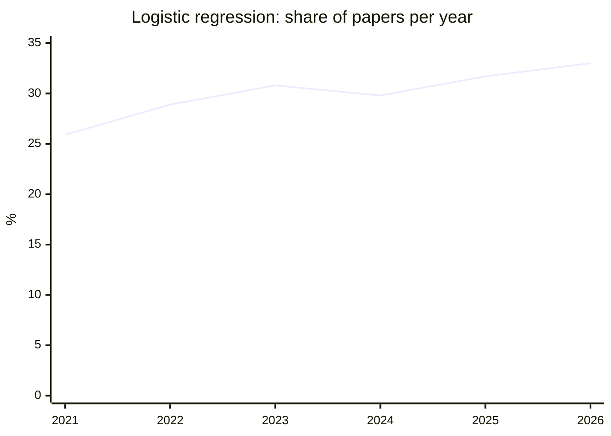
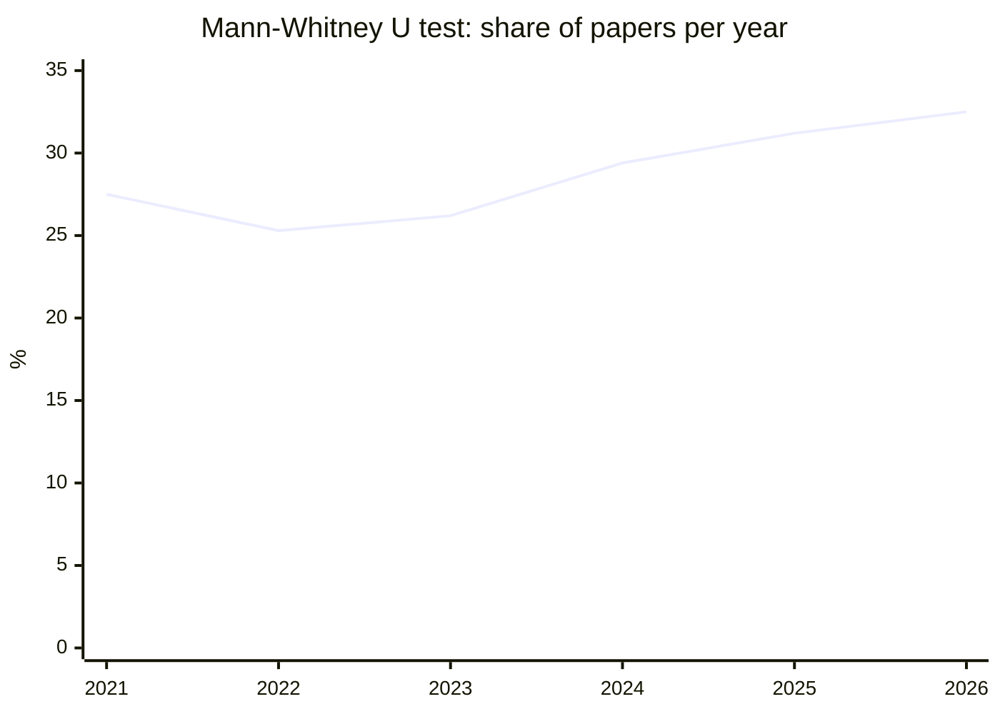
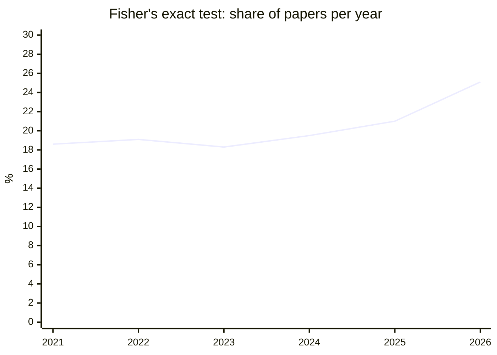

# Literature watch

Updated 2026-11-27. Round: 25 papers per field and publication month, 2016-12 to 2026-11.

Which statistical methods epidemiological research uses, from a random sample of open-access research articles in PubMed and PMC per field and month (no reviews). Claude lists each paper's methods from its abstract and methods section; only IDs, titles and the methods are stored.

## Progress

| Field | Months complete | Papers read |
|---|---|---|
| cardiovascular | 69 / 120 | 1725 / 3000 |
| metabolic | 68 / 120 | 1713 / 3000 |
| mental-health | 68 / 120 | 1700 / 3000 |
| cancer | 68 / 120 | 1700 / 3000 |
| respiratory-allergy | 68 / 120 | 1700 / 3000 |
| infections | 68 / 120 | 1700 / 3000 |
| pregnancy-child | 68 / 120 | 1700 / 3000 |
| environment | 68 / 120 | 1700 / 3000 |
| nutrition | 68 / 120 | 1700 / 3000 |
| omics | 68 / 120 | 1695 / 2995 |
| lifestyle | 68 / 120 | 1700 / 3000 |
| **all** | 749 / 1320 | 18733 / 32995 |

## All fields

Papers read: 15214, 14854 of them usable (7952 of these in the last 36 months, which the order below is based on).

| Method | Share, last 3 years | Papers | 2016 | 2017 | 2018 | 2019 | 2020 | 2021 | 2022 | 2023 | 2024 | 2025 | 2026 | Trend | In DataSHIELD |
|---|---|---|---|---|---|---|---|---|---|---|---|---|---|---|---|
| Chi-square test | 46% | 3680 | – | – | – | – | – | 41% | 44% | 46% | 46% | 46% | 47% | rising | – |
| Student's t-test | 35% | 2787 | – | – | – | – | – | 35% | 31% | 32% | 34% | 36% | 34% | rising | – |
| Logistic regression | 31% | 2504 | – | – | – | – | – | 26% | 29% | 31% | 30% | 32% | 33% | rising | – |
| Mann-Whitney U test | 31% | 2459 | – | – | – | – | – | 27% | 25% | 26% | 29% | 31% | 33% | rising | – |
| Fisher's exact test | 22% | 1731 | – | – | – | – | – | 19% | 19% | 18% | 20% | 21% | 25% | rising | – |
| Linear regression | 18% | 1396 | – | – | – | – | – | 17% | 16% | 16% | 16% | 17% | 20% | rising | – |
| Analysis of variance (ANOVA) | 15% | 1202 | – | – | – | – | – | 15% | 14% | 14% | 15% | 15% | 15% | steady | – |
| Cox proportional hazards regression | 15% | 1158 | – | – | – | – | – | 12% | 13% | 15% | 14% | 14% | 16% | rising | – |
| ROC curve analysis | 14% | 1125 | – | – | – | – | – | 9% | 9% | 9% | 12% | 16% | 15% | rising | – |
| Spearman's rank correlation | 12% | 965 | – | – | – | – | – | 10% | 9% | 10% | 10% | 13% | 14% | rising | – |
| Kruskal-Wallis test | 12% | 956 | – | – | – | – | – | 10% | 11% | 10% | 12% | 11% | 13% | rising | – |
| Kaplan-Meier estimator | 12% | 915 | – | – | – | – | – | 11% | 11% | 11% | 11% | 11% | 12% | steady | – |
| Pearson correlation | 11% | 905 | – | – | – | – | – | 11% | 9% | 10% | 11% | 13% | 11% | rising | – |
| Shapiro-Wilk test | 11% | 850 | – | – | – | – | – | 6% | 7% | 6% | 8% | 12% | 12% | rising | – |
| Subgroup analysis | 9% | 703 | – | – | – | – | – | 4% | 5% | 7% | 8% | 9% | 10% | rising | – |
| false-discovery-rate-correction | 9% | 686 | – | – | – | – | – | 6% | 5% | 5% | 6% | 7% | 12% | rising | – |
| Log-rank test | 8% | 615 | – | – | – | – | – | 8% | 7% | 8% | 8% | 7% | 8% | steady | – |
| Variance inflation factor | 7% | 524 | – | – | – | – | – | 3% | 4% | 3% | 3% | 6% | 11% | rising | – |
| Kolmogorov-Smirnov test | 6% | 506 | – | – | – | – | – | 6% | 5% | 6% | 7% | 7% | 5% | steady | – |
| Restricted cubic splines | 6% | 500 | – | – | – | – | – | 2% | 3% | 3% | 5% | 7% | 7% | rising | – |
| *papers read* | | | 0 | 0 | 0 | 0 | 0 | 2020 | 2513 | 2591 | 2583 | 2619 | 2528 | | |

**Variants named in at least 2 papers** (DataSHIELD may have the method but not the variant):

| Method | Variant | Papers | In DataSHIELD |
|---|---|---|---|
| Student's t-test | Independent samples | 877 | – |
| Analysis of variance (ANOVA) | One-way ANOVA | 833 | – |
| false-discovery-rate-correction | Benjamini-Hochberg procedure | 723 | – |
| Student's t-test | Paired samples | 553 | – |
| Multiple imputation | Multiple imputation by chained equations | 401 | – |
| Linear mixed model | Random intercept | 356 | – |
| Logistic regression | Survey-weighted | 294 | – |
| Analysis of variance (ANOVA) | Analysis of covariance | 208 | – |
| Cox proportional hazards regression | Stratified baseline hazards | 203 | – |
| Mediation analysis | Bootstrap confidence intervals | 202 | – |
| Propensity score matching | Nearest-neighbor matching | 193 | – |
| Student's t-test | Welch unequal variances | 189 | – |
| Poisson regression | Robust standard errors | 172 | – |
| ROC curve analysis | Youden optimal cutoff | 169 | – |
| Generalized linear mixed model | Random intercept | 168 | – |
| Propensity score matching | Caliper matching | 168 | – |
| Analysis of variance (ANOVA) | Repeated measures ANOVA | 167 | – |
| Cox proportional hazards regression | Time-varying covariates | 159 | – |
| Linear regression | Survey-weighted regression | 126 | – |
| Generalized linear mixed model | Binomial logit link | 124 | – |

## cardiovascular

Papers read: 1377, 1341 of them usable (717 of these in the last 36 months, which the order below is based on).

| Method | Share, last 3 years | Papers | 2016 | 2017 | 2018 | 2019 | 2020 | 2021 | 2022 | 2023 | 2024 | 2025 | 2026 | Trend | In DataSHIELD |
|---|---|---|---|---|---|---|---|---|---|---|---|---|---|---|---|
| Chi-square test | 57% | 406 | – | – | – | – | – | 55% | 57% | 59% | 56% | 56% | 59% | steady | – |
| Mann-Whitney U test | 43% | 306 | – | – | – | – | – | 32% | 35% | 33% | 37% | 47% | 44% | rising | – |
| Student's t-test | 41% | 294 | – | – | – | – | – | 38% | 43% | 38% | 39% | 44% | 39% | steady | – |
| Logistic regression | 37% | 264 | – | – | – | – | – | 32% | 35% | 32% | 35% | 35% | 39% | steady | – |
| Fisher's exact test | 33% | 235 | – | – | – | – | – | 26% | 26% | 26% | 30% | 32% | 36% | rising | – |
| Cox proportional hazards regression | 24% | 175 | – | – | – | – | – | 20% | 21% | 24% | 29% | 20% | 25% | steady | – |
| Kaplan-Meier estimator | 20% | 146 | – | – | – | – | – | 19% | 16% | 24% | 22% | 21% | 19% | steady | – |
| ROC curve analysis | 20% | 146 | – | – | – | – | – | 13% | 14% | 13% | 19% | 19% | 23% | rising | – |
| Analysis of variance (ANOVA) | 15% | 107 | – | – | – | – | – | 15% | 16% | 19% | 16% | 14% | 16% | steady | – |
| Shapiro-Wilk test | 14% | 100 | – | – | – | – | – | 8% | 6% | 8% | 11% | 14% | 17% | rising | – |
| *papers read* | | | 0 | 0 | 0 | 0 | 0 | 193 | 222 | 229 | 231 | 234 | 232 | | |

**Variants named in at least 2 papers** (DataSHIELD may have the method but not the variant):

| Method | Variant | Papers | In DataSHIELD |
|---|---|---|---|
| Analysis of variance (ANOVA) | One-way ANOVA | 84 | – |
| Student's t-test | Independent samples | 77 | – |
| Student's t-test | Paired samples | 62 | – |
| Multiple imputation | Multiple imputation by chained equations | 42 | – |
| ROC curve analysis | Youden optimal cutoff | 25 | – |
| Logistic regression | Survey-weighted | 23 | – |
| Propensity score matching | Nearest-neighbor matching | 23 | – |
| false-discovery-rate-correction | Benjamini-Hochberg procedure | 20 | – |
| Student's t-test | Welch unequal variances | 20 | – |
| Cox proportional hazards regression | Stratified baseline hazards | 19 | – |
| Propensity score matching | Caliper matching | 18 | – |
| Analysis of variance (ANOVA) | Analysis of covariance | 17 | – |
| Generalized linear mixed model | Random intercept | 16 | – |
| Linear mixed model | Random intercept | 16 | – |
| Mediation analysis | Bootstrap confidence intervals | 16 | – |
| Subgroup analysis | With interaction test | 16 | – |
| Cox proportional hazards regression | Time-varying covariates | 14 | – |
| gradient-boosting | XGBoost | 14 | – |
| Logistic regression | Stratified analysis | 13 | – |
| Analysis of variance (ANOVA) | Repeated measures ANOVA | 12 | – |

## metabolic

Papers read: 1407, 1382 of them usable (738 of these in the last 36 months, which the order below is based on).

| Method | Share, last 3 years | Papers | 2016 | 2017 | 2018 | 2019 | 2020 | 2021 | 2022 | 2023 | 2024 | 2025 | 2026 | Trend | In DataSHIELD |
|---|---|---|---|---|---|---|---|---|---|---|---|---|---|---|---|
| Chi-square test | 55% | 406 | – | – | – | – | – | 43% | 53% | 55% | 53% | 57% | 55% | rising | – |
| Student's t-test | 45% | 331 | – | – | – | – | – | 42% | 37% | 40% | 44% | 48% | 44% | steady | – |
| Logistic regression | 37% | 274 | – | – | – | – | – | 28% | 34% | 31% | 36% | 37% | 40% | rising | – |
| Mann-Whitney U test | 33% | 246 | – | – | – | – | – | 26% | 27% | 32% | 31% | 34% | 34% | rising | – |
| Analysis of variance (ANOVA) | 21% | 157 | – | – | – | – | – | 19% | 23% | 16% | 19% | 23% | 22% | steady | – |
| Fisher's exact test | 21% | 152 | – | – | – | – | – | 16% | 21% | 16% | 20% | 20% | 23% | steady | – |
| Linear regression | 20% | 151 | – | – | – | – | – | 17% | 17% | 16% | 17% | 22% | 24% | rising | – |
| ROC curve analysis | 16% | 115 | – | – | – | – | – | 10% | 11% | 13% | 13% | 16% | 18% | rising | – |
| Cox proportional hazards regression | 15% | 113 | – | – | – | – | – | 14% | 10% | 18% | 13% | 15% | 17% | steady | – |
| Kruskal-Wallis test | 14% | 106 | – | – | – | – | – | 10% | 13% | 13% | 12% | 15% | 16% | rising | – |
| *papers read* | | | 0 | 0 | 0 | 0 | 0 | 189 | 240 | 238 | 242 | 246 | 227 | | |

**Variants named in at least 2 papers** (DataSHIELD may have the method but not the variant):

| Method | Variant | Papers | In DataSHIELD |
|---|---|---|---|
| Analysis of variance (ANOVA) | One-way ANOVA | 109 | – |
| Student's t-test | Independent samples | 90 | – |
| Student's t-test | Paired samples | 78 | – |
| Logistic regression | Survey-weighted | 42 | – |
| Multiple imputation | Multiple imputation by chained equations | 42 | – |
| Propensity score matching | Nearest-neighbor matching | 34 | – |
| Analysis of variance (ANOVA) | Analysis of covariance | 32 | – |
| false-discovery-rate-correction | Benjamini-Hochberg procedure | 31 | – |
| Propensity score matching | Caliper matching | 30 | – |
| Linear mixed model | Random intercept | 29 | – |
| Analysis of variance (ANOVA) | Repeated measures ANOVA | 27 | – |
| Mediation analysis | Bootstrap confidence intervals | 19 | – |
| Poisson regression | Robust standard errors | 19 | – |
| Logistic regression | Stratified analysis | 18 | – |
| ROC curve analysis | Youden optimal cutoff | 18 | – |
| Linear regression | Stratified regression | 16 | – |
| Cox proportional hazards regression | Stratified baseline hazards | 15 | – |
| Student's t-test | Survey-weighted | 14 | – |
| Student's t-test | Welch unequal variances | 14 | – |
| gradient-boosting | XGBoost | 13 | – |

## mental-health

Papers read: 1382, 1356 of them usable (725 of these in the last 36 months, which the order below is based on).

| Method | Share, last 3 years | Papers | 2016 | 2017 | 2018 | 2019 | 2020 | 2021 | 2022 | 2023 | 2024 | 2025 | 2026 | Trend | In DataSHIELD |
|---|---|---|---|---|---|---|---|---|---|---|---|---|---|---|---|
| Chi-square test | 46% | 330 | – | – | – | – | – | 41% | 44% | 38% | 46% | 44% | 45% | steady | – |
| Student's t-test | 35% | 251 | – | – | – | – | – | 30% | 31% | 26% | 32% | 36% | 34% | steady | – |
| Logistic regression | 29% | 212 | – | – | – | – | – | 25% | 31% | 25% | 31% | 27% | 29% | steady | – |
| Mann-Whitney U test | 22% | 156 | – | – | – | – | – | 17% | 20% | 19% | 23% | 19% | 23% | steady | – |
| Linear regression | 21% | 151 | – | – | – | – | – | 26% | 20% | 18% | 20% | 19% | 24% | steady | – |
| Analysis of variance (ANOVA) | 17% | 122 | – | – | – | – | – | 17% | 14% | 13% | 18% | 18% | 14% | steady | – |
| Pearson correlation | 15% | 110 | – | – | – | – | – | 16% | 9% | 12% | 15% | 18% | 13% | steady | – |
| Fisher's exact test | 14% | 101 | – | – | – | – | – | 13% | 10% | 12% | 11% | 11% | 20% | steady | – |
| ROC curve analysis | 11% | 78 | – | – | – | – | – | 3% | 6% | 4% | 8% | 13% | 12% | rising | – |
| Spearman's rank correlation | 11% | 78 | – | – | – | – | – | 7% | 6% | 7% | 12% | 10% | 11% | rising | – |
| *papers read* | | | 0 | 0 | 0 | 0 | 0 | 191 | 220 | 240 | 234 | 240 | 231 | | |

**Variants named in at least 2 papers** (DataSHIELD may have the method but not the variant):

| Method | Variant | Papers | In DataSHIELD |
|---|---|---|---|
| Student's t-test | Independent samples | 104 | – |
| Analysis of variance (ANOVA) | One-way ANOVA | 61 | – |
| false-discovery-rate-correction | Benjamini-Hochberg procedure | 61 | – |
| Multiple imputation | Multiple imputation by chained equations | 51 | – |
| Linear mixed model | Random intercept | 45 | – |
| Student's t-test | Paired samples | 45 | – |
| Mediation analysis | Bootstrap confidence intervals | 41 | – |
| Analysis of variance (ANOVA) | Analysis of covariance | 37 | – |
| Linear mixed model | Random slopes | 28 | – |
| Analysis of variance (ANOVA) | Repeated measures ANOVA | 25 | – |
| Cox proportional hazards regression | Stratified baseline hazards | 22 | – |
| Linear regression | Interaction terms | 22 | – |
| Logistic regression | Survey-weighted | 21 | – |
| Poisson regression | Robust standard errors | 20 | – |
| Propensity score matching | Nearest-neighbor matching | 20 | – |
| Cox proportional hazards regression | Time-varying covariates | 19 | – |
| Generalized linear mixed model | Random intercept | 18 | – |
| Propensity score matching | Caliper matching | 18 | – |
| Student's t-test | Welch unequal variances | 16 | – |
| Cox proportional hazards regression | Robust standard errors | 15 | – |

## cancer

Papers read: 1359, 1307 of them usable (709 of these in the last 36 months, which the order below is based on).

| Method | Share, last 3 years | Papers | 2016 | 2017 | 2018 | 2019 | 2020 | 2021 | 2022 | 2023 | 2024 | 2025 | 2026 | Trend | In DataSHIELD |
|---|---|---|---|---|---|---|---|---|---|---|---|---|---|---|---|
| Chi-square test | 49% | 347 | – | – | – | – | – | 39% | 44% | 49% | 52% | 46% | 49% | steady | – |
| Kaplan-Meier estimator | 36% | 256 | – | – | – | – | – | 34% | 40% | 39% | 40% | 33% | 36% | steady | – |
| Mann-Whitney U test | 34% | 238 | – | – | – | – | – | 34% | 25% | 32% | 35% | 31% | 36% | steady | – |
| Student's t-test | 32% | 229 | – | – | – | – | – | 31% | 31% | 35% | 34% | 31% | 31% | steady | – |
| Fisher's exact test | 31% | 222 | – | – | – | – | – | 22% | 22% | 28% | 32% | 27% | 36% | rising | – |
| Logistic regression | 30% | 212 | – | – | – | – | – | 20% | 21% | 27% | 26% | 33% | 30% | rising | – |
| Cox proportional hazards regression | 30% | 210 | – | – | – | – | – | 26% | 29% | 34% | 31% | 24% | 33% | steady | – |
| Log-rank test | 27% | 194 | – | – | – | – | – | 26% | 24% | 28% | 32% | 25% | 26% | steady | – |
| ROC curve analysis | 21% | 150 | – | – | – | – | – | 12% | 19% | 14% | 18% | 25% | 21% | rising | – |
| Kruskal-Wallis test | 9% | 63 | – | – | – | – | – | 8% | 11% | 8% | 7% | 8% | 11% | steady | – |
| *papers read* | | | 0 | 0 | 0 | 0 | 0 | 172 | 220 | 225 | 230 | 227 | 233 | | |

**Variants named in at least 2 papers** (DataSHIELD may have the method but not the variant):

| Method | Variant | Papers | In DataSHIELD |
|---|---|---|---|
| Analysis of variance (ANOVA) | One-way ANOVA | 57 | – |
| Student's t-test | Independent samples | 52 | – |
| Student's t-test | Paired samples | 42 | – |
| false-discovery-rate-correction | Benjamini-Hochberg procedure | 32 | – |
| ROC curve analysis | Youden optimal cutoff | 29 | – |
| Propensity score matching | Caliper matching | 27 | – |
| Propensity score matching | Nearest-neighbor matching | 25 | – |
| Cox proportional hazards regression | Stratified baseline hazards | 21 | – |
| Multiple imputation | Multiple imputation by chained equations | 20 | – |
| gradient-boosting | XGBoost | 18 | – |
| Bootstrap | Optimism-corrected internal validation | 15 | – |
| Cross-validation | K-fold cross-validation | 15 | – |
| Cox proportional hazards regression | Time-varying covariates | 14 | – |
| Linear mixed model | Random intercept | 14 | – |
| Stepwise variable selection | Backward elimination | 13 | – |
| Concordance index (C-index) | harrell's | 11 | – |
| Kaplan-Meier estimator | reverse (follow-up time) | 11 | – |
| Cox proportional hazards regression | Cause-specific hazards | 10 | – |
| Cumulative incidence function (Aalen-Johansen) | competing risks | 10 | – |
| Analysis of variance (ANOVA) | Repeated measures ANOVA | 9 | – |

## respiratory-allergy

Papers read: 1386, 1354 of them usable (732 of these in the last 36 months, which the order below is based on).

| Method | Share, last 3 years | Papers | 2016 | 2017 | 2018 | 2019 | 2020 | 2021 | 2022 | 2023 | 2024 | 2025 | 2026 | Trend | In DataSHIELD |
|---|---|---|---|---|---|---|---|---|---|---|---|---|---|---|---|
| Chi-square test | 53% | 390 | – | – | – | – | – | 43% | 49% | 54% | 52% | 55% | 52% | steady | – |
| Student's t-test | 39% | 288 | – | – | – | – | – | 35% | 32% | 38% | 40% | 39% | 39% | steady | – |
| Mann-Whitney U test | 38% | 281 | – | – | – | – | – | 30% | 31% | 31% | 36% | 43% | 38% | rising | – |
| Logistic regression | 33% | 238 | – | – | – | – | – | 18% | 28% | 26% | 30% | 34% | 35% | rising | – |
| Fisher's exact test | 32% | 231 | – | – | – | – | – | 28% | 31% | 28% | 27% | 31% | 37% | steady | – |
| Kaplan-Meier estimator | 24% | 179 | – | – | – | – | – | 30% | 31% | 28% | 26% | 24% | 23% | falling | – |
| Cox proportional hazards regression | 22% | 162 | – | – | – | – | – | 23% | 23% | 26% | 23% | 20% | 24% | steady | – |
| ROC curve analysis | 21% | 153 | – | – | – | – | – | 12% | 18% | 14% | 19% | 24% | 21% | rising | – |
| Log-rank test | 16% | 117 | – | – | – | – | – | 19% | 21% | 19% | 19% | 15% | 14% | falling | – |
| Analysis of variance (ANOVA) | 14% | 103 | – | – | – | – | – | 19% | 10% | 11% | 12% | 15% | 14% | steady | – |
| *papers read* | | | 0 | 0 | 0 | 0 | 0 | 181 | 225 | 236 | 240 | 238 | 234 | | |

**Variants named in at least 2 papers** (DataSHIELD may have the method but not the variant):

| Method | Variant | Papers | In DataSHIELD |
|---|---|---|---|
| Student's t-test | Independent samples | 77 | – |
| Analysis of variance (ANOVA) | One-way ANOVA | 72 | – |
| Student's t-test | Paired samples | 60 | – |
| Propensity score matching | Caliper matching | 32 | – |
| Multiple imputation | Multiple imputation by chained equations | 30 | – |
| Propensity score matching | Nearest-neighbor matching | 30 | – |
| false-discovery-rate-correction | Benjamini-Hochberg procedure | 24 | – |
| gradient-boosting | XGBoost | 20 | – |
| ROC curve analysis | Youden optimal cutoff | 20 | – |
| Cox proportional hazards regression | Stratified baseline hazards | 19 | – |
| Linear mixed model | Random intercept | 18 | – |
| Cross-validation | K-fold cross-validation | 17 | – |
| Analysis of variance (ANOVA) | Repeated measures ANOVA | 14 | – |
| Logistic regression | Survey-weighted | 14 | – |
| Stepwise variable selection | Backward elimination | 14 | – |
| Bootstrap | Optimism-corrected internal validation | 13 | – |
| Student's t-test | Welch unequal variances | 13 | – |
| Analysis of variance (ANOVA) | Analysis of covariance | 12 | – |
| Cox proportional hazards regression | Time-varying covariates | 12 | – |
| Kaplan-Meier estimator | reverse (follow-up time) | 11 | – |

## infections

Papers read: 1387, 1338 of them usable (741 of these in the last 36 months, which the order below is based on).

| Method | Share, last 3 years | Papers | 2016 | 2017 | 2018 | 2019 | 2020 | 2021 | 2022 | 2023 | 2024 | 2025 | 2026 | Trend | In DataSHIELD |
|---|---|---|---|---|---|---|---|---|---|---|---|---|---|---|---|
| Chi-square test | 48% | 356 | – | – | – | – | – | 45% | 51% | 50% | 44% | 50% | 49% | steady | – |
| Logistic regression | 35% | 258 | – | – | – | – | – | 25% | 25% | 35% | 33% | 36% | 37% | rising | – |
| Mann-Whitney U test | 30% | 221 | – | – | – | – | – | 33% | 25% | 27% | 27% | 30% | 32% | steady | – |
| Fisher's exact test | 28% | 211 | – | – | – | – | – | 23% | 29% | 23% | 21% | 30% | 35% | rising | – |
| Student's t-test | 27% | 201 | – | – | – | – | – | 32% | 30% | 33% | 26% | 30% | 26% | steady | – |
| ROC curve analysis | 12% | 87 | – | – | – | – | – | 12% | 7% | 6% | 9% | 13% | 14% | rising | – |
| Analysis of variance (ANOVA) | 10% | 76 | – | – | – | – | – | 7% | 10% | 9% | 9% | 10% | 12% | steady | – |
| Cox proportional hazards regression | 10% | 73 | – | – | – | – | – | 9% | 8% | 7% | 8% | 12% | 9% | steady | – |
| Linear regression | 10% | 73 | – | – | – | – | – | 16% | 8% | 12% | 8% | 12% | 10% | steady | – |
| Kaplan-Meier estimator | 10% | 71 | – | – | – | – | – | 9% | 7% | 6% | 9% | 10% | 10% | steady | – |
| *papers read* | | | 0 | 0 | 0 | 0 | 0 | 162 | 220 | 236 | 239 | 250 | 231 | | |

**Variants named in at least 2 papers** (DataSHIELD may have the method but not the variant):

| Method | Variant | Papers | In DataSHIELD |
|---|---|---|---|
| Student's t-test | Independent samples | 65 | – |
| Analysis of variance (ANOVA) | One-way ANOVA | 51 | – |
| Student's t-test | Paired samples | 41 | – |
| false-discovery-rate-correction | Benjamini-Hochberg procedure | 29 | – |
| Poisson regression | Robust standard errors | 23 | – |
| Multiple imputation | Multiple imputation by chained equations | 22 | – |
| Propensity score matching | Nearest-neighbor matching | 22 | – |
| Generalized linear mixed model | Random intercept | 21 | – |
| ROC curve analysis | Youden optimal cutoff | 21 | – |
| Phylogenetic analysis | maximum likelihood | 19 | – |
| Logistic regression | Survey-weighted | 17 | – |
| Segmented (piecewise) regression | Interrupted time series | 15 | – |
| Propensity score matching | Caliper matching | 14 | – |
| Stepwise variable selection | Backward elimination | 14 | – |
| Linear mixed model | Random intercept | 13 | – |
| Generalized linear mixed model | Binomial logit link | 12 | – |
| Poisson regression | Modified Poisson regression | 12 | – |
| Linear regression | Hierarchical blockwise entry | 11 | – |
| Student's t-test | Welch unequal variances | 11 | – |
| Logistic regression | Interaction terms | 10 | – |

## pregnancy-child

Papers read: 1406, 1370 of them usable (729 of these in the last 36 months, which the order below is based on).

| Method | Share, last 3 years | Papers | 2016 | 2017 | 2018 | 2019 | 2020 | 2021 | 2022 | 2023 | 2024 | 2025 | 2026 | Trend | In DataSHIELD |
|---|---|---|---|---|---|---|---|---|---|---|---|---|---|---|---|
| Chi-square test | 46% | 335 | – | – | – | – | – | 46% | 52% | 52% | 45% | 50% | 43% | steady | – |
| Logistic regression | 37% | 273 | – | – | – | – | – | 36% | 42% | 45% | 33% | 39% | 42% | steady | – |
| Student's t-test | 35% | 252 | – | – | – | – | – | 45% | 33% | 36% | 32% | 39% | 32% | steady | – |
| Mann-Whitney U test | 30% | 218 | – | – | – | – | – | 30% | 26% | 27% | 29% | 32% | 28% | steady | – |
| Fisher's exact test | 25% | 182 | – | – | – | – | – | 24% | 26% | 24% | 22% | 27% | 25% | steady | – |
| Linear regression | 15% | 111 | – | – | – | – | – | 15% | 15% | 12% | 16% | 14% | 16% | steady | – |
| ROC curve analysis | 14% | 100 | – | – | – | – | – | 11% | 12% | 10% | 13% | 16% | 12% | steady | – |
| Analysis of variance (ANOVA) | 13% | 97 | – | – | – | – | – | 15% | 10% | 13% | 13% | 15% | 14% | steady | – |
| Shapiro-Wilk test | 11% | 79 | – | – | – | – | – | 9% | 7% | 6% | 9% | 12% | 10% | steady | – |
| Kruskal-Wallis test | 10% | 71 | – | – | – | – | – | 11% | 10% | 10% | 9% | 11% | 10% | steady | – |
| *papers read* | | | 0 | 0 | 0 | 0 | 0 | 184 | 231 | 248 | 231 | 234 | 242 | | |

**Variants named in at least 2 papers** (DataSHIELD may have the method but not the variant):

| Method | Variant | Papers | In DataSHIELD |
|---|---|---|---|
| Analysis of variance (ANOVA) | One-way ANOVA | 74 | – |
| Student's t-test | Independent samples | 73 | – |
| Multiple imputation | Multiple imputation by chained equations | 43 | – |
| Student's t-test | Paired samples | 34 | – |
| false-discovery-rate-correction | Benjamini-Hochberg procedure | 33 | – |
| Poisson regression | Robust standard errors | 33 | – |
| Linear mixed model | Random intercept | 28 | – |
| Poisson regression | Modified Poisson regression | 21 | – |
| Student's t-test | Welch unequal variances | 20 | – |
| Logistic regression | Stratified analysis | 17 | – |
| Generalized estimating equations | Exchangeable working correlation | 15 | – |
| Generalized linear mixed model | Binomial logit link | 14 | – |
| Propensity score matching | Nearest-neighbor matching | 14 | – |
| ROC curve analysis | Youden optimal cutoff | 13 | – |
| Analysis of variance (ANOVA) | Analysis of covariance | 12 | – |
| Cox proportional hazards regression | Robust standard errors | 12 | – |
| Generalized linear mixed model | Random intercept | 12 | – |
| Analysis of variance (ANOVA) | Repeated measures ANOVA | 11 | – |
| Generalized estimating equations | Robust sandwich standard errors | 11 | – |
| Cox proportional hazards regression | Time-varying covariates | 10 | – |

## environment

Papers read: 1431, 1408 of them usable (745 of these in the last 36 months, which the order below is based on).

| Method | Share, last 3 years | Papers | 2016 | 2017 | 2018 | 2019 | 2020 | 2021 | 2022 | 2023 | 2024 | 2025 | 2026 | Trend | In DataSHIELD |
|---|---|---|---|---|---|---|---|---|---|---|---|---|---|---|---|
| Chi-square test | 36% | 267 | – | – | – | – | – | 33% | 29% | 35% | 39% | 32% | 35% | steady | – |
| Logistic regression | 31% | 230 | – | – | – | – | – | 29% | 28% | 34% | 29% | 28% | 34% | steady | – |
| Student's t-test | 26% | 194 | – | – | – | – | – | 30% | 22% | 21% | 26% | 27% | 23% | steady | – |
| Linear regression | 24% | 177 | – | – | – | – | – | 19% | 19% | 22% | 20% | 23% | 30% | rising | – |
| Mann-Whitney U test | 21% | 156 | – | – | – | – | – | 19% | 16% | 12% | 18% | 22% | 23% | rising | – |
| Subgroup analysis | 17% | 125 | – | – | – | – | – | 10% | 18% | 16% | 15% | 18% | 18% | steady | – |
| Spearman's rank correlation | 16% | 122 | – | – | – | – | – | 13% | 10% | 9% | 13% | 18% | 19% | rising | – |
| Cox proportional hazards regression | 14% | 103 | – | – | – | – | – | 8% | 15% | 15% | 13% | 13% | 15% | steady | – |
| Pearson correlation | 13% | 96 | – | – | – | – | – | 13% | 9% | 13% | 14% | 12% | 12% | steady | – |
| Restricted cubic splines | 13% | 94 | – | – | – | – | – | 5% | 10% | 8% | 10% | 16% | 12% | rising | – |
| *papers read* | | | 0 | 0 | 0 | 0 | 0 | 196 | 237 | 249 | 248 | 245 | 233 | | |

**Variants named in at least 2 papers** (DataSHIELD may have the method but not the variant):

| Method | Variant | Papers | In DataSHIELD |
|---|---|---|---|
| Multiple imputation | Multiple imputation by chained equations | 70 | – |
| Linear mixed model | Random intercept | 64 | – |
| Student's t-test | Independent samples | 64 | – |
| false-discovery-rate-correction | Benjamini-Hochberg procedure | 51 | – |
| Cox proportional hazards regression | Time-varying covariates | 49 | – |
| Analysis of variance (ANOVA) | One-way ANOVA | 47 | – |
| Cox proportional hazards regression | Stratified baseline hazards | 44 | – |
| Cox proportional hazards regression | Age as time scale | 39 | – |
| Logistic regression | Survey-weighted | 39 | – |
| Student's t-test | Paired samples | 35 | – |
| Generalized linear mixed model | Random intercept | 27 | – |
| Poisson regression | Robust standard errors | 23 | – |
| Interaction analysis | Regression product term | 21 | – |
| Generalized linear mixed model | Binomial logit link | 20 | – |
| Linear regression | Log-transformed outcome | 16 | – |
| Mediation analysis | Bootstrap confidence intervals | 16 | – |
| Mediation analysis | Counterfactual causal mediation | 16 | – |
| Linear regression | Survey-weighted regression | 15 | – |
| Cox proportional hazards regression | Robust standard errors | 13 | – |
| Logistic regression | Stratified analysis | 13 | – |

## nutrition

Papers read: 1464, 1450 of them usable (762 of these in the last 36 months, which the order below is based on).

| Method | Share, last 3 years | Papers | 2016 | 2017 | 2018 | 2019 | 2020 | 2021 | 2022 | 2023 | 2024 | 2025 | 2026 | Trend | In DataSHIELD |
|---|---|---|---|---|---|---|---|---|---|---|---|---|---|---|---|
| Chi-square test | 51% | 392 | – | – | – | – | – | 40% | 46% | 44% | 48% | 49% | 58% | rising | – |
| Student's t-test | 35% | 265 | – | – | – | – | – | 31% | 25% | 26% | 34% | 34% | 37% | rising | – |
| Logistic regression | 34% | 262 | – | – | – | – | – | 28% | 37% | 37% | 35% | 36% | 32% | steady | – |
| Linear regression | 27% | 208 | – | – | – | – | – | 23% | 24% | 25% | 24% | 25% | 34% | rising | – |
| Mann-Whitney U test | 26% | 195 | – | – | – | – | – | 22% | 17% | 18% | 25% | 24% | 29% | rising | – |
| Analysis of variance (ANOVA) | 21% | 159 | – | – | – | – | – | 20% | 22% | 20% | 20% | 20% | 24% | steady | – |
| Fisher's exact test | 17% | 128 | – | – | – | – | – | 14% | 9% | 12% | 16% | 17% | 18% | rising | – |
| Kruskal-Wallis test | 16% | 119 | – | – | – | – | – | 11% | 11% | 10% | 14% | 15% | 18% | rising | – |
| Cox proportional hazards regression | 15% | 115 | – | – | – | – | – | 6% | 9% | 14% | 13% | 17% | 16% | rising | – |
| Shapiro-Wilk test | 15% | 113 | – | – | – | – | – | 7% | 6% | 7% | 12% | 15% | 19% | rising | – |
| *papers read* | | | 0 | 0 | 0 | 0 | 0 | 204 | 249 | 259 | 239 | 254 | 245 | | |

**Variants named in at least 2 papers** (DataSHIELD may have the method but not the variant):

| Method | Variant | Papers | In DataSHIELD |
|---|---|---|---|
| Analysis of variance (ANOVA) | One-way ANOVA | 111 | – |
| Student's t-test | Independent samples | 98 | – |
| Logistic regression | Survey-weighted | 64 | – |
| false-discovery-rate-correction | Benjamini-Hochberg procedure | 51 | – |
| Student's t-test | Paired samples | 50 | – |
| Analysis of variance (ANOVA) | Analysis of covariance | 40 | – |
| Linear regression | Survey-weighted regression | 36 | – |
| Multiple imputation | Multiple imputation by chained equations | 36 | – |
| Linear mixed model | Random intercept | 35 | – |
| Principal component analysis | Varimax rotation | 34 | – |
| Cox proportional hazards regression | Stratified baseline hazards | 24 | – |
| Mediation analysis | Bootstrap confidence intervals | 23 | – |
| Poisson regression | Robust standard errors | 20 | – |
| Cox proportional hazards regression | Age as time scale | 19 | – |
| Exploratory factor analysis | Varimax rotation | 17 | – |
| ROC curve analysis | Youden optimal cutoff | 17 | – |
| Test for trend | linear | 17 | – |
| Analysis of variance (ANOVA) | Repeated measures ANOVA | 16 | – |
| Cox proportional hazards regression | Time-varying covariates | 16 | – |
| Linear regression | Interaction terms | 16 | – |

## omics

Papers read: 1407, 1364 of them usable (731 of these in the last 36 months, which the order below is based on).

| Method | Share, last 3 years | Papers | 2016 | 2017 | 2018 | 2019 | 2020 | 2021 | 2022 | 2023 | 2024 | 2025 | 2026 | Trend | In DataSHIELD |
|---|---|---|---|---|---|---|---|---|---|---|---|---|---|---|---|
| Mann-Whitney U test | 48% | 353 | – | – | – | – | – | 46% | 45% | 48% | 48% | 46% | 51% | steady | – |
| false-discovery-rate-correction | 43% | 317 | – | – | – | – | – | 30% | 35% | 37% | 36% | 42% | 53% | rising | – |
| Student's t-test | 40% | 293 | – | – | – | – | – | 40% | 38% | 34% | 39% | 43% | 38% | steady | – |
| Chi-square test | 33% | 239 | – | – | – | – | – | 30% | 30% | 35% | 32% | 33% | 33% | steady | – |
| PERMANOVA | 31% | 230 | – | – | – | – | – | 26% | 35% | 39% | 29% | 28% | 37% | steady | – |
| Spearman's rank correlation | 29% | 212 | – | – | – | – | – | 18% | 22% | 25% | 24% | 30% | 32% | rising | – |
| Kruskal-Wallis test | 26% | 188 | – | – | – | – | – | 23% | 30% | 25% | 24% | 26% | 27% | steady | – |
| Principal coordinates analysis | 26% | 188 | – | – | – | – | – | 26% | 35% | 32% | 24% | 26% | 27% | steady | – |
| ROC curve analysis | 26% | 188 | – | – | – | – | – | 19% | 13% | 15% | 22% | 30% | 26% | rising | – |
| Fisher's exact test | 21% | 156 | – | – | – | – | – | 18% | 22% | 19% | 22% | 17% | 26% | steady | – |
| *papers read* | | | 0 | 0 | 0 | 0 | 0 | 193 | 237 | 223 | 241 | 236 | 234 | | |

**Variants named in at least 2 papers** (DataSHIELD may have the method but not the variant):

| Method | Variant | Papers | In DataSHIELD |
|---|---|---|---|
| false-discovery-rate-correction | Benjamini-Hochberg procedure | 373 | – |
| Analysis of variance (ANOVA) | One-way ANOVA | 96 | – |
| Student's t-test | Welch unequal variances | 60 | – |
| Student's t-test | Independent samples | 57 | – |
| Student's t-test | Paired samples | 52 | – |
| Alpha diversity analysis | shannon index | 51 | – |
| Linear mixed model | Random intercept | 47 | – |
| Principal coordinates analysis | bray-curtis distance | 34 | – |
| Hierarchical clustering | Ward linkage | 32 | – |
| DESeq2 differential expression analysis | differential abundance | 27 | – |
| Cross-validation | Repeated cross-validation | 25 | – |
| Pathway enrichment analysis | Over-representation analysis | 24 | – |
| Cross-validation | K-fold cross-validation | 21 | – |
| Beta diversity analysis | bray-curtis | 20 | – |
| Analysis of variance (ANOVA) | Factorial multi-way ANOVA | 19 | – |
| Cross-validation | Leave-one-out cross-validation | 18 | – |
| PERMANOVA | pairwise | 18 | – |
| Principal coordinates analysis | bray-curtis dissimilarity | 17 | – |
| Mann-Whitney U test | pairwise | 16 | – |
| Analysis of variance (ANOVA) | Repeated measures ANOVA | 15 | – |

## lifestyle

Papers read: 1446, 1413 of them usable (746 of these in the last 36 months, which the order below is based on).

| Method | Share, last 3 years | Papers | 2016 | 2017 | 2018 | 2019 | 2020 | 2021 | 2022 | 2023 | 2024 | 2025 | 2026 | Trend | In DataSHIELD |
|---|---|---|---|---|---|---|---|---|---|---|---|---|---|---|---|
| Chi-square test | 36% | 269 | – | – | – | – | – | 40% | 35% | 38% | 40% | 34% | 35% | steady | – |
| Student's t-test | 31% | 233 | – | – | – | – | – | 32% | 26% | 27% | 30% | 31% | 32% | steady | – |
| Logistic regression | 29% | 215 | – | – | – | – | – | 31% | 27% | 31% | 27% | 31% | 28% | steady | – |
| Linear regression | 25% | 183 | – | – | – | – | – | 27% | 23% | 20% | 24% | 21% | 30% | steady | – |
| Mann-Whitney U test | 17% | 128 | – | – | – | – | – | 14% | 13% | 15% | 14% | 19% | 19% | rising | – |
| Analysis of variance (ANOVA) | 17% | 126 | – | – | – | – | – | 20% | 14% | 14% | 19% | 17% | 15% | steady | – |
| Pearson correlation | 14% | 103 | – | – | – | – | – | 16% | 12% | 12% | 10% | 14% | 17% | steady | – |
| Spearman's rank correlation | 11% | 83 | – | – | – | – | – | 8% | 6% | 9% | 8% | 13% | 12% | rising | – |
| Shapiro-Wilk test | 11% | 82 | – | – | – | – | – | 9% | 7% | 5% | 9% | 12% | 13% | rising | – |
| Subgroup analysis | 10% | 75 | – | – | – | – | – | 3% | 3% | 5% | 11% | 10% | 10% | rising | – |
| *papers read* | | | 0 | 0 | 0 | 0 | 0 | 200 | 242 | 247 | 242 | 251 | 231 | | |

**Variants named in at least 2 papers** (DataSHIELD may have the method but not the variant):

| Method | Variant | Papers | In DataSHIELD |
|---|---|---|---|
| Student's t-test | Independent samples | 129 | – |
| Analysis of variance (ANOVA) | One-way ANOVA | 83 | – |
| Student's t-test | Paired samples | 62 | – |
| Logistic regression | Survey-weighted | 58 | – |
| Linear mixed model | Random intercept | 54 | – |
| Mediation analysis | Bootstrap confidence intervals | 53 | – |
| Multiple imputation | Multiple imputation by chained equations | 41 | – |
| Analysis of variance (ANOVA) | Analysis of covariance | 33 | – |
| false-discovery-rate-correction | Benjamini-Hochberg procedure | 30 | – |
| Generalized linear mixed model | Random intercept | 29 | – |
| Linear regression | Interaction terms | 25 | – |
| Analysis of variance (ANOVA) | Repeated measures ANOVA | 24 | – |
| Cox proportional hazards regression | Stratified baseline hazards | 22 | – |
| Logistic regression | Stratified analysis | 22 | – |
| Poisson regression | Robust standard errors | 22 | – |
| Generalized linear mixed model | Binomial logit link | 19 | – |
| Linear regression | Hierarchical blockwise entry | 19 | – |
| Linear regression | Survey-weighted regression | 19 | – |
| Logistic regression | Complex survey design | 17 | – |
| Linear regression | Log-transformed outcome | 16 | – |

## Searches

| Field | Version | Search |
|---|---|---|
| cardiovascular | `2b21c0b8` | `"Epidemiologic Studies"[MeSH Terms] AND ("Cardiovascular Diseases"[majr]) AND "pubmed pmc open access"[filter] NOT (review[pt] OR systematic review[pt] OR meta-analysis[pt])` |
| metabolic | `d26e1bd5` | `"Epidemiologic Studies"[MeSH Terms] AND ("Nutritional and Metabolic Diseases"[majr]) AND "pubmed pmc open access"[filter] NOT (review[pt] OR systematic review[pt] OR meta-analysis[pt])` |
| mental-health | `49157751` | `"Epidemiologic Studies"[MeSH Terms] AND ("Mental Disorders"[majr]) AND "pubmed pmc open access"[filter] NOT (review[pt] OR systematic review[pt] OR meta-analysis[pt])` |
| cancer | `3e24eb6c` | `"Epidemiologic Studies"[MeSH Terms] AND ("Neoplasms"[majr]) AND "pubmed pmc open access"[filter] NOT (review[pt] OR systematic review[pt] OR meta-analysis[pt])` |
| respiratory-allergy | `2b88ada3` | `"Epidemiologic Studies"[MeSH Terms] AND (("Respiratory Tract Diseases"[majr] OR "Hypersensitivity"[majr]) NOT "Respiratory Tract Infections"[majr]) AND "pubmed pmc open access"[filter] NOT (review[pt] OR systematic review[pt] OR meta-analysis[pt])` |
| infections | `5ffaa918` | `"Epidemiologic Studies"[MeSH Terms] AND ("Infections"[majr]) AND "pubmed pmc open access"[filter] NOT (review[pt] OR systematic review[pt] OR meta-analysis[pt])` |
| pregnancy-child | `7287be76` | `"Epidemiologic Studies"[MeSH Terms] AND ("Pregnancy Complications"[majr] OR "Prenatal Exposure Delayed Effects"[majr] OR "Child Development"[majr] OR "Infant, Newborn, Diseases"[majr]) AND "pubmed pmc open access"[filter] NOT (review[pt] OR systematic review[pt] OR meta-analysis[pt])` |
| environment | `5e248b92` | `"Epidemiologic Studies"[MeSH Terms] AND ("Environmental Exposure"[majr] OR "Environmental Pollutants"[majr] OR "Air Pollution"[majr] OR "Noise"[majr] OR "Built Environment"[majr]) AND "pubmed pmc open access"[filter] NOT (review[pt] OR systematic review[pt] OR meta-analysis[pt])` |
| nutrition | `e3ba59b3` | `"Epidemiologic Studies"[MeSH Terms] AND ("Diet"[majr] OR "Nutritional Status"[majr] OR "Feeding Behavior"[majr]) AND "pubmed pmc open access"[filter] NOT (review[pt] OR systematic review[pt] OR meta-analysis[pt])` |
| omics | `88c8ab9a` | `"Epidemiologic Studies"[MeSH Terms] AND ("Genomics"[majr] OR "Epigenomics"[majr] OR "Metabolomics"[majr] OR "Proteomics"[majr] OR "Multiomics"[majr] OR "Microbiota"[majr]) AND "pubmed pmc open access"[filter] NOT (review[pt] OR systematic review[pt] OR meta-analysis[pt])` |
| lifestyle | `d8a73a12` | `"Epidemiologic Studies"[MeSH Terms] AND ("Exercise"[majr] OR "Sedentary Behavior"[majr] OR "Smoking"[majr] OR "Alcohol Drinking"[majr] OR "Sleep"[majr]) AND "pubmed pmc open access"[filter] NOT (review[pt] OR systematic review[pt] OR meta-analysis[pt])` |

_Notes: shares are per year of publication; all fields dip in 2022-2023, most likely NLM's switch to automated MeSH indexing, so read changes around those years with care. Method names are merged by the vocabulary (`vocabulary.yml`, Claude); names not classified yet are shown as the papers gave them. "In DataSHIELD" is Claude's verdict against the functions' documentation in the package catalogue, with the function it found; "partly" means the plain method or only some of it, "no (in development)" a match only in a development package, "unconfirmed" an answer whose evidence didn't check out, "–" not checked yet (fewer papers than the threshold)._
