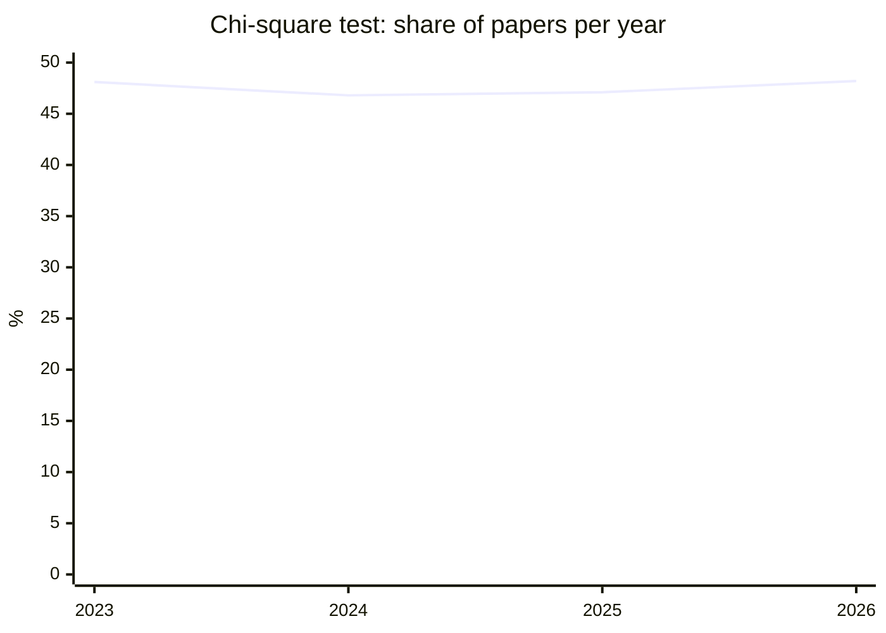
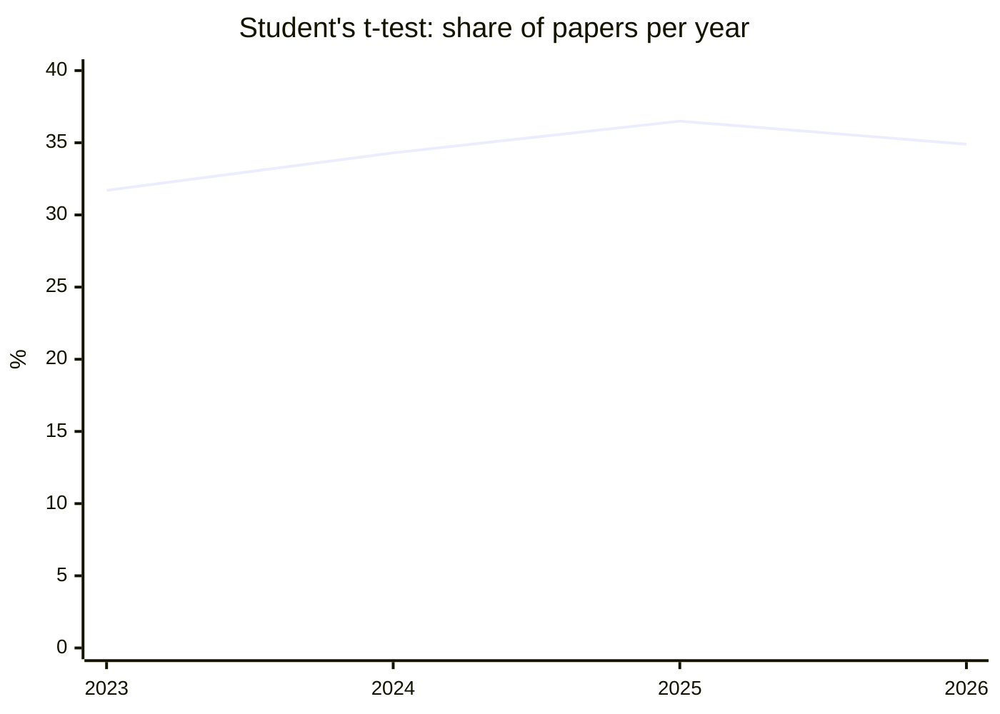
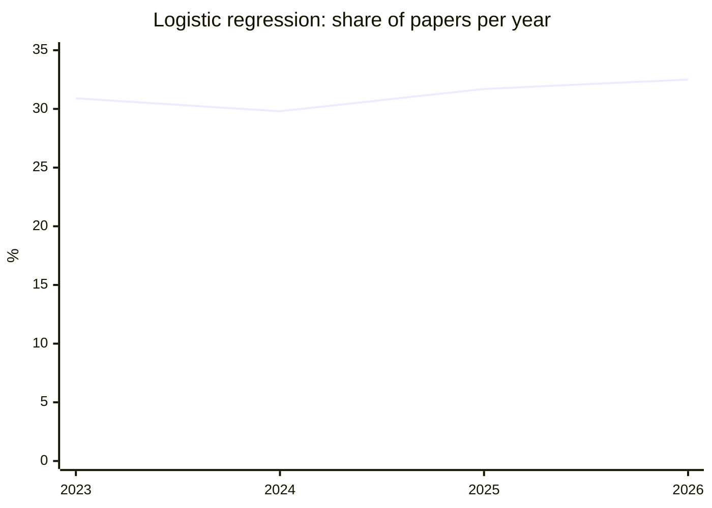
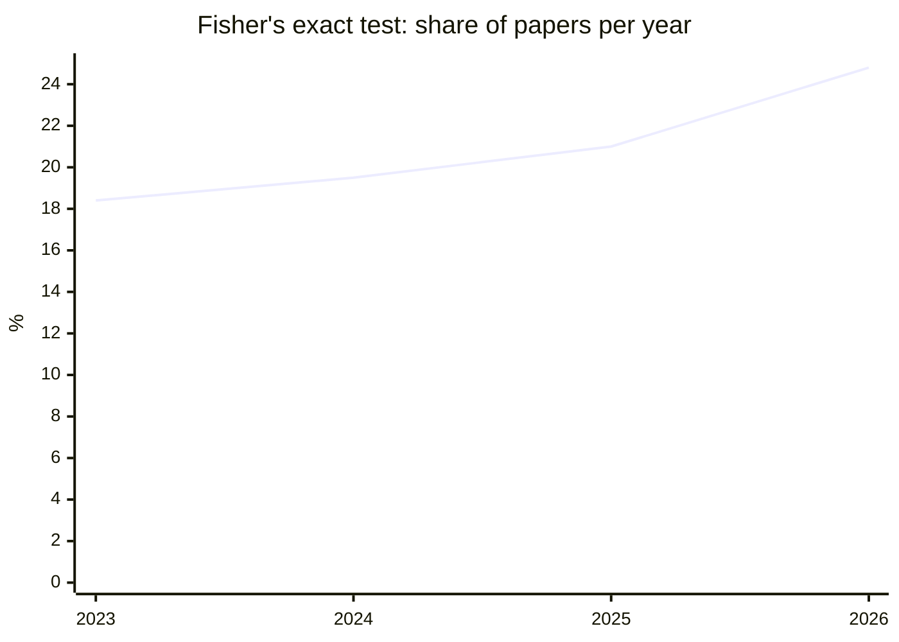

# Literature watch

Updated 2026-11-23. Round: 25 papers per field and publication month, 2016-10 to 2026-09.

Which statistical methods epidemiological research uses, from a random sample of open-access research articles in PubMed and PMC per field and month (no reviews). Claude lists each paper's methods from its abstract and methods section; only IDs, titles and the methods are stored.

## Progress

| Field | Months complete | Papers read |
|---|---|---|
| cardiovascular | 41 / 120 | 1025 / 3000 |
| metabolic | 41 / 120 | 1025 / 3000 |
| mental-health | 41 / 120 | 1025 / 3000 |
| cancer | 41 / 120 | 1025 / 3000 |
| respiratory-allergy | 41 / 120 | 1025 / 3000 |
| infections | 41 / 120 | 1025 / 3000 |
| pregnancy-child | 41 / 120 | 1025 / 3000 |
| environment | 41 / 120 | 1025 / 3000 |
| nutrition | 40 / 120 | 1014 / 3000 |
| omics | 40 / 120 | 1000 / 3000 |
| lifestyle | 40 / 120 | 1000 / 3000 |
| **all** | 448 / 1320 | 11214 / 33000 |

## All fields

Papers read: 9246, 9057 of them usable (7970 of these in the last 36 months, which the order below is based on).

| Method | Share, last 3 years | Papers | 2016 | 2017 | 2018 | 2019 | 2020 | 2021 | 2022 | 2023 | 2024 | 2025 | 2026 | Trend | In DataSHIELD |
|---|---|---|---|---|---|---|---|---|---|---|---|---|---|---|---|
| Chi-square test | 48% | 3796 | – | – | – | – | – | – | – | 48% | 47% | 47% | 48% | steady | – |
| Student's t-test | 35% | 2802 | – | – | – | – | – | – | – | 32% | 34% | 36% | 35% | rising | – |
| Logistic regression | 31% | 2485 | – | – | – | – | – | – | – | 31% | 30% | 32% | 32% | steady | – |
| Mann-Whitney U test | 31% | 2456 | – | – | – | – | – | – | – | 27% | 29% | 31% | 33% | rising | – |
| Fisher's exact test | 21% | 1707 | – | – | – | – | – | – | – | 18% | 19% | 21% | 25% | rising | – |
| Linear regression | 17% | 1392 | – | – | – | – | – | – | – | 15% | 16% | 17% | 20% | rising | – |
| Analysis of variance (ANOVA) | 15% | 1227 | – | – | – | – | – | – | – | 15% | 16% | 15% | 15% | steady | – |
| Cox proportional hazards regression | 14% | 1152 | – | – | – | – | – | – | – | 14% | 14% | 14% | 16% | steady | – |
| ROC curve analysis | 14% | 1117 | – | – | – | – | – | – | – | 10% | 12% | 16% | 15% | rising | – |
| Spearman's rank correlation | 12% | 947 | – | – | – | – | – | – | – | 10% | 10% | 13% | 14% | rising | – |
| Kruskal-Wallis test | 12% | 940 | – | – | – | – | – | – | – | 10% | 12% | 11% | 13% | rising | – |
| Kaplan-Meier estimator | 11% | 911 | – | – | – | – | – | – | – | 11% | 11% | 11% | 12% | steady | – |
| Pearson correlation | 11% | 898 | – | – | – | – | – | – | – | 10% | 11% | 13% | 11% | steady | – |
| Shapiro-Wilk test | 10% | 812 | – | – | – | – | – | – | – | 6% | 8% | 12% | 12% | rising | – |
| Subgroup analysis | 9% | 690 | – | – | – | – | – | – | – | 6% | 8% | 9% | 9% | rising | – |
| false-discovery-rate-correction | 8% | 654 | – | – | – | – | – | – | – | 5% | 6% | 7% | 12% | rising | – |
| Log-rank test | 8% | 610 | – | – | – | – | – | – | – | 8% | 8% | 7% | 8% | steady | – |
| Kolmogorov-Smirnov test | 7% | 523 | – | – | – | – | – | – | – | 6% | 7% | 7% | 5% | steady | – |
| Variance inflation factor | 6% | 489 | – | – | – | – | – | – | – | 3% | 3% | 6% | 10% | rising | – |
| Multiple imputation | 6% | 474 | – | – | – | – | – | – | – | 4% | 5% | 6% | 8% | rising | – |
| *papers read* | | | 0 | 0 | 0 | 0 | 0 | 0 | 0 | 1747 | 2583 | 2619 | 2108 | | |

**Variants named in at least 2 papers** (DataSHIELD may have the method but not the variant):

| Method | Variant | Papers | In DataSHIELD |
|---|---|---|---|
| Student's t-test | Independent samples | 555 | – |
| Analysis of variance (ANOVA) | One-way ANOVA | 550 | – |
| false-discovery-rate-correction | Benjamini-Hochberg procedure | 490 | – |
| Student's t-test | Paired samples | 333 | – |
| Multiple imputation | chained equations | 234 | – |
| Linear mixed model | Random intercept | 209 | – |
| Logistic regression | Survey-weighted | 207 | – |
| Mediation analysis | Bootstrap confidence intervals | 160 | – |
| Propensity score matching | Nearest-neighbor matching | 144 | – |
| Analysis of variance (ANOVA) | Analysis of covariance | 128 | – |
| Propensity score matching | Caliper matching | 127 | – |
| Cox proportional hazards regression | Stratified baseline hazards | 126 | – |
| Student's t-test | Welch unequal variances | 119 | – |
| Poisson regression | Robust standard errors | 114 | – |
| gradient-boosting | xgboost implementation | 92 | – |
| Analysis of variance (ANOVA) | Repeated measures ANOVA | 91 | – |
| Cox proportional hazards regression | Time-varying covariates | 90 | – |
| Linear regression | Survey-weighted regression | 76 | – |
| Linear mixed model | Random slopes | 72 | – |
| ROC curve analysis | youden optimal cutoff | 71 | – |

## cardiovascular

Papers read: 830, 809 of them usable (713 of these in the last 36 months, which the order below is based on).

| Method | Share, last 3 years | Papers | 2016 | 2017 | 2018 | 2019 | 2020 | 2021 | 2022 | 2023 | 2024 | 2025 | 2026 | Trend | In DataSHIELD |
|---|---|---|---|---|---|---|---|---|---|---|---|---|---|---|---|
| Chi-square test | 57% | 409 | – | – | – | – | – | – | – | 61% | 57% | 56% | 60% | steady | – |
| Mann-Whitney U test | 42% | 303 | – | – | – | – | – | – | – | 36% | 37% | 47% | 45% | rising | – |
| Student's t-test | 41% | 291 | – | – | – | – | – | – | – | 40% | 39% | 44% | 40% | steady | – |
| Logistic regression | 36% | 259 | – | – | – | – | – | – | – | 33% | 35% | 35% | 39% | steady | – |
| Fisher's exact test | 32% | 228 | – | – | – | – | – | – | – | 27% | 30% | 32% | 36% | steady | – |
| Cox proportional hazards regression | 25% | 175 | – | – | – | – | – | – | – | 24% | 29% | 20% | 25% | steady | – |
| Kaplan-Meier estimator | 21% | 148 | – | – | – | – | – | – | – | 25% | 22% | 21% | 19% | steady | – |
| ROC curve analysis | 20% | 142 | – | – | – | – | – | – | – | 13% | 19% | 19% | 23% | rising | – |
| Analysis of variance (ANOVA) | 16% | 113 | – | – | – | – | – | – | – | 23% | 16% | 14% | 15% | steady | – |
| Linear regression | 14% | 100 | – | – | – | – | – | – | – | 13% | 15% | 11% | 18% | steady | – |
| *papers read* | | | 0 | 0 | 0 | 0 | 0 | 0 | 0 | 150 | 231 | 234 | 194 | | |

**Variants named in at least 2 papers** (DataSHIELD may have the method but not the variant):

| Method | Variant | Papers | In DataSHIELD |
|---|---|---|---|
| Analysis of variance (ANOVA) | One-way ANOVA | 54 | – |
| Student's t-test | Independent samples | 45 | – |
| Student's t-test | Paired samples | 43 | – |
| Multiple imputation | chained equations | 27 | – |
| Propensity score matching | Nearest-neighbor matching | 17 | – |
| false-discovery-rate-correction | Benjamini-Hochberg procedure | 16 | – |
| Logistic regression | Survey-weighted | 14 | – |
| Mediation analysis | Bootstrap confidence intervals | 14 | – |
| Propensity score matching | Caliper matching | 14 | – |
| Analysis of variance (ANOVA) | Analysis of covariance | 12 | – |
| Student's t-test | Welch unequal variances | 12 | – |
| Cox proportional hazards regression | Stratified baseline hazards | 11 | – |
| Cox proportional hazards regression | Time-varying covariates | 10 | – |
| Linear mixed model | Random intercept | 10 | – |
| gradient-boosting | xgboost implementation | 8 | – |
| Linear regression | Stepwise selection | 8 | – |
| Cox proportional hazards regression | Survey-weighted | 7 | – |
| Generalized linear mixed model | random intercept | 7 | – |
| Logistic regression | Stratified analysis | 7 | – |
| Bootstrap | internal model validation | 6 | – |

## metabolic

Papers read: 855, 844 of them usable (736 of these in the last 36 months, which the order below is based on).

| Method | Share, last 3 years | Papers | 2016 | 2017 | 2018 | 2019 | 2020 | 2021 | 2022 | 2023 | 2024 | 2025 | 2026 | Trend | In DataSHIELD |
|---|---|---|---|---|---|---|---|---|---|---|---|---|---|---|---|
| Chi-square test | 57% | 420 | – | – | – | – | – | – | – | 54% | 56% | 59% | 58% | steady | – |
| Student's t-test | 45% | 331 | – | – | – | – | – | – | – | 39% | 44% | 48% | 46% | steady | – |
| Logistic regression | 36% | 266 | – | – | – | – | – | – | – | 28% | 36% | 37% | 37% | steady | – |
| Mann-Whitney U test | 33% | 246 | – | – | – | – | – | – | – | 31% | 31% | 34% | 35% | steady | – |
| Analysis of variance (ANOVA) | 21% | 156 | – | – | – | – | – | – | – | 17% | 20% | 23% | 22% | steady | – |
| Linear regression | 21% | 152 | – | – | – | – | – | – | – | 14% | 17% | 22% | 25% | rising | – |
| Fisher's exact test | 20% | 146 | – | – | – | – | – | – | – | 14% | 20% | 20% | 23% | steady | – |
| ROC curve analysis | 16% | 116 | – | – | – | – | – | – | – | 14% | 13% | 16% | 17% | steady | – |
| Cox proportional hazards regression | 15% | 112 | – | – | – | – | – | – | – | 21% | 13% | 15% | 16% | steady | – |
| Kruskal-Wallis test | 14% | 103 | – | – | – | – | – | – | – | 12% | 12% | 15% | 16% | steady | – |
| *papers read* | | | 0 | 0 | 0 | 0 | 0 | 0 | 0 | 167 | 242 | 246 | 189 | | |

**Variants named in at least 2 papers** (DataSHIELD may have the method but not the variant):

| Method | Variant | Papers | In DataSHIELD |
|---|---|---|---|
| Analysis of variance (ANOVA) | One-way ANOVA | 69 | – |
| Student's t-test | Paired samples | 50 | – |
| Student's t-test | Independent samples | 46 | – |
| Logistic regression | Survey-weighted | 34 | – |
| false-discovery-rate-correction | Benjamini-Hochberg procedure | 28 | – |
| Multiple imputation | chained equations | 25 | – |
| Analysis of variance (ANOVA) | Analysis of covariance | 22 | – |
| Propensity score matching | Nearest-neighbor matching | 22 | – |
| Propensity score matching | Caliper matching | 19 | – |
| Linear mixed model | Random intercept | 18 | – |
| Mediation analysis | Bootstrap confidence intervals | 15 | – |
| Poisson regression | Robust standard errors | 14 | – |
| Analysis of variance (ANOVA) | Repeated measures ANOVA | 12 | – |
| Student's t-test | Survey-weighted | 12 | – |
| Linear regression | Survey-weighted regression | 11 | – |
| Chi-square test | survey-weighted | 10 | – |
| Linear regression | Stratified regression | 9 | – |
| Student's t-test | Welch unequal variances | 9 | – |
| gradient-boosting | xgboost implementation | 8 | – |
| Linear regression | Stepwise selection | 8 | – |

## mental-health

Papers read: 853, 840 of them usable (733 of these in the last 36 months, which the order below is based on).

| Method | Share, last 3 years | Papers | 2016 | 2017 | 2018 | 2019 | 2020 | 2021 | 2022 | 2023 | 2024 | 2025 | 2026 | Trend | In DataSHIELD |
|---|---|---|---|---|---|---|---|---|---|---|---|---|---|---|---|
| Chi-square test | 46% | 335 | – | – | – | – | – | – | – | 38% | 47% | 45% | 47% | steady | – |
| Student's t-test | 35% | 254 | – | – | – | – | – | – | – | 25% | 32% | 36% | 36% | rising | – |
| Logistic regression | 29% | 211 | – | – | – | – | – | – | – | 28% | 31% | 27% | 29% | steady | – |
| Mann-Whitney U test | 21% | 157 | – | – | – | – | – | – | – | 19% | 23% | 19% | 24% | steady | – |
| Linear regression | 21% | 156 | – | – | – | – | – | – | – | 18% | 20% | 20% | 25% | steady | – |
| Analysis of variance (ANOVA) | 17% | 126 | – | – | – | – | – | – | – | 14% | 18% | 19% | 15% | steady | – |
| Pearson correlation | 15% | 112 | – | – | – | – | – | – | – | 11% | 15% | 18% | 13% | steady | – |
| Fisher's exact test | 13% | 96 | – | – | – | – | – | – | – | 10% | 11% | 11% | 18% | rising | – |
| Spearman's rank correlation | 11% | 79 | – | – | – | – | – | – | – | 7% | 12% | 10% | 12% | steady | – |
| ROC curve analysis | 11% | 78 | – | – | – | – | – | – | – | 4% | 8% | 13% | 13% | rising | – |
| *papers read* | | | 0 | 0 | 0 | 0 | 0 | 0 | 0 | 172 | 234 | 240 | 194 | | |

**Variants named in at least 2 papers** (DataSHIELD may have the method but not the variant):

| Method | Variant | Papers | In DataSHIELD |
|---|---|---|---|
| Student's t-test | Independent samples | 70 | – |
| false-discovery-rate-correction | Benjamini-Hochberg procedure | 42 | – |
| Analysis of variance (ANOVA) | One-way ANOVA | 41 | – |
| Mediation analysis | Bootstrap confidence intervals | 35 | – |
| Multiple imputation | chained equations | 34 | – |
| Linear mixed model | Random intercept | 28 | – |
| Analysis of variance (ANOVA) | Analysis of covariance | 26 | – |
| Student's t-test | Paired samples | 26 | – |
| Linear mixed model | Random slopes | 21 | – |
| Propensity score matching | Nearest-neighbor matching | 17 | – |
| Cox proportional hazards regression | Stratified baseline hazards | 16 | – |
| Analysis of variance (ANOVA) | Repeated measures ANOVA | 15 | – |
| Cox proportional hazards regression | Robust standard errors | 15 | – |
| Logistic regression | Survey-weighted | 15 | – |
| Linear regression | Interaction terms | 14 | – |
| Propensity score matching | Caliper matching | 14 | – |
| Poisson regression | Robust standard errors | 12 | – |
| Cox proportional hazards regression | Time-varying covariates | 11 | – |
| Structural equation modeling | path analysis | 11 | – |
| gradient-boosting | xgboost implementation | 10 | – |

## cancer

Papers read: 843, 815 of them usable (716 of these in the last 36 months, which the order below is based on).

| Method | Share, last 3 years | Papers | 2016 | 2017 | 2018 | 2019 | 2020 | 2021 | 2022 | 2023 | 2024 | 2025 | 2026 | Trend | In DataSHIELD |
|---|---|---|---|---|---|---|---|---|---|---|---|---|---|---|---|
| Chi-square test | 50% | 357 | – | – | – | – | – | – | – | 50% | 52% | 47% | 50% | steady | – |
| Kaplan-Meier estimator | 35% | 252 | – | – | – | – | – | – | – | 37% | 40% | 33% | 35% | steady | – |
| Mann-Whitney U test | 34% | 245 | – | – | – | – | – | – | – | 33% | 35% | 31% | 36% | steady | – |
| Student's t-test | 32% | 232 | – | – | – | – | – | – | – | 35% | 34% | 31% | 30% | steady | – |
| Fisher's exact test | 31% | 222 | – | – | – | – | – | – | – | 29% | 32% | 27% | 35% | steady | – |
| Logistic regression | 30% | 214 | – | – | – | – | – | – | – | 29% | 26% | 33% | 30% | steady | – |
| Cox proportional hazards regression | 29% | 205 | – | – | – | – | – | – | – | 32% | 31% | 24% | 33% | steady | – |
| Log-rank test | 27% | 192 | – | – | – | – | – | – | – | 25% | 32% | 25% | 25% | steady | – |
| ROC curve analysis | 22% | 155 | – | – | – | – | – | – | – | 16% | 19% | 25% | 21% | steady | – |
| Kruskal-Wallis test | 9% | 62 | – | – | – | – | – | – | – | 6% | 7% | 8% | 11% | steady | – |
| *papers read* | | | 0 | 0 | 0 | 0 | 0 | 0 | 0 | 159 | 230 | 227 | 199 | | |

**Variants named in at least 2 papers** (DataSHIELD may have the method but not the variant):

| Method | Variant | Papers | In DataSHIELD |
|---|---|---|---|
| Student's t-test | Independent samples | 33 | – |
| Analysis of variance (ANOVA) | One-way ANOVA | 27 | – |
| Student's t-test | Paired samples | 25 | – |
| false-discovery-rate-correction | Benjamini-Hochberg procedure | 21 | – |
| Propensity score matching | Caliper matching | 21 | – |
| Propensity score matching | Nearest-neighbor matching | 19 | – |
| Cox proportional hazards regression | Stratified baseline hazards | 13 | – |
| gradient-boosting | xgboost implementation | 13 | – |
| ROC curve analysis | youden optimal cutoff | 13 | – |
| Cross-validation | k-fold | 11 | – |
| Linear mixed model | Random intercept | 10 | – |
| Direct standardization | age | 9 | – |
| gradient-boosting | lightgbm | 9 | – |
| Multiple imputation | chained equations | 9 | – |
| Concordance index (C-index) | harrell's | 8 | – |
| Cox proportional hazards regression | Cause-specific hazards | 8 | – |
| Cox proportional hazards regression | Time-varying covariates | 8 | – |
| Cumulative incidence function (Aalen-Johansen) | competing risks | 7 | – |
| Kaplan-Meier estimator | reverse (follow-up time) | 7 | – |
| ROC curve analysis | time-dependent | 7 | – |

## respiratory-allergy

Papers read: 856, 837 of them usable (736 of these in the last 36 months, which the order below is based on).

| Method | Share, last 3 years | Papers | 2016 | 2017 | 2018 | 2019 | 2020 | 2021 | 2022 | 2023 | 2024 | 2025 | 2026 | Trend | In DataSHIELD |
|---|---|---|---|---|---|---|---|---|---|---|---|---|---|---|---|
| Chi-square test | 54% | 400 | – | – | – | – | – | – | – | 54% | 54% | 55% | 51% | steady | – |
| Student's t-test | 39% | 285 | – | – | – | – | – | – | – | 35% | 40% | 39% | 38% | steady | – |
| Mann-Whitney U test | 37% | 274 | – | – | – | – | – | – | – | 28% | 36% | 43% | 35% | steady | – |
| Logistic regression | 32% | 236 | – | – | – | – | – | – | – | 26% | 30% | 34% | 35% | steady | – |
| Fisher's exact test | 30% | 223 | – | – | – | – | – | – | – | 27% | 27% | 31% | 35% | steady | – |
| Kaplan-Meier estimator | 24% | 180 | – | – | – | – | – | – | – | 26% | 26% | 24% | 21% | steady | – |
| Cox proportional hazards regression | 22% | 160 | – | – | – | – | – | – | – | 25% | 23% | 20% | 21% | steady | – |
| ROC curve analysis | 21% | 155 | – | – | – | – | – | – | – | 16% | 19% | 24% | 21% | steady | – |
| Log-rank test | 16% | 117 | – | – | – | – | – | – | – | 19% | 19% | 15% | 13% | steady | – |
| Analysis of variance (ANOVA) | 14% | 105 | – | – | – | – | – | – | – | 13% | 12% | 16% | 13% | steady | – |
| *papers read* | | | 0 | 0 | 0 | 0 | 0 | 0 | 0 | 162 | 240 | 238 | 197 | | |

**Variants named in at least 2 papers** (DataSHIELD may have the method but not the variant):

| Method | Variant | Papers | In DataSHIELD |
|---|---|---|---|
| Student's t-test | Independent samples | 52 | – |
| Analysis of variance (ANOVA) | One-way ANOVA | 46 | – |
| Student's t-test | Paired samples | 32 | – |
| Propensity score matching | Caliper matching | 27 | – |
| Propensity score matching | Nearest-neighbor matching | 24 | – |
| false-discovery-rate-correction | Benjamini-Hochberg procedure | 17 | – |
| gradient-boosting | xgboost implementation | 16 | – |
| LASSO regression | penalised (lasso) | 15 | – |
| Multiple imputation | chained equations | 14 | – |
| Cox proportional hazards regression | Stratified baseline hazards | 12 | – |
| Logistic regression | Survey-weighted | 12 | – |
| Student's t-test | Welch unequal variances | 10 | – |
| Linear mixed model | Random intercept | 9 | – |
| Analysis of variance (ANOVA) | Analysis of covariance | 8 | – |
| Bootstrap | internal model validation | 8 | – |
| ROC curve analysis | youden optimal cutoff | 8 | – |
| Analysis of variance (ANOVA) | Factorial multi-way ANOVA | 7 | – |
| Cox proportional hazards regression | Time-varying covariates | 7 | – |
| LASSO regression | logistic | 7 | – |
| Analysis of variance (ANOVA) | Repeated measures ANOVA | 6 | – |

## infections

Papers read: 869, 844 of them usable (740 of these in the last 36 months, which the order below is based on).

| Method | Share, last 3 years | Papers | 2016 | 2017 | 2018 | 2019 | 2020 | 2021 | 2022 | 2023 | 2024 | 2025 | 2026 | Trend | In DataSHIELD |
|---|---|---|---|---|---|---|---|---|---|---|---|---|---|---|---|
| Chi-square test | 50% | 368 | – | – | – | – | – | – | – | 51% | 44% | 52% | 52% | steady | – |
| Logistic regression | 35% | 257 | – | – | – | – | – | – | – | 32% | 33% | 36% | 38% | steady | – |
| Mann-Whitney U test | 31% | 228 | – | – | – | – | – | – | – | 25% | 27% | 30% | 36% | rising | – |
| Fisher's exact test | 29% | 212 | – | – | – | – | – | – | – | 23% | 21% | 30% | 38% | rising | – |
| Student's t-test | 28% | 207 | – | – | – | – | – | – | – | 31% | 26% | 30% | 28% | steady | – |
| ROC curve analysis | 12% | 86 | – | – | – | – | – | – | – | 7% | 9% | 13% | 14% | rising | – |
| Analysis of variance (ANOVA) | 10% | 73 | – | – | – | – | – | – | – | 9% | 9% | 10% | 11% | steady | – |
| Cox proportional hazards regression | 10% | 73 | – | – | – | – | – | – | – | 8% | 8% | 12% | 10% | steady | – |
| Kaplan-Meier estimator | 10% | 73 | – | – | – | – | – | – | – | 6% | 9% | 10% | 11% | steady | – |
| Linear regression | 10% | 73 | – | – | – | – | – | – | – | 11% | 8% | 12% | 10% | steady | – |
| *papers read* | | | 0 | 0 | 0 | 0 | 0 | 0 | 0 | 166 | 239 | 250 | 189 | | |

**Variants named in at least 2 papers** (DataSHIELD may have the method but not the variant):

| Method | Variant | Papers | In DataSHIELD |
|---|---|---|---|
| Student's t-test | Independent samples | 39 | – |
| Analysis of variance (ANOVA) | One-way ANOVA | 37 | – |
| Student's t-test | Paired samples | 27 | – |
| false-discovery-rate-correction | Benjamini-Hochberg procedure | 16 | – |
| Propensity score matching | Nearest-neighbor matching | 15 | – |
| Multiple imputation | chained equations | 14 | – |
| Poisson regression | Robust standard errors | 13 | – |
| Segmented (piecewise) regression | interrupted time series | 12 | – |
| Phylogenetic analysis | maximum likelihood | 11 | – |
| ROC curve analysis | youden optimal cutoff | 10 | – |
| Logistic regression | Survey-weighted | 9 | – |
| Propensity score matching | Caliper matching | 9 | – |
| Linear mixed model | Random intercept | 8 | – |
| Poisson regression | Modified Poisson regression | 8 | – |
| Student's t-test | Welch unequal variances | 8 | – |
| Generalized linear mixed model | random intercept | 7 | – |
| gradient-boosting | xgboost implementation | 7 | – |
| Linear regression | Log-transformed outcome | 7 | – |
| Logistic regression | Interaction terms | 7 | – |
| Logistic regression | Stratified analysis | 7 | – |

## pregnancy-child

Papers read: 856, 837 of them usable (733 of these in the last 36 months, which the order below is based on).

| Method | Share, last 3 years | Papers | 2016 | 2017 | 2018 | 2019 | 2020 | 2021 | 2022 | 2023 | 2024 | 2025 | 2026 | Trend | In DataSHIELD |
|---|---|---|---|---|---|---|---|---|---|---|---|---|---|---|---|
| Chi-square test | 46% | 340 | – | – | – | – | – | – | – | 54% | 45% | 50% | 42% | steady | – |
| Logistic regression | 37% | 270 | – | – | – | – | – | – | – | 45% | 33% | 39% | 39% | steady | – |
| Student's t-test | 35% | 257 | – | – | – | – | – | – | – | 36% | 32% | 39% | 32% | steady | – |
| Mann-Whitney U test | 29% | 216 | – | – | – | – | – | – | – | 29% | 29% | 32% | 26% | steady | – |
| Fisher's exact test | 24% | 179 | – | – | – | – | – | – | – | 24% | 22% | 27% | 24% | steady | – |
| Linear regression | 16% | 114 | – | – | – | – | – | – | – | 12% | 17% | 14% | 17% | steady | – |
| Analysis of variance (ANOVA) | 13% | 98 | – | – | – | – | – | – | – | 12% | 13% | 15% | 13% | steady | – |
| ROC curve analysis | 13% | 97 | – | – | – | – | – | – | – | 10% | 13% | 16% | 11% | steady | – |
| Shapiro-Wilk test | 10% | 74 | – | – | – | – | – | – | – | 6% | 9% | 12% | 9% | steady | – |
| Kruskal-Wallis test | 10% | 73 | – | – | – | – | – | – | – | 6% | 9% | 11% | 11% | steady | – |
| *papers read* | | | 0 | 0 | 0 | 0 | 0 | 0 | 0 | 170 | 231 | 234 | 202 | | |

**Variants named in at least 2 papers** (DataSHIELD may have the method but not the variant):

| Method | Variant | Papers | In DataSHIELD |
|---|---|---|---|
| Analysis of variance (ANOVA) | One-way ANOVA | 54 | – |
| Student's t-test | Independent samples | 49 | – |
| Poisson regression | Robust standard errors | 26 | – |
| false-discovery-rate-correction | Benjamini-Hochberg procedure | 24 | – |
| Student's t-test | Paired samples | 22 | – |
| Multiple imputation | chained equations | 20 | – |
| Poisson regression | Modified Poisson regression | 18 | – |
| Linear mixed model | Random intercept | 12 | – |
| Propensity score matching | Nearest-neighbor matching | 12 | – |
| Student's t-test | Welch unequal variances | 10 | – |
| Propensity score matching | Caliper matching | 9 | – |
| Analysis of variance (ANOVA) | Analysis of covariance | 8 | – |
| Linear mixed model | Random slopes | 8 | – |
| Logistic regression | Stratified analysis | 8 | – |
| Analysis of variance (ANOVA) | Repeated measures ANOVA | 7 | – |
| Cox proportional hazards regression | Robust standard errors | 7 | – |
| Generalized estimating equations | exchangeable correlation | 7 | – |
| Mediation analysis | Bootstrap confidence intervals | 7 | – |
| Cross-validation | k-fold | 6 | – |
| gradient-boosting | xgboost implementation | 6 | – |

## environment

Papers read: 869, 857 of them usable (747 of these in the last 36 months, which the order below is based on).

| Method | Share, last 3 years | Papers | 2016 | 2017 | 2018 | 2019 | 2020 | 2021 | 2022 | 2023 | 2024 | 2025 | 2026 | Trend | In DataSHIELD |
|---|---|---|---|---|---|---|---|---|---|---|---|---|---|---|---|
| Chi-square test | 37% | 276 | – | – | – | – | – | – | – | 37% | 39% | 33% | 36% | steady | – |
| Logistic regression | 30% | 227 | – | – | – | – | – | – | – | 36% | 29% | 28% | 33% | steady | – |
| Student's t-test | 26% | 191 | – | – | – | – | – | – | – | 22% | 26% | 27% | 22% | steady | – |
| Linear regression | 23% | 171 | – | – | – | – | – | – | – | 21% | 20% | 24% | 28% | steady | – |
| Mann-Whitney U test | 20% | 149 | – | – | – | – | – | – | – | 13% | 18% | 22% | 22% | rising | – |
| Subgroup analysis | 16% | 120 | – | – | – | – | – | – | – | 17% | 15% | 18% | 15% | steady | – |
| Spearman's rank correlation | 16% | 117 | – | – | – | – | – | – | – | 8% | 13% | 18% | 19% | rising | – |
| Cox proportional hazards regression | 14% | 103 | – | – | – | – | – | – | – | 13% | 13% | 13% | 15% | steady | – |
| Pearson correlation | 13% | 98 | – | – | – | – | – | – | – | 12% | 14% | 12% | 12% | steady | – |
| Restricted cubic splines | 12% | 91 | – | – | – | – | – | – | – | 7% | 10% | 16% | 11% | steady | – |
| *papers read* | | | 0 | 0 | 0 | 0 | 0 | 0 | 0 | 172 | 248 | 245 | 192 | | |

**Variants named in at least 2 papers** (DataSHIELD may have the method but not the variant):

| Method | Variant | Papers | In DataSHIELD |
|---|---|---|---|
| Multiple imputation | chained equations | 45 | – |
| false-discovery-rate-correction | Benjamini-Hochberg procedure | 43 | – |
| Linear mixed model | Random intercept | 40 | – |
| Student's t-test | Independent samples | 38 | – |
| Analysis of variance (ANOVA) | One-way ANOVA | 32 | – |
| Cox proportional hazards regression | Stratified baseline hazards | 26 | – |
| Logistic regression | Survey-weighted | 25 | – |
| Cox proportional hazards regression | Age as time scale | 24 | – |
| Cox proportional hazards regression | Time-varying covariates | 23 | – |
| Student's t-test | Paired samples | 21 | – |
| Mediation analysis | Bootstrap confidence intervals | 14 | – |
| Linear regression | Survey-weighted regression | 13 | – |
| Poisson regression | Robust standard errors | 11 | – |
| Meta-analysis | random-effects | 10 | – |
| Standardized incidence ratio | mortality ratio | 10 | – |
| Cox proportional hazards regression | Robust standard errors | 9 | – |
| Generalized linear mixed model | random intercepts | 9 | – |
| Interaction analysis | stratified | 9 | – |
| Linear mixed model | Random slopes | 9 | – |
| Linear regression | Log-transformed outcome | 9 | – |

## nutrition

Papers read: 872, 866 of them usable (764 of these in the last 36 months, which the order below is based on).

| Method | Share, last 3 years | Papers | 2016 | 2017 | 2018 | 2019 | 2020 | 2021 | 2022 | 2023 | 2024 | 2025 | 2026 | Trend | In DataSHIELD |
|---|---|---|---|---|---|---|---|---|---|---|---|---|---|---|---|
| Chi-square test | 54% | 410 | – | – | – | – | – | – | – | 49% | 50% | 52% | 61% | rising | – |
| Student's t-test | 35% | 268 | – | – | – | – | – | – | – | 26% | 34% | 34% | 41% | rising | – |
| Logistic regression | 35% | 267 | – | – | – | – | – | – | – | 37% | 35% | 36% | 33% | steady | – |
| Linear regression | 27% | 205 | – | – | – | – | – | – | – | 24% | 24% | 25% | 33% | rising | – |
| Mann-Whitney U test | 25% | 191 | – | – | – | – | – | – | – | 19% | 25% | 24% | 28% | steady | – |
| Analysis of variance (ANOVA) | 21% | 162 | – | – | – | – | – | – | – | 21% | 20% | 20% | 24% | steady | – |
| Fisher's exact test | 16% | 123 | – | – | – | – | – | – | – | 12% | 16% | 17% | 17% | steady | – |
| Cox proportional hazards regression | 15% | 115 | – | – | – | – | – | – | – | 11% | 13% | 17% | 16% | steady | – |
| Kruskal-Wallis test | 14% | 110 | – | – | – | – | – | – | – | 11% | 14% | 15% | 15% | steady | – |
| Shapiro-Wilk test | 14% | 106 | – | – | – | – | – | – | – | 8% | 12% | 15% | 18% | rising | – |
| *papers read* | | | 0 | 0 | 0 | 0 | 0 | 0 | 0 | 170 | 239 | 254 | 203 | | |

**Variants named in at least 2 papers** (DataSHIELD may have the method but not the variant):

| Method | Variant | Papers | In DataSHIELD |
|---|---|---|---|
| Student's t-test | Independent samples | 68 | – |
| Analysis of variance (ANOVA) | One-way ANOVA | 63 | – |
| Logistic regression | Survey-weighted | 48 | – |
| false-discovery-rate-correction | Benjamini-Hochberg procedure | 31 | – |
| Student's t-test | Paired samples | 26 | – |
| Principal component analysis | varimax rotation | 21 | – |
| Analysis of variance (ANOVA) | Analysis of covariance | 20 | – |
| Multiple imputation | chained equations | 20 | – |
| Linear regression | Survey-weighted regression | 19 | – |
| Cox proportional hazards regression | Stratified baseline hazards | 17 | – |
| Linear mixed model | Random intercept | 17 | – |
| Poisson regression | Robust standard errors | 17 | – |
| Mediation analysis | Bootstrap confidence intervals | 15 | – |
| Cox proportional hazards regression | Age as time scale | 13 | – |
| Cox proportional hazards regression | Time-varying covariates | 13 | – |
| Exploratory factor analysis | varimax rotation | 13 | – |
| Chi-square test | survey-weighted | 12 | – |
| Linear regression | Interaction terms | 11 | – |
| Student's t-test | Welch unequal variances | 10 | – |
| Linear mixed model | Random slopes | 9 | – |

## omics

Papers read: 823, 803 of them usable (724 of these in the last 36 months, which the order below is based on).

| Method | Share, last 3 years | Papers | 2016 | 2017 | 2018 | 2019 | 2020 | 2021 | 2022 | 2023 | 2024 | 2025 | 2026 | Trend | In DataSHIELD |
|---|---|---|---|---|---|---|---|---|---|---|---|---|---|---|---|
| Mann-Whitney U test | 49% | 357 | – | – | – | – | – | – | – | 51% | 48% | 46% | 53% | steady | – |
| false-discovery-rate-correction | 44% | 315 | – | – | – | – | – | – | – | 42% | 36% | 42% | 54% | rising | – |
| Student's t-test | 40% | 293 | – | – | – | – | – | – | – | 38% | 39% | 43% | 38% | steady | – |
| Chi-square test | 34% | 247 | – | – | – | – | – | – | – | 38% | 32% | 33% | 34% | steady | – |
| PERMANOVA | 31% | 228 | – | – | – | – | – | – | – | 42% | 29% | 28% | 35% | steady | – |
| Spearman's rank correlation | 29% | 208 | – | – | – | – | – | – | – | 26% | 24% | 30% | 33% | steady | – |
| Principal coordinates analysis | 26% | 191 | – | – | – | – | – | – | – | 32% | 24% | 25% | 26% | steady | – |
| Kruskal-Wallis test | 26% | 189 | – | – | – | – | – | – | – | 28% | 24% | 26% | 27% | steady | – |
| ROC curve analysis | 25% | 184 | – | – | – | – | – | – | – | 18% | 22% | 30% | 27% | rising | – |
| Fisher's exact test | 22% | 157 | – | – | – | – | – | – | – | 21% | 22% | 17% | 24% | steady | – |
| *papers read* | | | 0 | 0 | 0 | 0 | 0 | 0 | 0 | 136 | 241 | 236 | 190 | | |

**Variants named in at least 2 papers** (DataSHIELD may have the method but not the variant):

| Method | Variant | Papers | In DataSHIELD |
|---|---|---|---|
| false-discovery-rate-correction | Benjamini-Hochberg procedure | 243 | – |
| Analysis of variance (ANOVA) | One-way ANOVA | 72 | – |
| Student's t-test | Welch unequal variances | 37 | – |
| Alpha diversity analysis | shannon index | 32 | – |
| Student's t-test | Paired samples | 32 | – |
| Linear mixed model | Random intercept | 29 | – |
| Student's t-test | Independent samples | 25 | – |
| Principal coordinates analysis | bray-curtis distance | 20 | – |
| DESeq2 differential expression analysis | differential abundance | 14 | – |
| gradient-boosting | xgboost implementation | 14 | – |
| Cross-validation | repeated | 13 | – |
| Analysis of variance (ANOVA) | Factorial multi-way ANOVA | 12 | – |
| Cross-validation | k-fold | 12 | – |
| Analysis of variance (ANOVA) | Repeated measures ANOVA | 11 | – |
| Cross-validation | leave-one-out | 11 | – |
| Mendelian randomization | two-sample | 11 | – |
| Principal coordinates analysis | bray-curtis dissimilarity | 11 | – |
| Network analysis (graphical models) | co-occurrence | 10 | – |
| Pathway enrichment analysis | kegg | 10 | – |
| PERMANOVA | pairwise | 10 | – |

## lifestyle

Papers read: 853, 835 of them usable (746 of these in the last 36 months, which the order below is based on).

| Method | Share, last 3 years | Papers | 2016 | 2017 | 2018 | 2019 | 2020 | 2021 | 2022 | 2023 | 2024 | 2025 | 2026 | Trend | In DataSHIELD |
|---|---|---|---|---|---|---|---|---|---|---|---|---|---|---|---|
| Chi-square test | 39% | 289 | – | – | – | – | – | – | – | 42% | 40% | 36% | 39% | steady | – |
| Student's t-test | 31% | 233 | – | – | – | – | – | – | – | 27% | 30% | 31% | 35% | steady | – |
| Logistic regression | 29% | 214 | – | – | – | – | – | – | – | 27% | 27% | 31% | 29% | steady | – |
| Linear regression | 24% | 177 | – | – | – | – | – | – | – | 22% | 24% | 22% | 26% | steady | – |
| Analysis of variance (ANOVA) | 17% | 129 | – | – | – | – | – | – | – | 17% | 19% | 17% | 16% | steady | – |
| Mann-Whitney U test | 17% | 129 | – | – | – | – | – | – | – | 15% | 14% | 19% | 20% | steady | – |
| Pearson correlation | 13% | 98 | – | – | – | – | – | – | – | 10% | 10% | 14% | 16% | steady | – |
| Spearman's rank correlation | 11% | 82 | – | – | – | – | – | – | – | 11% | 8% | 13% | 13% | steady | – |
| Shapiro-Wilk test | 10% | 78 | – | – | – | – | – | – | – | 5% | 9% | 12% | 13% | rising | – |
| Subgroup analysis | 10% | 77 | – | – | – | – | – | – | – | 6% | 11% | 10% | 10% | steady | – |
| *papers read* | | | 0 | 0 | 0 | 0 | 0 | 0 | 0 | 153 | 242 | 251 | 189 | | |

**Variants named in at least 2 papers** (DataSHIELD may have the method but not the variant):

| Method | Variant | Papers | In DataSHIELD |
|---|---|---|---|
| Student's t-test | Independent samples | 94 | – |
| Analysis of variance (ANOVA) | One-way ANOVA | 61 | – |
| Mediation analysis | Bootstrap confidence intervals | 41 | – |
| Logistic regression | Survey-weighted | 36 | – |
| Student's t-test | Paired samples | 33 | – |
| Linear mixed model | Random intercept | 30 | – |
| Multiple imputation | chained equations | 24 | – |
| false-discovery-rate-correction | Benjamini-Hochberg procedure | 17 | – |
| Poisson regression | Robust standard errors | 16 | – |
| Analysis of variance (ANOVA) | Analysis of covariance | 15 | – |
| Mediation analysis | Serial mediation | 15 | – |
| Analysis of variance (ANOVA) | Repeated measures ANOVA | 14 | – |
| Cox proportional hazards regression | Stratified baseline hazards | 13 | – |
| Linear regression | Interaction terms | 13 | – |
| Generalized linear mixed model | random intercept | 12 | – |
| Logistic regression | Stratified analysis | 12 | – |
| Logistic regression | Complex survey design | 11 | – |
| Linear regression | Hierarchical blockwise entry | 10 | – |
| Linear regression | Survey-weighted regression | 10 | – |
| Linear mixed model | Random slopes | 9 | – |

## Searches

| Field | Version | Search |
|---|---|---|
| cardiovascular | `2b21c0b8` | `"Epidemiologic Studies"[MeSH Terms] AND ("Cardiovascular Diseases"[majr]) AND "pubmed pmc open access"[filter] NOT (review[pt] OR systematic review[pt] OR meta-analysis[pt])` |
| metabolic | `d26e1bd5` | `"Epidemiologic Studies"[MeSH Terms] AND ("Nutritional and Metabolic Diseases"[majr]) AND "pubmed pmc open access"[filter] NOT (review[pt] OR systematic review[pt] OR meta-analysis[pt])` |
| mental-health | `49157751` | `"Epidemiologic Studies"[MeSH Terms] AND ("Mental Disorders"[majr]) AND "pubmed pmc open access"[filter] NOT (review[pt] OR systematic review[pt] OR meta-analysis[pt])` |
| cancer | `3e24eb6c` | `"Epidemiologic Studies"[MeSH Terms] AND ("Neoplasms"[majr]) AND "pubmed pmc open access"[filter] NOT (review[pt] OR systematic review[pt] OR meta-analysis[pt])` |
| respiratory-allergy | `2b88ada3` | `"Epidemiologic Studies"[MeSH Terms] AND (("Respiratory Tract Diseases"[majr] OR "Hypersensitivity"[majr]) NOT "Respiratory Tract Infections"[majr]) AND "pubmed pmc open access"[filter] NOT (review[pt] OR systematic review[pt] OR meta-analysis[pt])` |
| infections | `5ffaa918` | `"Epidemiologic Studies"[MeSH Terms] AND ("Infections"[majr]) AND "pubmed pmc open access"[filter] NOT (review[pt] OR systematic review[pt] OR meta-analysis[pt])` |
| pregnancy-child | `7287be76` | `"Epidemiologic Studies"[MeSH Terms] AND ("Pregnancy Complications"[majr] OR "Prenatal Exposure Delayed Effects"[majr] OR "Child Development"[majr] OR "Infant, Newborn, Diseases"[majr]) AND "pubmed pmc open access"[filter] NOT (review[pt] OR systematic review[pt] OR meta-analysis[pt])` |
| environment | `5e248b92` | `"Epidemiologic Studies"[MeSH Terms] AND ("Environmental Exposure"[majr] OR "Environmental Pollutants"[majr] OR "Air Pollution"[majr] OR "Noise"[majr] OR "Built Environment"[majr]) AND "pubmed pmc open access"[filter] NOT (review[pt] OR systematic review[pt] OR meta-analysis[pt])` |
| nutrition | `e3ba59b3` | `"Epidemiologic Studies"[MeSH Terms] AND ("Diet"[majr] OR "Nutritional Status"[majr] OR "Feeding Behavior"[majr]) AND "pubmed pmc open access"[filter] NOT (review[pt] OR systematic review[pt] OR meta-analysis[pt])` |
| omics | `88c8ab9a` | `"Epidemiologic Studies"[MeSH Terms] AND ("Genomics"[majr] OR "Epigenomics"[majr] OR "Metabolomics"[majr] OR "Proteomics"[majr] OR "Multiomics"[majr] OR "Microbiota"[majr]) AND "pubmed pmc open access"[filter] NOT (review[pt] OR systematic review[pt] OR meta-analysis[pt])` |
| lifestyle | `d8a73a12` | `"Epidemiologic Studies"[MeSH Terms] AND ("Exercise"[majr] OR "Sedentary Behavior"[majr] OR "Smoking"[majr] OR "Alcohol Drinking"[majr] OR "Sleep"[majr]) AND "pubmed pmc open access"[filter] NOT (review[pt] OR systematic review[pt] OR meta-analysis[pt])` |

_Notes: shares are per year of publication; all fields dip in 2022-2023, most likely NLM's switch to automated MeSH indexing, so read changes around those years with care. Method names are merged by the vocabulary (`vocabulary.yml`, Claude); names not classified yet are shown as the papers gave them. "In DataSHIELD" is Claude's verdict against the functions' documentation in the package catalogue, with the function it found; "partly" means the plain method or only some of it, "no (in development)" a match only in a development package, "unconfirmed" an answer whose evidence didn't check out, "–" not checked yet (fewer papers than the threshold)._
