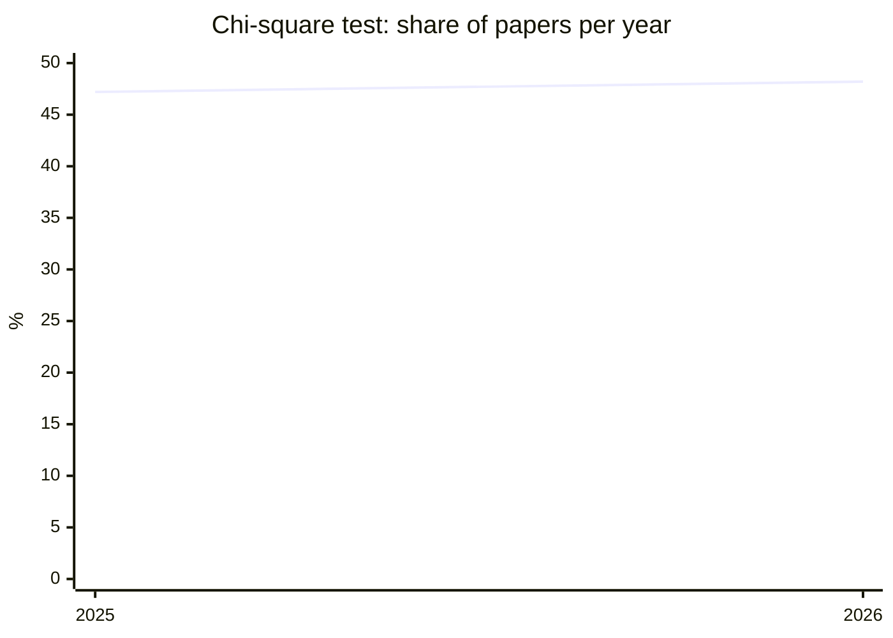
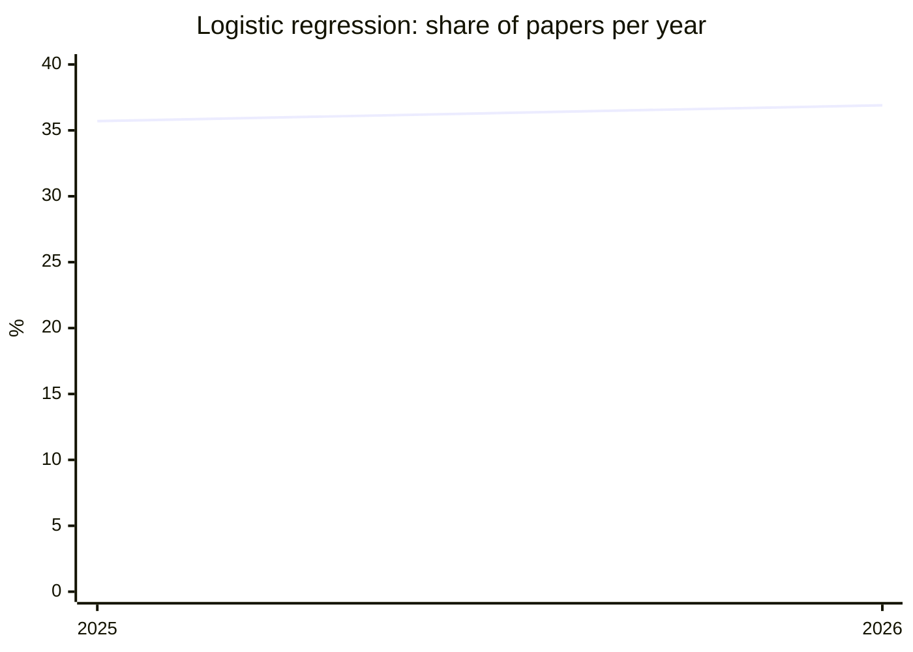
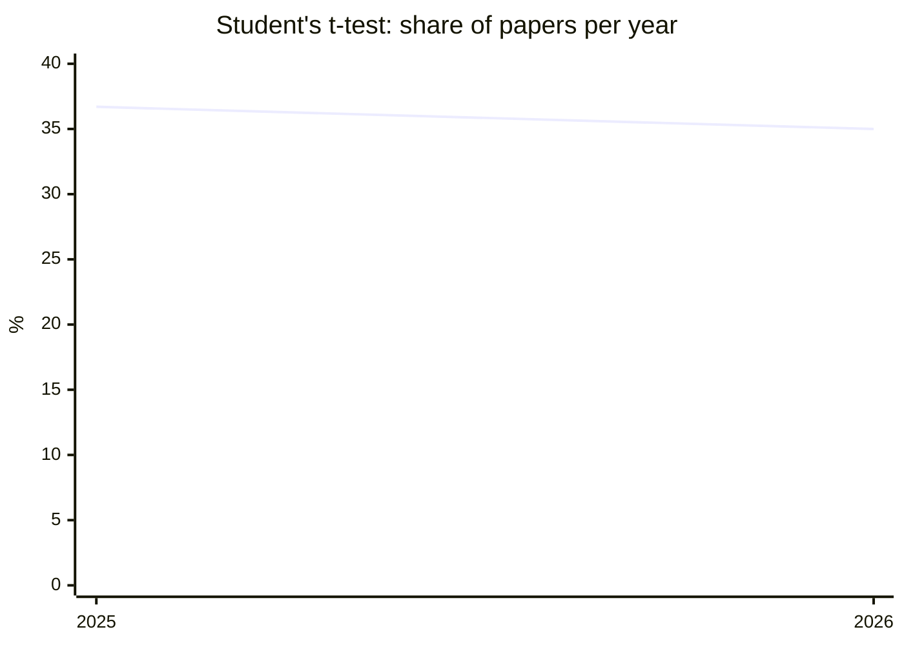
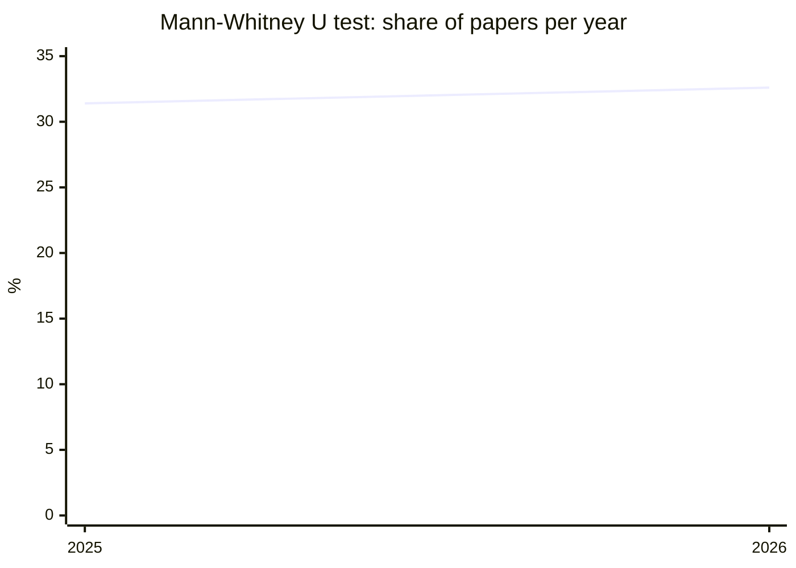
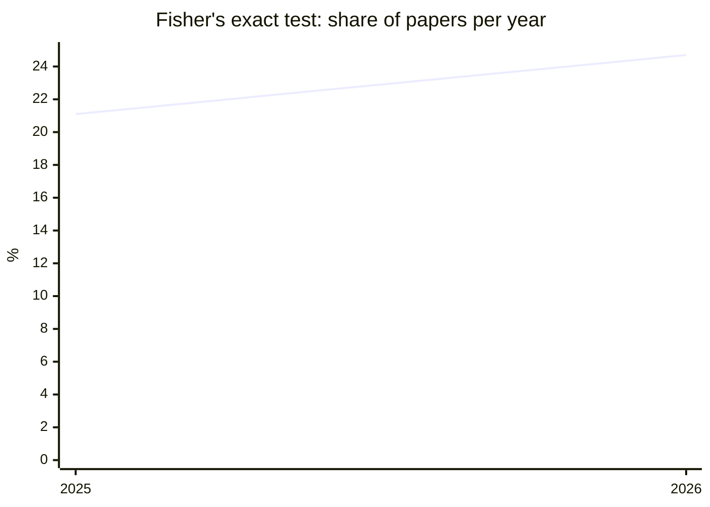

# Literature watch

Updated 2026-11-19. Round: 25 papers per field and publication month, 2016-10 to 2026-09.

Which statistical methods epidemiological research uses, from a random sample of open-access research articles in PubMed and PMC per field and month (no reviews). Claude lists each paper's methods from its abstract and methods section; only IDs, titles and the methods are stored.

## Progress

| Field | Months complete | Papers read |
|---|---|---|
| cardiovascular | 21 / 120 | 525 / 3000 |
| metabolic | 21 / 120 | 525 / 3000 |
| mental-health | 21 / 120 | 525 / 3000 |
| cancer | 21 / 120 | 525 / 3000 |
| respiratory-allergy | 21 / 120 | 525 / 3000 |
| infections | 20 / 120 | 500 / 3000 |
| pregnancy-child | 20 / 120 | 500 / 3000 |
| environment | 20 / 120 | 500 / 3000 |
| nutrition | 20 / 120 | 500 / 3000 |
| omics | 20 / 120 | 500 / 3000 |
| lifestyle | 20 / 120 | 500 / 3000 |
| **all** | 225 / 1320 | 5625 / 33000 |

## All fields

Papers read: 4753, 4675 of them usable (4675 of these in the last 36 months, which the order below is based on).

| Method | Share, last 3 years | Papers | 2016 | 2017 | 2018 | 2019 | 2020 | 2021 | 2022 | 2023 | 2024 | 2025 | 2026 | Trend | In DataSHIELD |
|---|---|---|---|---|---|---|---|---|---|---|---|---|---|---|---|
| Chi-square test | 48% | 2228 | – | – | – | – | – | – | – | – | – | 47% | 48% | – | – |
| Logistic regression | 36% | 1694 | – | – | – | – | – | – | – | – | – | 36% | 37% | – | – |
| Student's t-test | 36% | 1681 | – | – | – | – | – | – | – | – | – | 37% | 35% | – | – |
| Mann-Whitney U test | 32% | 1493 | – | – | – | – | – | – | – | – | – | 31% | 33% | – | – |
| Fisher's exact test | 23% | 1062 | – | – | – | – | – | – | – | – | – | 21% | 25% | – | – |
| Linear regression | 19% | 874 | – | – | – | – | – | – | – | – | – | 17% | 20% | – | – |
| Analysis of variance (ANOVA) | 16% | 750 | – | – | – | – | – | – | – | – | – | 16% | 16% | – | – |
| Cox proportional hazards regression | 16% | 726 | – | – | – | – | – | – | – | – | – | 15% | 17% | – | – |
| ROC curve analysis | 16% | 726 | – | – | – | – | – | – | – | – | – | 16% | 15% | – | – |
| Spearman's rank correlation | 13% | 610 | – | – | – | – | – | – | – | – | – | 12% | 14% | – | – |
| Kruskal-Wallis test | 12% | 563 | – | – | – | – | – | – | – | – | – | 11% | 13% | – | – |
| Shapiro-Wilk test | 12% | 559 | – | – | – | – | – | – | – | – | – | 12% | 12% | – | – |
| Pearson correlation | 12% | 557 | – | – | – | – | – | – | – | – | – | 13% | 11% | – | – |
| Kaplan-Meier estimator | 12% | 540 | – | – | – | – | – | – | – | – | – | 12% | 12% | – | – |
| false-discovery-rate-correction | 9% | 444 | – | – | – | – | – | – | – | – | – | 7% | 12% | – | – |
| Subgroup analysis | 9% | 425 | – | – | – | – | – | – | – | – | – | 9% | 9% | – | – |
| Variance inflation factor | 8% | 379 | – | – | – | – | – | – | – | – | – | 6% | 10% | – | – |
| Log-rank test | 8% | 353 | – | – | – | – | – | – | – | – | – | 7% | 8% | – | – |
| Multiple imputation | 7% | 315 | – | – | – | – | – | – | – | – | – | 6% | 8% | – | – |
| Restricted cubic splines | 7% | 312 | – | – | – | – | – | – | – | – | – | 7% | 7% | – | – |
| *papers read* | | | 0 | 0 | 0 | 0 | 0 | 0 | 0 | 0 | 0 | 2564 | 2111 | | |

**Variants named in at least 2 papers** (DataSHIELD may have the method but not the variant):

| Method | Variant | Papers | In DataSHIELD |
|---|---|---|---|
| false-discovery-rate-correction | benjamini-hochberg | 320 | – |
| Analysis of variance (ANOVA) | one-way | 317 | – |
| Student's t-test | independent samples | 255 | – |
| Student's t-test | paired | 166 | – |
| Multiple imputation | chained equations | 148 | – |
| Logistic regression | survey-weighted | 81 | – |
| Propensity score matching | caliper | 72 | – |
| gradient-boosting | xgboost implementation | 69 | – |
| Linear mixed model | random intercept | 68 | – |
| Cox proportional hazards regression | stratified | 60 | – |
| Linear mixed model | random intercepts | 56 | – |
| Analysis of variance (ANOVA) | covariate-adjusted (ancova) | 54 | – |
| Poisson regression | robust standard errors | 53 | – |
| Analysis of variance (ANOVA) | repeated measures | 52 | – |
| Mediation analysis | bootstrap confidence intervals | 52 | – |
| Student's t-test | welch unequal variances | 52 | – |
| Cox proportional hazards regression | time-varying covariates | 47 | – |
| Poisson regression | robust variance | 43 | – |
| LASSO regression | penalised (lasso) | 42 | – |
| ROC curve analysis | youden optimal cutoff | 41 | – |

## cardiovascular

Papers read: 438, 429 of them usable (429 of these in the last 36 months, which the order below is based on).

| Method | Share, last 3 years | Papers | 2016 | 2017 | 2018 | 2019 | 2020 | 2021 | 2022 | 2023 | 2024 | 2025 | 2026 | Trend | In DataSHIELD |
|---|---|---|---|---|---|---|---|---|---|---|---|---|---|---|---|
| Chi-square test | 58% | 249 | – | – | – | – | – | – | – | – | – | 56% | 60% | – | – |
| Mann-Whitney U test | 46% | 199 | – | – | – | – | – | – | – | – | – | 47% | 46% | – | – |
| Student's t-test | 42% | 182 | – | – | – | – | – | – | – | – | – | 44% | 40% | – | – |
| Logistic regression | 41% | 178 | – | – | – | – | – | – | – | – | – | 40% | 44% | – | – |
| Fisher's exact test | 34% | 144 | – | – | – | – | – | – | – | – | – | 32% | 36% | – | – |
| Cox proportional hazards regression | 24% | 102 | – | – | – | – | – | – | – | – | – | 21% | 27% | – | – |
| ROC curve analysis | 21% | 90 | – | – | – | – | – | – | – | – | – | 19% | 23% | – | – |
| Kaplan-Meier estimator | 20% | 85 | – | – | – | – | – | – | – | – | – | 21% | 19% | – | – |
| Analysis of variance (ANOVA) | 15% | 66 | – | – | – | – | – | – | – | – | – | 14% | 17% | – | – |
| Shapiro-Wilk test | 15% | 66 | – | – | – | – | – | – | – | – | – | 14% | 17% | – | – |
| *papers read* | | | 0 | 0 | 0 | 0 | 0 | 0 | 0 | 0 | 0 | 234 | 195 | | |

**Variants named in at least 2 papers** (DataSHIELD may have the method but not the variant):

| Method | Variant | Papers | In DataSHIELD |
|---|---|---|---|
| Analysis of variance (ANOVA) | one-way | 25 | – |
| Student's t-test | paired | 23 | – |
| Multiple imputation | chained equations | 20 | – |
| Student's t-test | independent samples | 18 | – |
| false-discovery-rate-correction | benjamini-hochberg | 13 | – |
| Propensity score matching | caliper | 7 | – |
| Student's t-test | welch unequal variances | 7 | – |
| gradient-boosting | xgboost implementation | 6 | – |
| Linear mixed model | random intercepts | 6 | – |
| Subgroup analysis | interaction terms | 6 | – |
| Test for trend | linear | 6 | – |
| Bootstrap | internal model validation | 5 | – |
| Cox proportional hazards regression | stratified | 5 | – |
| Generalized linear mixed model | logistic | 5 | – |
| Generalized linear mixed model | random intercept | 5 | – |
| Linear regression | stepwise | 5 | – |
| Logistic regression | survey-weighted | 5 | – |
| Subgroup analysis | interaction tests | 5 | – |
| Analysis of variance (ANOVA) | covariate-adjusted (ancova) | 4 | – |
| Analysis of variance (ANOVA) | repeated measures | 4 | – |

## metabolic

Papers read: 439, 436 of them usable (436 of these in the last 36 months, which the order below is based on).

| Method | Share, last 3 years | Papers | 2016 | 2017 | 2018 | 2019 | 2020 | 2021 | 2022 | 2023 | 2024 | 2025 | 2026 | Trend | In DataSHIELD |
|---|---|---|---|---|---|---|---|---|---|---|---|---|---|---|---|
| Chi-square test | 59% | 256 | – | – | – | – | – | – | – | – | – | 59% | 58% | – | – |
| Student's t-test | 47% | 203 | – | – | – | – | – | – | – | – | – | 47% | 46% | – | – |
| Logistic regression | 42% | 181 | – | – | – | – | – | – | – | – | – | 42% | 41% | – | – |
| Mann-Whitney U test | 34% | 150 | – | – | – | – | – | – | – | – | – | 34% | 35% | – | – |
| Analysis of variance (ANOVA) | 24% | 105 | – | – | – | – | – | – | – | – | – | 24% | 24% | – | – |
| Linear regression | 24% | 103 | – | – | – | – | – | – | – | – | – | 22% | 25% | – | – |
| Fisher's exact test | 21% | 92 | – | – | – | – | – | – | – | – | – | 20% | 23% | – | – |
| ROC curve analysis | 17% | 72 | – | – | – | – | – | – | – | – | – | 16% | 17% | – | – |
| Shapiro-Wilk test | 17% | 72 | – | – | – | – | – | – | – | – | – | 17% | 16% | – | – |
| Cox proportional hazards regression | 16% | 69 | – | – | – | – | – | – | – | – | – | 15% | 16% | – | – |
| *papers read* | | | 0 | 0 | 0 | 0 | 0 | 0 | 0 | 0 | 0 | 246 | 190 | | |

**Variants named in at least 2 papers** (DataSHIELD may have the method but not the variant):

| Method | Variant | Papers | In DataSHIELD |
|---|---|---|---|
| Analysis of variance (ANOVA) | one-way | 44 | – |
| Student's t-test | paired | 22 | – |
| Logistic regression | survey-weighted | 19 | – |
| false-discovery-rate-correction | benjamini-hochberg | 18 | – |
| Student's t-test | independent samples | 18 | – |
| Multiple imputation | chained equations | 15 | – |
| Analysis of variance (ANOVA) | covariate-adjusted (ancova) | 11 | – |
| Propensity score matching | caliper | 10 | – |
| Poisson regression | robust standard errors | 9 | – |
| Chi-square test | survey-weighted | 8 | – |
| Poisson regression | modified | 8 | – |
| Linear regression | survey-weighted | 7 | – |
| Linear mixed model | random intercept | 6 | – |
| Poisson regression | robust variance | 6 | – |
| Segmented (piecewise) regression | threshold effect | 6 | – |
| Student's t-test | survey-weighted | 6 | – |
| Analysis of variance (ANOVA) | repeated measures | 5 | – |
| gradient-boosting | xgboost implementation | 5 | – |
| Linear mixed model | random intercepts | 5 | – |
| Logistic regression | interaction terms | 5 | – |

## mental-health

Papers read: 439, 434 of them usable (434 of these in the last 36 months, which the order below is based on).

| Method | Share, last 3 years | Papers | 2016 | 2017 | 2018 | 2019 | 2020 | 2021 | 2022 | 2023 | 2024 | 2025 | 2026 | Trend | In DataSHIELD |
|---|---|---|---|---|---|---|---|---|---|---|---|---|---|---|---|
| Chi-square test | 46% | 199 | – | – | – | – | – | – | – | – | – | 45% | 47% | – | – |
| Student's t-test | 36% | 158 | – | – | – | – | – | – | – | – | – | 37% | 36% | – | – |
| Logistic regression | 32% | 141 | – | – | – | – | – | – | – | – | – | 32% | 34% | – | – |
| Linear regression | 23% | 99 | – | – | – | – | – | – | – | – | – | 20% | 26% | – | – |
| Mann-Whitney U test | 21% | 92 | – | – | – | – | – | – | – | – | – | 19% | 24% | – | – |
| Analysis of variance (ANOVA) | 19% | 81 | – | – | – | – | – | – | – | – | – | 20% | 18% | – | – |
| Pearson correlation | 16% | 68 | – | – | – | – | – | – | – | – | – | 18% | 13% | – | – |
| Fisher's exact test | 14% | 61 | – | – | – | – | – | – | – | – | – | 11% | 18% | – | – |
| ROC curve analysis | 13% | 58 | – | – | – | – | – | – | – | – | – | 13% | 13% | – | – |
| Spearman's rank correlation | 11% | 46 | – | – | – | – | – | – | – | – | – | 10% | 12% | – | – |
| *papers read* | | | 0 | 0 | 0 | 0 | 0 | 0 | 0 | 0 | 0 | 240 | 194 | | |

**Variants named in at least 2 papers** (DataSHIELD may have the method but not the variant):

| Method | Variant | Papers | In DataSHIELD |
|---|---|---|---|
| Student's t-test | independent samples | 33 | – |
| Analysis of variance (ANOVA) | one-way | 30 | – |
| false-discovery-rate-correction | benjamini-hochberg | 28 | – |
| Multiple imputation | chained equations | 21 | – |
| Student's t-test | paired | 15 | – |
| Analysis of variance (ANOVA) | covariate-adjusted (ancova) | 14 | – |
| Mediation analysis | bootstrap confidence intervals | 10 | – |
| Analysis of variance (ANOVA) | repeated measures | 9 | – |
| gradient-boosting | xgboost implementation | 8 | – |
| Linear mixed model | random intercepts | 8 | – |
| Poisson regression | robust standard errors | 8 | – |
| Propensity score matching | caliper | 8 | – |
| Cox proportional hazards regression | robust standard errors | 7 | – |
| Cox proportional hazards regression | stratified | 7 | – |
| Linear mixed model | random slopes | 7 | – |
| Cross-validation | k-fold | 6 | – |
| Linear mixed model | random intercept | 6 | – |
| Poisson regression | modified | 6 | – |
| Structural equation modeling | path analysis | 6 | – |
| Cox proportional hazards regression | time-varying covariates | 5 | – |

## cancer

Papers read: 440, 426 of them usable (426 of these in the last 36 months, which the order below is based on).

| Method | Share, last 3 years | Papers | 2016 | 2017 | 2018 | 2019 | 2020 | 2021 | 2022 | 2023 | 2024 | 2025 | 2026 | Trend | In DataSHIELD |
|---|---|---|---|---|---|---|---|---|---|---|---|---|---|---|---|
| Chi-square test | 48% | 205 | – | – | – | – | – | – | – | – | – | 47% | 50% | – | – |
| Kaplan-Meier estimator | 34% | 146 | – | – | – | – | – | – | – | – | – | 33% | 35% | – | – |
| Logistic regression | 34% | 145 | – | – | – | – | – | – | – | – | – | 35% | 33% | – | – |
| Mann-Whitney U test | 33% | 142 | – | – | – | – | – | – | – | – | – | 31% | 36% | – | – |
| Fisher's exact test | 31% | 131 | – | – | – | – | – | – | – | – | – | 27% | 35% | – | – |
| Student's t-test | 31% | 131 | – | – | – | – | – | – | – | – | – | 32% | 30% | – | – |
| Cox proportional hazards regression | 30% | 128 | – | – | – | – | – | – | – | – | – | 26% | 35% | – | – |
| Log-rank test | 25% | 106 | – | – | – | – | – | – | – | – | – | 25% | 25% | – | – |
| ROC curve analysis | 23% | 98 | – | – | – | – | – | – | – | – | – | 25% | 21% | – | – |
| Kruskal-Wallis test | 9% | 39 | – | – | – | – | – | – | – | – | – | 8% | 11% | – | – |
| *papers read* | | | 0 | 0 | 0 | 0 | 0 | 0 | 0 | 0 | 0 | 227 | 199 | | |

**Variants named in at least 2 papers** (DataSHIELD may have the method but not the variant):

| Method | Variant | Papers | In DataSHIELD |
|---|---|---|---|
| Analysis of variance (ANOVA) | one-way | 16 | – |
| false-discovery-rate-correction | benjamini-hochberg | 16 | – |
| Student's t-test | independent samples | 15 | – |
| Propensity score matching | caliper | 12 | – |
| Student's t-test | paired | 11 | – |
| gradient-boosting | xgboost implementation | 10 | – |
| Cox proportional hazards regression | stratified | 8 | – |
| Cross-validation | k-fold | 8 | – |
| gradient-boosting | lightgbm | 7 | – |
| ROC curve analysis | youden optimal cutoff | 7 | – |
| Bootstrap | internal model validation | 5 | – |
| Cox proportional hazards regression | time-varying covariates | 5 | – |
| Concordance index (C-index) | harrell's | 4 | – |
| Cox proportional hazards regression | robust standard errors | 4 | – |
| Cross-validation | nested | 4 | – |
| Cross-validation | stratified | 4 | – |
| Generalized estimating equations | exchangeable correlation | 4 | – |
| Kaplan-Meier estimator | reverse (follow-up time) | 4 | – |
| LASSO regression | penalised (lasso) | 4 | – |
| Linear mixed model | random intercept | 4 | – |

## respiratory-allergy

Papers read: 439, 435 of them usable (435 of these in the last 36 months, which the order below is based on).

| Method | Share, last 3 years | Papers | 2016 | 2017 | 2018 | 2019 | 2020 | 2021 | 2022 | 2023 | 2024 | 2025 | 2026 | Trend | In DataSHIELD |
|---|---|---|---|---|---|---|---|---|---|---|---|---|---|---|---|
| Chi-square test | 53% | 231 | – | – | – | – | – | – | – | – | – | 55% | 50% | – | – |
| Logistic regression | 41% | 179 | – | – | – | – | – | – | – | – | – | 41% | 41% | – | – |
| Mann-Whitney U test | 39% | 170 | – | – | – | – | – | – | – | – | – | 43% | 35% | – | – |
| Student's t-test | 38% | 167 | – | – | – | – | – | – | – | – | – | 39% | 38% | – | – |
| Fisher's exact test | 33% | 142 | – | – | – | – | – | – | – | – | – | 31% | 35% | – | – |
| ROC curve analysis | 23% | 99 | – | – | – | – | – | – | – | – | – | 24% | 21% | – | – |
| Kaplan-Meier estimator | 23% | 98 | – | – | – | – | – | – | – | – | – | 24% | 20% | – | – |
| Cox proportional hazards regression | 22% | 95 | – | – | – | – | – | – | – | – | – | 22% | 22% | – | – |
| Analysis of variance (ANOVA) | 15% | 66 | – | – | – | – | – | – | – | – | – | 16% | 14% | – | – |
| Pearson correlation | 14% | 62 | – | – | – | – | – | – | – | – | – | 14% | 15% | – | – |
| *papers read* | | | 0 | 0 | 0 | 0 | 0 | 0 | 0 | 0 | 0 | 238 | 197 | | |

**Variants named in at least 2 papers** (DataSHIELD may have the method but not the variant):

| Method | Variant | Papers | In DataSHIELD |
|---|---|---|---|
| Analysis of variance (ANOVA) | one-way | 29 | – |
| Student's t-test | independent samples | 23 | – |
| gradient-boosting | xgboost implementation | 13 | – |
| LASSO regression | penalised (lasso) | 12 | – |
| Propensity score matching | caliper | 12 | – |
| Student's t-test | paired | 12 | – |
| false-discovery-rate-correction | benjamini-hochberg | 10 | – |
| Multiple imputation | chained equations | 10 | – |
| Logistic regression | stepwise selection | 7 | – |
| Bootstrap | internal model validation | 6 | – |
| Cox proportional hazards regression | stratified | 6 | – |
| LASSO regression | logistic | 6 | – |
| Student's t-test | unpaired | 6 | – |
| Analysis of variance (ANOVA) | two-way | 5 | – |
| Cox proportional hazards regression | time-varying covariates | 5 | – |
| Linear mixed model | random intercept | 5 | – |
| Student's t-test | welch unequal variances | 5 | – |
| Cross-validation | stratified | 4 | – |
| Propensity score matching | 1:1 | 4 | – |
| ROC curve analysis | youden optimal cutoff | 4 | – |

## infections

Papers read: 441, 431 of them usable (431 of these in the last 36 months, which the order below is based on).

| Method | Share, last 3 years | Papers | 2016 | 2017 | 2018 | 2019 | 2020 | 2021 | 2022 | 2023 | 2024 | 2025 | 2026 | Trend | In DataSHIELD |
|---|---|---|---|---|---|---|---|---|---|---|---|---|---|---|---|
| Chi-square test | 53% | 227 | – | – | – | – | – | – | – | – | – | 53% | 52% | – | – |
| Logistic regression | 42% | 180 | – | – | – | – | – | – | – | – | – | 40% | 44% | – | – |
| Fisher's exact test | 34% | 145 | – | – | – | – | – | – | – | – | – | 30% | 38% | – | – |
| Mann-Whitney U test | 33% | 142 | – | – | – | – | – | – | – | – | – | 31% | 36% | – | – |
| Student's t-test | 29% | 124 | – | – | – | – | – | – | – | – | – | 29% | 28% | – | – |
| ROC curve analysis | 13% | 57 | – | – | – | – | – | – | – | – | – | 13% | 14% | – | – |
| Cox proportional hazards regression | 12% | 53 | – | – | – | – | – | – | – | – | – | 13% | 11% | – | – |
| Linear regression | 11% | 47 | – | – | – | – | – | – | – | – | – | 12% | 10% | – | – |
| Analysis of variance (ANOVA) | 11% | 46 | – | – | – | – | – | – | – | – | – | 11% | 11% | – | – |
| Kaplan-Meier estimator | 10% | 45 | – | – | – | – | – | – | – | – | – | 10% | 11% | – | – |
| *papers read* | | | 0 | 0 | 0 | 0 | 0 | 0 | 0 | 0 | 0 | 242 | 189 | | |

**Variants named in at least 2 papers** (DataSHIELD may have the method but not the variant):

| Method | Variant | Papers | In DataSHIELD |
|---|---|---|---|
| Analysis of variance (ANOVA) | one-way | 21 | – |
| Student's t-test | independent samples | 18 | – |
| false-discovery-rate-correction | benjamini-hochberg | 13 | – |
| Multiple imputation | chained equations | 11 | – |
| Student's t-test | paired | 11 | – |
| Poisson regression | robust standard errors | 7 | – |
| Segmented (piecewise) regression | interrupted time series | 7 | – |
| gradient-boosting | xgboost implementation | 6 | – |
| Phylogenetic analysis | maximum likelihood | 6 | – |
| ROC curve analysis | youden optimal cutoff | 6 | – |
| Linear regression | log-transformed outcome | 5 | – |
| Logistic regression | forward stepwise selection | 5 | – |
| Logistic regression | survey-weighted | 5 | – |
| Poisson regression | robust variance | 5 | – |
| Propensity score matching | caliper | 5 | – |
| Cox proportional hazards regression | stratified | 4 | – |
| Cox proportional hazards regression | time-varying covariates | 4 | – |
| Linear mixed model | random intercept | 4 | – |
| Phylogenetic analysis | bootstrap | 4 | – |
| Poisson regression | modified | 4 | – |

## pregnancy-child

Papers read: 435, 427 of them usable (427 of these in the last 36 months, which the order below is based on).

| Method | Share, last 3 years | Papers | 2016 | 2017 | 2018 | 2019 | 2020 | 2021 | 2022 | 2023 | 2024 | 2025 | 2026 | Trend | In DataSHIELD |
|---|---|---|---|---|---|---|---|---|---|---|---|---|---|---|---|
| Chi-square test | 46% | 196 | – | – | – | – | – | – | – | – | – | 49% | 42% | – | – |
| Logistic regression | 45% | 193 | – | – | – | – | – | – | – | – | – | 44% | 47% | – | – |
| Student's t-test | 37% | 157 | – | – | – | – | – | – | – | – | – | 41% | 32% | – | – |
| Mann-Whitney U test | 30% | 126 | – | – | – | – | – | – | – | – | – | 32% | 26% | – | – |
| Fisher's exact test | 26% | 110 | – | – | – | – | – | – | – | – | – | 28% | 24% | – | – |
| Linear regression | 16% | 68 | – | – | – | – | – | – | – | – | – | 15% | 17% | – | – |
| Analysis of variance (ANOVA) | 14% | 60 | – | – | – | – | – | – | – | – | – | 15% | 13% | – | – |
| ROC curve analysis | 14% | 58 | – | – | – | – | – | – | – | – | – | 16% | 11% | – | – |
| Kruskal-Wallis test | 11% | 46 | – | – | – | – | – | – | – | – | – | 10% | 11% | – | – |
| Shapiro-Wilk test | 11% | 46 | – | – | – | – | – | – | – | – | – | 12% | 9% | – | – |
| *papers read* | | | 0 | 0 | 0 | 0 | 0 | 0 | 0 | 0 | 0 | 225 | 202 | | |

**Variants named in at least 2 papers** (DataSHIELD may have the method but not the variant):

| Method | Variant | Papers | In DataSHIELD |
|---|---|---|---|
| Analysis of variance (ANOVA) | one-way | 30 | – |
| Student's t-test | independent samples | 23 | – |
| false-discovery-rate-correction | benjamini-hochberg | 16 | – |
| Student's t-test | paired | 13 | – |
| Poisson regression | robust standard errors | 9 | – |
| Multiple imputation | chained equations | 8 | – |
| Poisson regression | modified | 6 | – |
| Poisson regression | robust variance | 6 | – |
| Propensity score matching | caliper | 6 | – |
| Bootstrap | internal validation | 5 | – |
| LASSO regression | penalised (lasso) | 5 | – |
| Linear mixed model | random intercepts | 5 | – |
| Logistic regression | stratified | 5 | – |
| Analysis of variance (ANOVA) | covariate-adjusted (ancova) | 4 | – |
| Cox proportional hazards regression | robust standard errors | 4 | – |
| Generalized linear mixed model | logistic | 4 | – |
| Generalized linear mixed model | random intercept | 4 | – |
| gradient-boosting | xgboost implementation | 4 | – |
| Logistic regression | cluster-robust standard errors | 4 | – |
| Logistic regression | forward stepwise selection | 4 | – |

## environment

Papers read: 432, 428 of them usable (428 of these in the last 36 months, which the order below is based on).

| Method | Share, last 3 years | Papers | 2016 | 2017 | 2018 | 2019 | 2020 | 2021 | 2022 | 2023 | 2024 | 2025 | 2026 | Trend | In DataSHIELD |
|---|---|---|---|---|---|---|---|---|---|---|---|---|---|---|---|
| Chi-square test | 34% | 147 | – | – | – | – | – | – | – | – | – | 33% | 36% | – | – |
| Logistic regression | 32% | 137 | – | – | – | – | – | – | – | – | – | 29% | 36% | – | – |
| Linear regression | 26% | 113 | – | – | – | – | – | – | – | – | – | 25% | 29% | – | – |
| Student's t-test | 25% | 105 | – | – | – | – | – | – | – | – | – | 27% | 22% | – | – |
| Mann-Whitney U test | 22% | 93 | – | – | – | – | – | – | – | – | – | 21% | 22% | – | – |
| Spearman's rank correlation | 18% | 78 | – | – | – | – | – | – | – | – | – | 17% | 19% | – | – |
| Subgroup analysis | 16% | 68 | – | – | – | – | – | – | – | – | – | 17% | 15% | – | – |
| Cox proportional hazards regression | 15% | 65 | – | – | – | – | – | – | – | – | – | 15% | 15% | – | – |
| Restricted cubic splines | 14% | 59 | – | – | – | – | – | – | – | – | – | 16% | 11% | – | – |
| Fisher's exact test | 13% | 54 | – | – | – | – | – | – | – | – | – | 11% | 14% | – | – |
| *papers read* | | | 0 | 0 | 0 | 0 | 0 | 0 | 0 | 0 | 0 | 236 | 192 | | |

**Variants named in at least 2 papers** (DataSHIELD may have the method but not the variant):

| Method | Variant | Papers | In DataSHIELD |
|---|---|---|---|
| false-discovery-rate-correction | benjamini-hochberg | 33 | – |
| Multiple imputation | chained equations | 29 | – |
| Analysis of variance (ANOVA) | one-way | 19 | – |
| Student's t-test | independent samples | 18 | – |
| Student's t-test | paired | 14 | – |
| Cox proportional hazards regression | time-varying covariates | 13 | – |
| Cox proportional hazards regression | stratified | 11 | – |
| Linear mixed model | random intercept | 10 | – |
| Cox proportional hazards regression | age as time scale | 9 | – |
| Interaction analysis | stratified | 8 | – |
| Interaction analysis | interaction terms | 7 | – |
| Linear mixed model | random intercepts | 6 | – |
| Logistic regression | survey-weighted | 5 | – |
| Logistic regression | unconditional | 5 | – |
| Poisson regression | robust standard errors | 5 | – |
| Standardized incidence ratio | mortality ratio | 5 | – |
| Generalized linear mixed model | random intercepts | 4 | – |
| gradient-boosting | xgboost implementation | 4 | – |
| Linear regression | robust standard errors | 4 | – |
| Linear regression | survey-weighted | 4 | – |

## nutrition

Papers read: 447, 445 of them usable (445 of these in the last 36 months, which the order below is based on).

| Method | Share, last 3 years | Papers | 2016 | 2017 | 2018 | 2019 | 2020 | 2021 | 2022 | 2023 | 2024 | 2025 | 2026 | Trend | In DataSHIELD |
|---|---|---|---|---|---|---|---|---|---|---|---|---|---|---|---|
| Chi-square test | 57% | 253 | – | – | – | – | – | – | – | – | – | 54% | 61% | – | – |
| Student's t-test | 37% | 166 | – | – | – | – | – | – | – | – | – | 34% | 41% | – | – |
| Logistic regression | 37% | 164 | – | – | – | – | – | – | – | – | – | 38% | 35% | – | – |
| Linear regression | 29% | 131 | – | – | – | – | – | – | – | – | – | 26% | 34% | – | – |
| Mann-Whitney U test | 25% | 112 | – | – | – | – | – | – | – | – | – | 23% | 27% | – | – |
| Analysis of variance (ANOVA) | 23% | 104 | – | – | – | – | – | – | – | – | – | 22% | 25% | – | – |
| Cox proportional hazards regression | 17% | 77 | – | – | – | – | – | – | – | – | – | 18% | 16% | – | – |
| Fisher's exact test | 17% | 75 | – | – | – | – | – | – | – | – | – | 17% | 17% | – | – |
| Shapiro-Wilk test | 16% | 73 | – | – | – | – | – | – | – | – | – | 15% | 18% | – | – |
| Kruskal-Wallis test | 16% | 69 | – | – | – | – | – | – | – | – | – | 16% | 15% | – | – |
| *papers read* | | | 0 | 0 | 0 | 0 | 0 | 0 | 0 | 0 | 0 | 241 | 204 | | |

**Variants named in at least 2 papers** (DataSHIELD may have the method but not the variant):

| Method | Variant | Papers | In DataSHIELD |
|---|---|---|---|
| Analysis of variance (ANOVA) | one-way | 37 | – |
| Student's t-test | independent samples | 30 | – |
| false-discovery-rate-correction | benjamini-hochberg | 23 | – |
| Logistic regression | survey-weighted | 21 | – |
| Student's t-test | paired | 15 | – |
| Principal component analysis | varimax rotation | 13 | – |
| Multiple imputation | chained equations | 11 | – |
| Analysis of variance (ANOVA) | covariate-adjusted (ancova) | 8 | – |
| Cox proportional hazards regression | stratified | 8 | – |
| Chi-square test | survey-weighted | 7 | – |
| Cox proportional hazards regression | time-varying covariates | 7 | – |
| Linear mixed model | random intercept | 7 | – |
| Analysis of variance (ANOVA) | repeated measures | 6 | – |
| Linear regression | robust standard errors | 6 | – |
| Logistic regression | survey weights | 6 | – |
| Mediation analysis | bootstrap confidence intervals | 6 | – |
| Poisson regression | robust variance | 6 | – |
| Analysis of variance (ANOVA) | covariate adjusted | 5 | – |
| Exploratory factor analysis | varimax rotation | 5 | – |
| LASSO regression | penalised (lasso) | 5 | – |

## omics

Papers read: 433, 421 of them usable (421 of these in the last 36 months, which the order below is based on).

| Method | Share, last 3 years | Papers | 2016 | 2017 | 2018 | 2019 | 2020 | 2021 | 2022 | 2023 | 2024 | 2025 | 2026 | Trend | In DataSHIELD |
|---|---|---|---|---|---|---|---|---|---|---|---|---|---|---|---|
| Mann-Whitney U test | 49% | 208 | – | – | – | – | – | – | – | – | – | 46% | 53% | – | – |
| false-discovery-rate-correction | 47% | 198 | – | – | – | – | – | – | – | – | – | 42% | 54% | – | – |
| Student's t-test | 41% | 173 | – | – | – | – | – | – | – | – | – | 44% | 38% | – | – |
| Chi-square test | 33% | 140 | – | – | – | – | – | – | – | – | – | 32% | 34% | – | – |
| Spearman's rank correlation | 31% | 131 | – | – | – | – | – | – | – | – | – | 30% | 33% | – | – |
| PERMANOVA | 31% | 130 | – | – | – | – | – | – | – | – | – | 28% | 35% | – | – |
| ROC curve analysis | 29% | 121 | – | – | – | – | – | – | – | – | – | 30% | 27% | – | – |
| Kruskal-Wallis test | 26% | 111 | – | – | – | – | – | – | – | – | – | 26% | 27% | – | – |
| Principal coordinates analysis | 26% | 109 | – | – | – | – | – | – | – | – | – | 26% | 26% | – | – |
| Linear regression | 21% | 89 | – | – | – | – | – | – | – | – | – | 21% | 22% | – | – |
| *papers read* | | | 0 | 0 | 0 | 0 | 0 | 0 | 0 | 0 | 0 | 231 | 190 | | |

**Variants named in at least 2 papers** (DataSHIELD may have the method but not the variant):

| Method | Variant | Papers | In DataSHIELD |
|---|---|---|---|
| false-discovery-rate-correction | benjamini-hochberg | 143 | – |
| Analysis of variance (ANOVA) | one-way | 36 | – |
| Student's t-test | welch unequal variances | 18 | – |
| Linear mixed model | random intercept | 14 | – |
| Principal coordinates analysis | bray-curtis distance | 11 | – |
| Student's t-test | paired | 11 | – |
| Alpha diversity analysis | shannon index | 10 | – |
| gradient-boosting | xgboost implementation | 10 | – |
| Student's t-test | independent samples | 10 | – |
| Network analysis (graphical models) | co-occurrence | 9 | – |
| Pathway enrichment analysis | kegg | 9 | – |
| Cross-validation | nested | 7 | – |
| Cross-validation | repeated | 7 | – |
| Cross-validation | stratified | 7 | – |
| DESeq2 differential expression analysis | differential abundance | 7 | – |
| Linear mixed model | random intercepts | 7 | – |
| Logistic regression | survey-weighted | 7 | – |
| Multiple imputation | chained equations | 7 | – |
| Cross-validation | k-fold | 6 | – |
| Cross-validation | leave-one-out | 6 | – |

## lifestyle

Papers read: 438, 429 of them usable (429 of these in the last 36 months, which the order below is based on).

| Method | Share, last 3 years | Papers | 2016 | 2017 | 2018 | 2019 | 2020 | 2021 | 2022 | 2023 | 2024 | 2025 | 2026 | Trend | In DataSHIELD |
|---|---|---|---|---|---|---|---|---|---|---|---|---|---|---|---|
| Chi-square test | 37% | 159 | – | – | – | – | – | – | – | – | – | 35% | 39% | – | – |
| Logistic regression | 33% | 142 | – | – | – | – | – | – | – | – | – | 35% | 31% | – | – |
| Student's t-test | 33% | 141 | – | – | – | – | – | – | – | – | – | 31% | 35% | – | – |
| Linear regression | 24% | 101 | – | – | – | – | – | – | – | – | – | 22% | 26% | – | – |
| Mann-Whitney U test | 20% | 84 | – | – | – | – | – | – | – | – | – | 19% | 20% | – | – |
| Analysis of variance (ANOVA) | 17% | 75 | – | – | – | – | – | – | – | – | – | 18% | 17% | – | – |
| Pearson correlation | 15% | 64 | – | – | – | – | – | – | – | – | – | 14% | 16% | – | – |
| Spearman's rank correlation | 13% | 54 | – | – | – | – | – | – | – | – | – | 12% | 13% | – | – |
| Shapiro-Wilk test | 12% | 52 | – | – | – | – | – | – | – | – | – | 12% | 13% | – | – |
| Variance inflation factor | 12% | 50 | – | – | – | – | – | – | – | – | – | 9% | 15% | – | – |
| *papers read* | | | 0 | 0 | 0 | 0 | 0 | 0 | 0 | 0 | 0 | 240 | 189 | | |

**Variants named in at least 2 papers** (DataSHIELD may have the method but not the variant):

| Method | Variant | Papers | In DataSHIELD |
|---|---|---|---|
| Student's t-test | independent samples | 51 | – |
| Analysis of variance (ANOVA) | one-way | 34 | – |
| Student's t-test | paired | 22 | – |
| Multiple imputation | chained equations | 15 | – |
| false-discovery-rate-correction | benjamini-hochberg | 12 | – |
| Logistic regression | survey-weighted | 12 | – |
| Analysis of variance (ANOVA) | repeated measures | 11 | – |
| Mediation analysis | bootstrap confidence intervals | 11 | – |
| Poisson regression | robust variance | 10 | – |
| Linear mixed model | random intercepts | 9 | – |
| Linear mixed model | random intercept | 8 | – |
| Analysis of variance (ANOVA) | covariate-adjusted (ancova) | 6 | – |
| Cox proportional hazards regression | stratified | 6 | – |
| Mediation analysis | bootstrap | 6 | – |
| Poisson regression | modified | 6 | – |
| Poisson regression | robust standard errors | 6 | – |
| Segmented (piecewise) regression | threshold effect | 6 | – |
| Generalized linear mixed model | random intercept | 5 | – |
| Linear mixed model | interaction terms | 5 | – |
| Linear regression | hierarchical blockwise entry | 5 | – |

## Searches

| Field | Version | Search |
|---|---|---|
| cardiovascular | `2b21c0b8` | `"Epidemiologic Studies"[MeSH Terms] AND ("Cardiovascular Diseases"[majr]) AND "pubmed pmc open access"[filter] NOT (review[pt] OR systematic review[pt] OR meta-analysis[pt])` |
| metabolic | `d26e1bd5` | `"Epidemiologic Studies"[MeSH Terms] AND ("Nutritional and Metabolic Diseases"[majr]) AND "pubmed pmc open access"[filter] NOT (review[pt] OR systematic review[pt] OR meta-analysis[pt])` |
| mental-health | `49157751` | `"Epidemiologic Studies"[MeSH Terms] AND ("Mental Disorders"[majr]) AND "pubmed pmc open access"[filter] NOT (review[pt] OR systematic review[pt] OR meta-analysis[pt])` |
| cancer | `3e24eb6c` | `"Epidemiologic Studies"[MeSH Terms] AND ("Neoplasms"[majr]) AND "pubmed pmc open access"[filter] NOT (review[pt] OR systematic review[pt] OR meta-analysis[pt])` |
| respiratory-allergy | `2b88ada3` | `"Epidemiologic Studies"[MeSH Terms] AND (("Respiratory Tract Diseases"[majr] OR "Hypersensitivity"[majr]) NOT "Respiratory Tract Infections"[majr]) AND "pubmed pmc open access"[filter] NOT (review[pt] OR systematic review[pt] OR meta-analysis[pt])` |
| infections | `5ffaa918` | `"Epidemiologic Studies"[MeSH Terms] AND ("Infections"[majr]) AND "pubmed pmc open access"[filter] NOT (review[pt] OR systematic review[pt] OR meta-analysis[pt])` |
| pregnancy-child | `7287be76` | `"Epidemiologic Studies"[MeSH Terms] AND ("Pregnancy Complications"[majr] OR "Prenatal Exposure Delayed Effects"[majr] OR "Child Development"[majr] OR "Infant, Newborn, Diseases"[majr]) AND "pubmed pmc open access"[filter] NOT (review[pt] OR systematic review[pt] OR meta-analysis[pt])` |
| environment | `5e248b92` | `"Epidemiologic Studies"[MeSH Terms] AND ("Environmental Exposure"[majr] OR "Environmental Pollutants"[majr] OR "Air Pollution"[majr] OR "Noise"[majr] OR "Built Environment"[majr]) AND "pubmed pmc open access"[filter] NOT (review[pt] OR systematic review[pt] OR meta-analysis[pt])` |
| nutrition | `e3ba59b3` | `"Epidemiologic Studies"[MeSH Terms] AND ("Diet"[majr] OR "Nutritional Status"[majr] OR "Feeding Behavior"[majr]) AND "pubmed pmc open access"[filter] NOT (review[pt] OR systematic review[pt] OR meta-analysis[pt])` |
| omics | `88c8ab9a` | `"Epidemiologic Studies"[MeSH Terms] AND ("Genomics"[majr] OR "Epigenomics"[majr] OR "Metabolomics"[majr] OR "Proteomics"[majr] OR "Multiomics"[majr] OR "Microbiota"[majr]) AND "pubmed pmc open access"[filter] NOT (review[pt] OR systematic review[pt] OR meta-analysis[pt])` |
| lifestyle | `d8a73a12` | `"Epidemiologic Studies"[MeSH Terms] AND ("Exercise"[majr] OR "Sedentary Behavior"[majr] OR "Smoking"[majr] OR "Alcohol Drinking"[majr] OR "Sleep"[majr]) AND "pubmed pmc open access"[filter] NOT (review[pt] OR systematic review[pt] OR meta-analysis[pt])` |

_Notes: shares are per year of publication; all fields dip in 2022-2023, most likely NLM's switch to automated MeSH indexing, so read changes around those years with care. Method names are merged by the vocabulary (`vocabulary.yml`, Claude); names not classified yet are shown as the papers gave them. "In DataSHIELD" is Claude's verdict against the functions' documentation in the package catalogue, with the function it found; "partly" means the plain method or only some of it, "no (in development)" a match only in a development package, "unconfirmed" an answer whose evidence didn't check out, "–" not checked yet (fewer papers than the threshold)._
