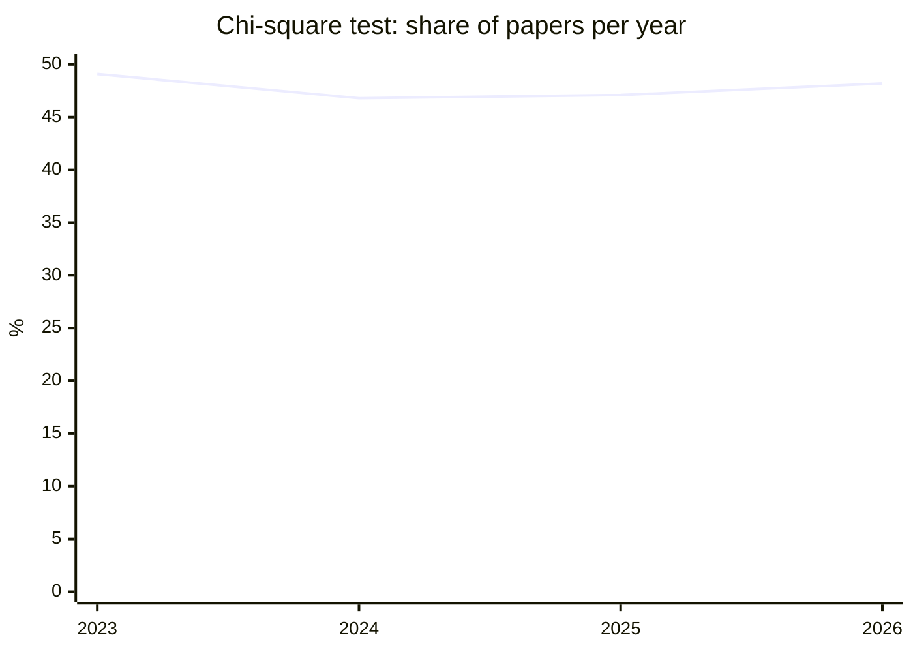
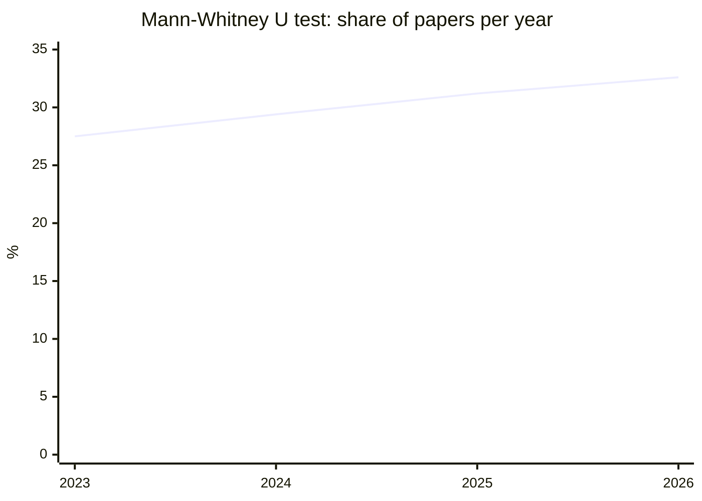
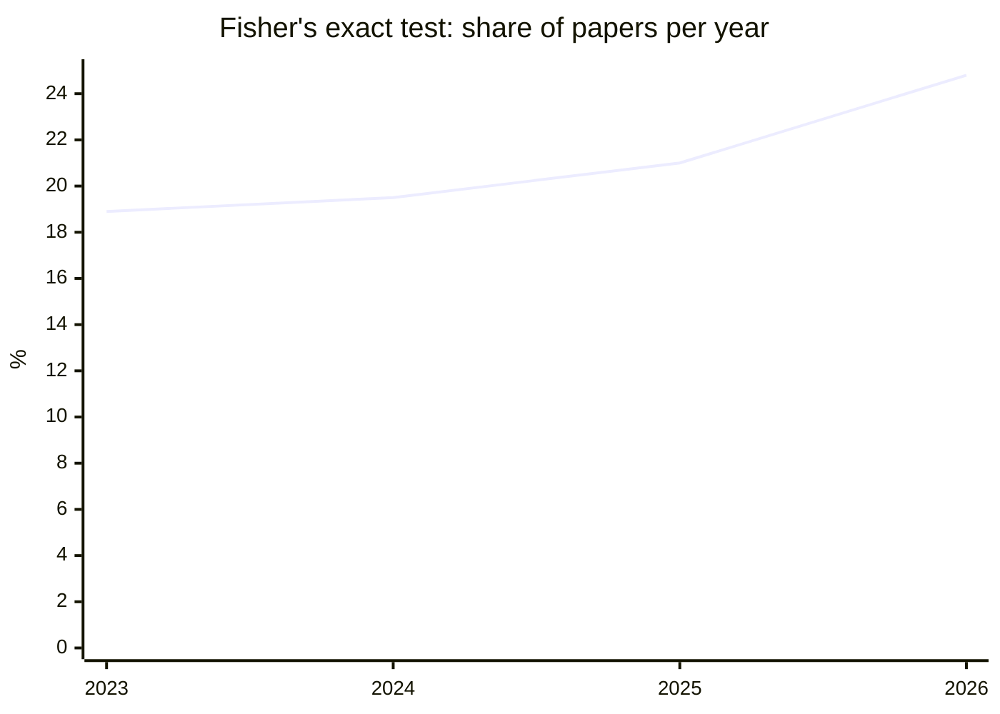

# Literature watch

Updated 2026-11-22. Round: 25 papers per field and publication month, 2016-10 to 2026-09.

Which statistical methods epidemiological research uses, from a random sample of open-access research articles in PubMed and PMC per field and month (no reviews). Claude lists each paper's methods from its abstract and methods section; only IDs, titles and the methods are stored.

## Progress

| Field | Months complete | Papers read |
|---|---|---|
| cardiovascular | 35 / 120 | 875 / 3000 |
| metabolic | 35 / 120 | 875 / 3000 |
| mental-health | 35 / 120 | 875 / 3000 |
| cancer | 34 / 120 | 862 / 3000 |
| respiratory-allergy | 34 / 120 | 850 / 3000 |
| infections | 34 / 120 | 850 / 3000 |
| pregnancy-child | 34 / 120 | 850 / 3000 |
| environment | 34 / 120 | 850 / 3000 |
| nutrition | 34 / 120 | 850 / 3000 |
| omics | 34 / 120 | 850 / 3000 |
| lifestyle | 34 / 120 | 850 / 3000 |
| **all** | 377 / 1320 | 9437 / 33000 |

## All fields

Papers read: 7746, 7601 of them usable (7601 of these in the last 36 months, which the order below is based on).

| Method | Share, last 3 years | Papers | 2016 | 2017 | 2018 | 2019 | 2020 | 2021 | 2022 | 2023 | 2024 | 2025 | 2026 | Trend | In DataSHIELD |
|---|---|---|---|---|---|---|---|---|---|---|---|---|---|---|---|
| Chi-square test | 47% | 3600 | – | – | – | – | – | – | – | 49% | 47% | 47% | 48% | steady | – |
| Student's t-test | 35% | 2681 | – | – | – | – | – | – | – | 36% | 34% | 36% | 35% | steady | – |
| Logistic regression | 31% | 2370 | – | – | – | – | – | – | – | 29% | 30% | 32% | 32% | rising | – |
| Mann-Whitney U test | 31% | 2344 | – | – | – | – | – | – | – | 27% | 29% | 31% | 33% | rising | – |
| Fisher's exact test | 21% | 1631 | – | – | – | – | – | – | – | 19% | 19% | 21% | 25% | rising | – |
| Linear regression | 18% | 1331 | – | – | – | – | – | – | – | 14% | 16% | 17% | 20% | rising | – |
| Analysis of variance (ANOVA) | 15% | 1162 | – | – | – | – | – | – | – | 14% | 16% | 15% | 15% | steady | – |
| Cox proportional hazards regression | 14% | 1102 | – | – | – | – | – | – | – | 16% | 14% | 14% | 16% | steady | – |
| ROC curve analysis | 14% | 1085 | – | – | – | – | – | – | – | 13% | 12% | 16% | 15% | rising | – |
| Spearman's rank correlation | 12% | 916 | – | – | – | – | – | – | – | 11% | 10% | 13% | 14% | rising | – |
| Kruskal-Wallis test | 12% | 898 | – | – | – | – | – | – | – | 10% | 12% | 11% | 13% | steady | – |
| Kaplan-Meier estimator | 12% | 880 | – | – | – | – | – | – | – | 13% | 11% | 11% | 12% | steady | – |
| Pearson correlation | 11% | 859 | – | – | – | – | – | – | – | 8% | 11% | 13% | 11% | steady | – |
| Shapiro-Wilk test | 10% | 796 | – | – | – | – | – | – | – | 6% | 8% | 12% | 12% | rising | – |
| Subgroup analysis | 9% | 655 | – | – | – | – | – | – | – | 5% | 8% | 9% | 9% | rising | – |
| false-discovery-rate-correction | 8% | 628 | – | – | – | – | – | – | – | 5% | 6% | 7% | 12% | rising | – |
| Log-rank test | 8% | 590 | – | – | – | – | – | – | – | 8% | 8% | 7% | 8% | steady | – |
| Kolmogorov-Smirnov test | 7% | 497 | – | – | – | – | – | – | – | 7% | 7% | 7% | 5% | steady | – |
| Variance inflation factor | 6% | 476 | – | – | – | – | – | – | – | 3% | 3% | 6% | 10% | rising | – |
| Multiple imputation | 6% | 456 | – | – | – | – | – | – | – | 5% | 5% | 6% | 8% | rising | – |
| *papers read* | | | 0 | 0 | 0 | 0 | 0 | 0 | 0 | 291 | 2583 | 2619 | 2108 | | |

**Variants named in at least 2 papers** (DataSHIELD may have the method but not the variant):

| Method | Variant | Papers | In DataSHIELD |
|---|---|---|---|
| Student's t-test | Independent samples | 484 | – |
| Analysis of variance (ANOVA) | One-way ANOVA | 462 | – |
| false-discovery-rate-correction | benjamini-hochberg | 435 | – |
| Student's t-test | Paired samples | 284 | – |
| Multiple imputation | chained equations | 205 | – |
| Logistic regression | Survey-weighted | 174 | – |
| Propensity score matching | caliper | 107 | – |
| Analysis of variance (ANOVA) | Analysis of covariance | 106 | – |
| Cox proportional hazards regression | Stratified baseline hazards | 106 | – |
| Student's t-test | Welch unequal variances | 103 | – |
| Linear mixed model | random intercept | 92 | – |
| Linear mixed model | random intercepts | 86 | – |
| gradient-boosting | xgboost implementation | 85 | – |
| Poisson regression | robust standard errors | 81 | – |
| Cox proportional hazards regression | Time-varying covariates | 78 | – |
| Analysis of variance (ANOVA) | Repeated measures ANOVA | 77 | – |
| Mediation analysis | bootstrap confidence intervals | 73 | – |
| Poisson regression | robust variance | 66 | – |
| Linear regression | Survey-weighted regression | 65 | – |
| ROC curve analysis | youden optimal cutoff | 61 | – |

## cardiovascular

Papers read: 715, 699 of them usable (699 of these in the last 36 months, which the order below is based on).

| Method | Share, last 3 years | Papers | 2016 | 2017 | 2018 | 2019 | 2020 | 2021 | 2022 | 2023 | 2024 | 2025 | 2026 | Trend | In DataSHIELD |
|---|---|---|---|---|---|---|---|---|---|---|---|---|---|---|---|
| Chi-square test | 57% | 400 | – | – | – | – | – | – | – | 50% | 57% | 56% | 60% | steady | – |
| Mann-Whitney U test | 43% | 299 | – | – | – | – | – | – | – | 38% | 37% | 47% | 45% | steady | – |
| Student's t-test | 41% | 289 | – | – | – | – | – | – | – | 42% | 39% | 44% | 40% | steady | – |
| Logistic regression | 36% | 254 | – | – | – | – | – | – | – | 35% | 35% | 35% | 39% | steady | – |
| Fisher's exact test | 32% | 226 | – | – | – | – | – | – | – | 32% | 30% | 32% | 36% | steady | – |
| Cox proportional hazards regression | 24% | 169 | – | – | – | – | – | – | – | 15% | 29% | 20% | 25% | steady | – |
| Kaplan-Meier estimator | 21% | 144 | – | – | – | – | – | – | – | 20% | 22% | 21% | 19% | steady | – |
| ROC curve analysis | 20% | 142 | – | – | – | – | – | – | – | 18% | 19% | 19% | 23% | steady | – |
| Analysis of variance (ANOVA) | 15% | 105 | – | – | – | – | – | – | – | 12% | 16% | 14% | 15% | steady | – |
| Linear regression | 14% | 97 | – | – | – | – | – | – | – | 10% | 15% | 11% | 18% | steady | – |
| *papers read* | | | 0 | 0 | 0 | 0 | 0 | 0 | 0 | 40 | 231 | 234 | 194 | | |

**Variants named in at least 2 papers** (DataSHIELD may have the method but not the variant):

| Method | Variant | Papers | In DataSHIELD |
|---|---|---|---|
| Student's t-test | Independent samples | 42 | – |
| Analysis of variance (ANOVA) | One-way ANOVA | 40 | – |
| Student's t-test | Paired samples | 39 | – |
| Multiple imputation | chained equations | 25 | – |
| false-discovery-rate-correction | benjamini-hochberg | 15 | – |
| Logistic regression | Survey-weighted | 12 | – |
| Propensity score matching | caliper | 12 | – |
| Student's t-test | Welch unequal variances | 10 | – |
| Analysis of variance (ANOVA) | Analysis of covariance | 9 | – |
| Cox proportional hazards regression | Time-varying covariates | 9 | – |
| Cox proportional hazards regression | Stratified baseline hazards | 8 | – |
| gradient-boosting | xgboost implementation | 8 | – |
| Linear mixed model | random intercepts | 7 | – |
| Linear regression | Stepwise selection | 7 | – |
| Logistic regression | Stratified analysis | 7 | – |
| Bootstrap | internal model validation | 6 | – |
| Cox proportional hazards regression | Robust standard errors | 6 | – |
| Cox proportional hazards regression | Survey-weighted | 6 | – |
| Direct standardization | age | 6 | – |
| Generalized linear mixed model | logistic | 6 | – |

## metabolic

Papers read: 727, 718 of them usable (718 of these in the last 36 months, which the order below is based on).

| Method | Share, last 3 years | Papers | 2016 | 2017 | 2018 | 2019 | 2020 | 2021 | 2022 | 2023 | 2024 | 2025 | 2026 | Trend | In DataSHIELD |
|---|---|---|---|---|---|---|---|---|---|---|---|---|---|---|---|
| Chi-square test | 57% | 409 | – | – | – | – | – | – | – | 46% | 56% | 59% | 58% | steady | – |
| Student's t-test | 45% | 321 | – | – | – | – | – | – | – | 24% | 44% | 48% | 46% | steady | – |
| Logistic regression | 36% | 257 | – | – | – | – | – | – | – | 24% | 36% | 37% | 37% | steady | – |
| Mann-Whitney U test | 33% | 239 | – | – | – | – | – | – | – | 34% | 31% | 34% | 35% | steady | – |
| Analysis of variance (ANOVA) | 21% | 152 | – | – | – | – | – | – | – | 12% | 20% | 23% | 22% | steady | – |
| Linear regression | 21% | 150 | – | – | – | – | – | – | – | 15% | 17% | 22% | 25% | rising | – |
| Fisher's exact test | 20% | 144 | – | – | – | – | – | – | – | 10% | 20% | 20% | 23% | steady | – |
| Cox proportional hazards regression | 15% | 110 | – | – | – | – | – | – | – | 32% | 13% | 15% | 16% | steady | – |
| ROC curve analysis | 15% | 110 | – | – | – | – | – | – | – | 17% | 13% | 16% | 17% | steady | – |
| Kruskal-Wallis test | 14% | 101 | – | – | – | – | – | – | – | 12% | 12% | 15% | 16% | steady | – |
| *papers read* | | | 0 | 0 | 0 | 0 | 0 | 0 | 0 | 41 | 242 | 246 | 189 | | |

**Variants named in at least 2 papers** (DataSHIELD may have the method but not the variant):

| Method | Variant | Papers | In DataSHIELD |
|---|---|---|---|
| Analysis of variance (ANOVA) | One-way ANOVA | 60 | – |
| Student's t-test | Paired samples | 40 | – |
| Student's t-test | Independent samples | 37 | – |
| Logistic regression | Survey-weighted | 31 | – |
| false-discovery-rate-correction | benjamini-hochberg | 25 | – |
| Multiple imputation | chained equations | 21 | – |
| Analysis of variance (ANOVA) | Analysis of covariance | 20 | – |
| Propensity score matching | caliper | 15 | – |
| Student's t-test | Survey-weighted | 12 | – |
| Linear regression | Survey-weighted regression | 11 | – |
| Analysis of variance (ANOVA) | Repeated measures ANOVA | 10 | – |
| Chi-square test | survey-weighted | 10 | – |
| Linear mixed model | random intercept | 10 | – |
| Linear regression | Stratified regression | 9 | – |
| Poisson regression | robust standard errors | 9 | – |
| Logistic regression | Stratified analysis | 8 | – |
| Poisson regression | modified | 8 | – |
| Poisson regression | robust variance | 8 | – |
| Segmented (piecewise) regression | threshold effect | 8 | – |
| Student's t-test | Welch unequal variances | 8 | – |

## mental-health

Papers read: 720, 710 of them usable (710 of these in the last 36 months, which the order below is based on).

| Method | Share, last 3 years | Papers | 2016 | 2017 | 2018 | 2019 | 2020 | 2021 | 2022 | 2023 | 2024 | 2025 | 2026 | Trend | In DataSHIELD |
|---|---|---|---|---|---|---|---|---|---|---|---|---|---|---|---|
| Chi-square test | 46% | 328 | – | – | – | – | – | – | – | 48% | 47% | 45% | 47% | steady | – |
| Student's t-test | 35% | 249 | – | – | – | – | – | – | – | 40% | 32% | 36% | 36% | steady | – |
| Logistic regression | 29% | 206 | – | – | – | – | – | – | – | 29% | 31% | 27% | 29% | steady | – |
| Mann-Whitney U test | 22% | 153 | – | – | – | – | – | – | – | 19% | 23% | 19% | 24% | steady | – |
| Linear regression | 21% | 151 | – | – | – | – | – | – | – | 21% | 20% | 20% | 25% | steady | – |
| Analysis of variance (ANOVA) | 17% | 123 | – | – | – | – | – | – | – | 17% | 18% | 19% | 15% | steady | – |
| Pearson correlation | 15% | 108 | – | – | – | – | – | – | – | 12% | 15% | 18% | 13% | steady | – |
| Fisher's exact test | 13% | 94 | – | – | – | – | – | – | – | 19% | 11% | 11% | 18% | steady | – |
| ROC curve analysis | 11% | 78 | – | – | – | – | – | – | – | 5% | 8% | 13% | 13% | rising | – |
| Spearman's rank correlation | 11% | 77 | – | – | – | – | – | – | – | 10% | 12% | 10% | 12% | steady | – |
| *papers read* | | | 0 | 0 | 0 | 0 | 0 | 0 | 0 | 42 | 234 | 240 | 194 | | |

**Variants named in at least 2 papers** (DataSHIELD may have the method but not the variant):

| Method | Variant | Papers | In DataSHIELD |
|---|---|---|---|
| Student's t-test | Independent samples | 63 | – |
| Analysis of variance (ANOVA) | One-way ANOVA | 37 | – |
| false-discovery-rate-correction | benjamini-hochberg | 37 | – |
| Multiple imputation | chained equations | 28 | – |
| Student's t-test | Paired samples | 25 | – |
| Analysis of variance (ANOVA) | Analysis of covariance | 22 | – |
| Cox proportional hazards regression | Stratified baseline hazards | 15 | – |
| Linear mixed model | random slopes | 14 | – |
| Analysis of variance (ANOVA) | Repeated measures ANOVA | 13 | – |
| Cox proportional hazards regression | Robust standard errors | 13 | – |
| Mediation analysis | bootstrap confidence intervals | 13 | – |
| Propensity score matching | caliper | 13 | – |
| Linear mixed model | random intercepts | 12 | – |
| Linear regression | Interaction terms | 11 | – |
| gradient-boosting | xgboost implementation | 10 | – |
| Logistic regression | Survey-weighted | 10 | – |
| Poisson regression | robust standard errors | 10 | – |
| Structural equation modeling | path analysis | 10 | – |
| Student's t-test | Welch unequal variances | 10 | – |
| Cox proportional hazards regression | Time-varying covariates | 9 | – |

## cancer

Papers read: 703, 684 of them usable (684 of these in the last 36 months, which the order below is based on).

| Method | Share, last 3 years | Papers | 2016 | 2017 | 2018 | 2019 | 2020 | 2021 | 2022 | 2023 | 2024 | 2025 | 2026 | Trend | In DataSHIELD |
|---|---|---|---|---|---|---|---|---|---|---|---|---|---|---|---|
| Chi-square test | 49% | 336 | – | – | – | – | – | – | – | 43% | 52% | 47% | 50% | steady | – |
| Kaplan-Meier estimator | 36% | 245 | – | – | – | – | – | – | – | 29% | 40% | 33% | 35% | steady | – |
| Mann-Whitney U test | 34% | 230 | – | – | – | – | – | – | – | 25% | 35% | 31% | 36% | steady | – |
| Student's t-test | 32% | 217 | – | – | – | – | – | – | – | 32% | 34% | 31% | 30% | steady | – |
| Fisher's exact test | 31% | 211 | – | – | – | – | – | – | – | 21% | 32% | 27% | 35% | steady | – |
| Logistic regression | 30% | 203 | – | – | – | – | – | – | – | 36% | 26% | 33% | 30% | steady | – |
| Cox proportional hazards regression | 29% | 200 | – | – | – | – | – | – | – | 36% | 31% | 24% | 33% | steady | – |
| Log-rank test | 27% | 185 | – | – | – | – | – | – | – | 18% | 32% | 25% | 25% | steady | – |
| ROC curve analysis | 22% | 148 | – | – | – | – | – | – | – | 21% | 19% | 25% | 21% | steady | – |
| Kruskal-Wallis test | 9% | 59 | – | – | – | – | – | – | – | 14% | 7% | 8% | 11% | steady | – |
| *papers read* | | | 0 | 0 | 0 | 0 | 0 | 0 | 0 | 28 | 230 | 227 | 199 | | |

**Variants named in at least 2 papers** (DataSHIELD may have the method but not the variant):

| Method | Variant | Papers | In DataSHIELD |
|---|---|---|---|
| Student's t-test | Independent samples | 29 | – |
| Analysis of variance (ANOVA) | One-way ANOVA | 25 | – |
| false-discovery-rate-correction | benjamini-hochberg | 20 | – |
| Student's t-test | Paired samples | 20 | – |
| Propensity score matching | caliper | 17 | – |
| Cox proportional hazards regression | Stratified baseline hazards | 13 | – |
| ROC curve analysis | youden optimal cutoff | 12 | – |
| gradient-boosting | xgboost implementation | 10 | – |
| Cross-validation | k-fold | 9 | – |
| Cox proportional hazards regression | Time-varying covariates | 8 | – |
| Multiple imputation | chained equations | 8 | – |
| Propensity score matching | 1:1 | 8 | – |
| Concordance index (C-index) | harrell's | 7 | – |
| Cox proportional hazards regression | Cause-specific hazards | 7 | – |
| gradient-boosting | lightgbm | 7 | – |
| Cumulative incidence function (Aalen-Johansen) | competing risks | 6 | – |
| Kaplan-Meier estimator | reverse (follow-up time) | 6 | – |
| LASSO regression | penalised (lasso) | 6 | – |
| Propensity score matching | nearest neighbor | 6 | – |
| Stepwise variable selection | backward | 6 | – |

## respiratory-allergy

Papers read: 709, 695 of them usable (695 of these in the last 36 months, which the order below is based on).

| Method | Share, last 3 years | Papers | 2016 | 2017 | 2018 | 2019 | 2020 | 2021 | 2022 | 2023 | 2024 | 2025 | 2026 | Trend | In DataSHIELD |
|---|---|---|---|---|---|---|---|---|---|---|---|---|---|---|---|
| Chi-square test | 54% | 374 | – | – | – | – | – | – | – | 65% | 54% | 55% | 51% | steady | – |
| Student's t-test | 39% | 270 | – | – | – | – | – | – | – | 45% | 40% | 39% | 38% | steady | – |
| Mann-Whitney U test | 38% | 261 | – | – | – | – | – | – | – | 20% | 36% | 43% | 35% | steady | – |
| Logistic regression | 32% | 225 | – | – | – | – | – | – | – | 25% | 30% | 34% | 35% | steady | – |
| Fisher's exact test | 31% | 214 | – | – | – | – | – | – | – | 35% | 27% | 31% | 35% | steady | – |
| Kaplan-Meier estimator | 24% | 168 | – | – | – | – | – | – | – | 25% | 26% | 24% | 21% | steady | – |
| ROC curve analysis | 21% | 148 | – | – | – | – | – | – | – | 10% | 19% | 24% | 21% | steady | – |
| Cox proportional hazards regression | 21% | 147 | – | – | – | – | – | – | – | 10% | 23% | 20% | 21% | steady | – |
| Log-rank test | 16% | 110 | – | – | – | – | – | – | – | 20% | 19% | 15% | 13% | steady | – |
| Analysis of variance (ANOVA) | 14% | 98 | – | – | – | – | – | – | – | 25% | 12% | 16% | 13% | steady | – |
| *papers read* | | | 0 | 0 | 0 | 0 | 0 | 0 | 0 | 20 | 240 | 238 | 197 | | |

**Variants named in at least 2 papers** (DataSHIELD may have the method but not the variant):

| Method | Variant | Papers | In DataSHIELD |
|---|---|---|---|
| Student's t-test | Independent samples | 43 | – |
| Analysis of variance (ANOVA) | One-way ANOVA | 40 | – |
| Student's t-test | Paired samples | 28 | – |
| Propensity score matching | caliper | 22 | – |
| false-discovery-rate-correction | benjamini-hochberg | 16 | – |
| gradient-boosting | xgboost implementation | 15 | – |
| LASSO regression | penalised (lasso) | 14 | – |
| Multiple imputation | chained equations | 13 | – |
| Cox proportional hazards regression | Stratified baseline hazards | 10 | – |
| Logistic regression | Survey-weighted | 10 | – |
| Student's t-test | Welch unequal variances | 9 | – |
| Bootstrap | internal model validation | 8 | – |
| Propensity score matching | 1:1 | 8 | – |
| LASSO regression | logistic | 7 | – |
| Analysis of variance (ANOVA) | Analysis of covariance | 6 | – |
| Analysis of variance (ANOVA) | Factorial multi-way ANOVA | 6 | – |
| Analysis of variance (ANOVA) | Repeated measures ANOVA | 6 | – |
| Cox proportional hazards regression | Time-varying covariates | 6 | – |
| Linear mixed model | random intercept | 6 | – |
| ROC curve analysis | youden optimal cutoff | 6 | – |

## infections

Papers read: 717, 699 of them usable (699 of these in the last 36 months, which the order below is based on).

| Method | Share, last 3 years | Papers | 2016 | 2017 | 2018 | 2019 | 2020 | 2021 | 2022 | 2023 | 2024 | 2025 | 2026 | Trend | In DataSHIELD |
|---|---|---|---|---|---|---|---|---|---|---|---|---|---|---|---|
| Chi-square test | 49% | 346 | – | – | – | – | – | – | – | 62% | 44% | 52% | 52% | steady | – |
| Logistic regression | 35% | 243 | – | – | – | – | – | – | – | 19% | 33% | 36% | 38% | steady | – |
| Mann-Whitney U test | 31% | 214 | – | – | – | – | – | – | – | 33% | 27% | 30% | 36% | steady | – |
| Fisher's exact test | 29% | 201 | – | – | – | – | – | – | – | 14% | 21% | 30% | 38% | rising | – |
| Student's t-test | 28% | 194 | – | – | – | – | – | – | – | 24% | 26% | 30% | 28% | steady | – |
| ROC curve analysis | 12% | 82 | – | – | – | – | – | – | – | 5% | 9% | 13% | 14% | rising | – |
| Cox proportional hazards regression | 10% | 71 | – | – | – | – | – | – | – | 10% | 8% | 12% | 10% | steady | – |
| Analysis of variance (ANOVA) | 10% | 70 | – | – | – | – | – | – | – | 10% | 9% | 10% | 11% | steady | – |
| Linear regression | 10% | 70 | – | – | – | – | – | – | – | 14% | 8% | 12% | 10% | steady | – |
| Kaplan-Meier estimator | 10% | 69 | – | – | – | – | – | – | – | 5% | 9% | 10% | 11% | steady | – |
| *papers read* | | | 0 | 0 | 0 | 0 | 0 | 0 | 0 | 21 | 239 | 250 | 189 | | |

**Variants named in at least 2 papers** (DataSHIELD may have the method but not the variant):

| Method | Variant | Papers | In DataSHIELD |
|---|---|---|---|
| Analysis of variance (ANOVA) | One-way ANOVA | 29 | – |
| Student's t-test | Independent samples | 29 | – |
| Student's t-test | Paired samples | 21 | – |
| false-discovery-rate-correction | benjamini-hochberg | 15 | – |
| Multiple imputation | chained equations | 13 | – |
| Segmented (piecewise) regression | interrupted time series | 11 | – |
| Phylogenetic analysis | maximum likelihood | 10 | – |
| Poisson regression | robust standard errors | 9 | – |
| Propensity score matching | caliper | 8 | – |
| ROC curve analysis | youden optimal cutoff | 8 | – |
| Poisson regression | robust variance | 7 | – |
| gradient-boosting | xgboost implementation | 6 | – |
| Linear regression | Log-transformed outcome | 6 | – |
| Logistic regression | Interaction terms | 6 | – |
| Logistic regression | Survey-weighted | 6 | – |
| Logistic regression | Univariable (unadjusted) | 6 | – |
| Poisson regression | modified | 6 | – |
| Student's t-test | Welch unequal variances | 6 | – |
| Cox proportional hazards regression | Stratified baseline hazards | 5 | – |
| Cox proportional hazards regression | Time-varying covariates | 5 | – |

## pregnancy-child

Papers read: 702, 689 of them usable (689 of these in the last 36 months, which the order below is based on).

| Method | Share, last 3 years | Papers | 2016 | 2017 | 2018 | 2019 | 2020 | 2021 | 2022 | 2023 | 2024 | 2025 | 2026 | Trend | In DataSHIELD |
|---|---|---|---|---|---|---|---|---|---|---|---|---|---|---|---|
| Chi-square test | 46% | 315 | – | – | – | – | – | – | – | 50% | 45% | 50% | 42% | steady | – |
| Logistic regression | 36% | 250 | – | – | – | – | – | – | – | 14% | 33% | 39% | 39% | rising | – |
| Student's t-test | 35% | 239 | – | – | – | – | – | – | – | 36% | 32% | 39% | 32% | steady | – |
| Mann-Whitney U test | 29% | 203 | – | – | – | – | – | – | – | 32% | 29% | 32% | 26% | steady | – |
| Fisher's exact test | 25% | 169 | – | – | – | – | – | – | – | 32% | 22% | 27% | 24% | steady | – |
| Linear regression | 16% | 108 | – | – | – | – | – | – | – | 9% | 17% | 14% | 17% | steady | – |
| ROC curve analysis | 13% | 93 | – | – | – | – | – | – | – | 9% | 13% | 16% | 11% | steady | – |
| Analysis of variance (ANOVA) | 13% | 91 | – | – | – | – | – | – | – | 0% | 13% | 15% | 13% | steady | – |
| Shapiro-Wilk test | 10% | 72 | – | – | – | – | – | – | – | 18% | 9% | 12% | 9% | steady | – |
| Kruskal-Wallis test | 10% | 69 | – | – | – | – | – | – | – | 0% | 9% | 11% | 11% | steady | – |
| *papers read* | | | 0 | 0 | 0 | 0 | 0 | 0 | 0 | 22 | 231 | 234 | 202 | | |

**Variants named in at least 2 papers** (DataSHIELD may have the method but not the variant):

| Method | Variant | Papers | In DataSHIELD |
|---|---|---|---|
| Analysis of variance (ANOVA) | One-way ANOVA | 48 | – |
| Student's t-test | Independent samples | 45 | – |
| false-discovery-rate-correction | benjamini-hochberg | 22 | – |
| Poisson regression | robust standard errors | 19 | – |
| Student's t-test | Paired samples | 19 | – |
| Multiple imputation | chained equations | 18 | – |
| Poisson regression | modified | 16 | – |
| Poisson regression | robust variance | 15 | – |
| Linear mixed model | random intercepts | 8 | – |
| Student's t-test | Welch unequal variances | 8 | – |
| Analysis of variance (ANOVA) | Analysis of covariance | 7 | – |
| Cox proportional hazards regression | Robust standard errors | 7 | – |
| Logistic regression | Stratified analysis | 7 | – |
| Propensity score matching | caliper | 7 | – |
| Generalized estimating equations | exchangeable correlation | 6 | – |
| gradient-boosting | xgboost implementation | 6 | – |
| LASSO regression | penalised (lasso) | 6 | – |
| Pathway enrichment analysis | gene ontology | 6 | – |
| Bootstrap | internal validation | 5 | – |
| Cross-validation | k-fold | 5 | – |

## environment

Papers read: 716, 704 of them usable (704 of these in the last 36 months, which the order below is based on).

| Method | Share, last 3 years | Papers | 2016 | 2017 | 2018 | 2019 | 2020 | 2021 | 2022 | 2023 | 2024 | 2025 | 2026 | Trend | In DataSHIELD |
|---|---|---|---|---|---|---|---|---|---|---|---|---|---|---|---|
| Chi-square test | 37% | 260 | – | – | – | – | – | – | – | 58% | 39% | 33% | 36% | steady | – |
| Logistic regression | 30% | 213 | – | – | – | – | – | – | – | 58% | 29% | 28% | 33% | steady | – |
| Student's t-test | 26% | 183 | – | – | – | – | – | – | – | 58% | 26% | 27% | 22% | falling | – |
| Linear regression | 23% | 163 | – | – | – | – | – | – | – | 11% | 20% | 24% | 28% | rising | – |
| Mann-Whitney U test | 21% | 145 | – | – | – | – | – | – | – | 21% | 18% | 22% | 22% | steady | – |
| Spearman's rank correlation | 16% | 114 | – | – | – | – | – | – | – | 11% | 13% | 18% | 19% | steady | – |
| Subgroup analysis | 16% | 112 | – | – | – | – | – | – | – | 16% | 15% | 18% | 15% | steady | – |
| Cox proportional hazards regression | 13% | 95 | – | – | – | – | – | – | – | 21% | 13% | 13% | 15% | steady | – |
| Pearson correlation | 13% | 91 | – | – | – | – | – | – | – | 21% | 14% | 12% | 12% | steady | – |
| Restricted cubic splines | 12% | 87 | – | – | – | – | – | – | – | 11% | 10% | 16% | 11% | steady | – |
| *papers read* | | | 0 | 0 | 0 | 0 | 0 | 0 | 0 | 19 | 248 | 245 | 192 | | |

**Variants named in at least 2 papers** (DataSHIELD may have the method but not the variant):

| Method | Variant | Papers | In DataSHIELD |
|---|---|---|---|
| false-discovery-rate-correction | benjamini-hochberg | 40 | – |
| Multiple imputation | chained equations | 39 | – |
| Student's t-test | Independent samples | 31 | – |
| Analysis of variance (ANOVA) | One-way ANOVA | 25 | – |
| Cox proportional hazards regression | Age as time scale | 21 | – |
| Cox proportional hazards regression | Stratified baseline hazards | 20 | – |
| Cox proportional hazards regression | Time-varying covariates | 19 | – |
| Linear mixed model | random intercept | 19 | – |
| Logistic regression | Survey-weighted | 19 | – |
| Student's t-test | Paired samples | 18 | – |
| Linear mixed model | random intercepts | 14 | – |
| Linear regression | Survey-weighted regression | 10 | – |
| Generalized linear mixed model | random intercept | 8 | – |
| Generalized linear mixed model | random intercepts | 8 | – |
| Interaction analysis | stratified | 8 | – |
| Poisson regression | robust standard errors | 8 | – |
| Cox proportional hazards regression | Robust standard errors | 7 | – |
| Interaction analysis | interaction terms | 7 | – |
| Linear regression | Log-transformed outcome | 7 | – |
| Poisson regression | robust variance | 7 | – |

## nutrition

Papers read: 725, 720 of them usable (720 of these in the last 36 months, which the order below is based on).

| Method | Share, last 3 years | Papers | 2016 | 2017 | 2018 | 2019 | 2020 | 2021 | 2022 | 2023 | 2024 | 2025 | 2026 | Trend | In DataSHIELD |
|---|---|---|---|---|---|---|---|---|---|---|---|---|---|---|---|
| Chi-square test | 54% | 386 | – | – | – | – | – | – | – | 38% | 50% | 52% | 61% | rising | – |
| Student's t-test | 36% | 257 | – | – | – | – | – | – | – | 21% | 34% | 34% | 41% | steady | – |
| Logistic regression | 35% | 249 | – | – | – | – | – | – | – | 29% | 35% | 36% | 33% | steady | – |
| Linear regression | 27% | 193 | – | – | – | – | – | – | – | 21% | 24% | 25% | 33% | rising | – |
| Mann-Whitney U test | 25% | 179 | – | – | – | – | – | – | – | 17% | 25% | 24% | 28% | steady | – |
| Analysis of variance (ANOVA) | 21% | 151 | – | – | – | – | – | – | – | 12% | 20% | 20% | 24% | steady | – |
| Fisher's exact test | 16% | 117 | – | – | – | – | – | – | – | 8% | 16% | 17% | 17% | steady | – |
| Cox proportional hazards regression | 15% | 109 | – | – | – | – | – | – | – | 4% | 13% | 17% | 16% | steady | – |
| Kruskal-Wallis test | 15% | 105 | – | – | – | – | – | – | – | 8% | 14% | 15% | 15% | steady | – |
| Shapiro-Wilk test | 14% | 103 | – | – | – | – | – | – | – | 4% | 12% | 15% | 18% | rising | – |
| *papers read* | | | 0 | 0 | 0 | 0 | 0 | 0 | 0 | 24 | 239 | 254 | 203 | | |

**Variants named in at least 2 papers** (DataSHIELD may have the method but not the variant):

| Method | Variant | Papers | In DataSHIELD |
|---|---|---|---|
| Student's t-test | Independent samples | 59 | – |
| Analysis of variance (ANOVA) | One-way ANOVA | 50 | – |
| Logistic regression | Survey-weighted | 44 | – |
| false-discovery-rate-correction | benjamini-hochberg | 30 | – |
| Student's t-test | Paired samples | 23 | – |
| Principal component analysis | varimax rotation | 17 | – |
| Analysis of variance (ANOVA) | Analysis of covariance | 16 | – |
| Linear regression | Survey-weighted regression | 16 | – |
| Multiple imputation | chained equations | 15 | – |
| Cox proportional hazards regression | Stratified baseline hazards | 14 | – |
| Cox proportional hazards regression | Time-varying covariates | 12 | – |
| Poisson regression | robust variance | 12 | – |
| Chi-square test | survey-weighted | 11 | – |
| Cox proportional hazards regression | Age as time scale | 10 | – |
| Linear regression | Interaction terms | 10 | – |
| Student's t-test | Welch unequal variances | 10 | – |
| Exploratory factor analysis | varimax rotation | 8 | – |
| Mediation analysis | bootstrap confidence intervals | 8 | – |
| Poisson regression | modified | 8 | – |
| Poisson regression | robust standard errors | 8 | – |

## omics

Papers read: 704, 687 of them usable (687 of these in the last 36 months, which the order below is based on).

| Method | Share, last 3 years | Papers | 2016 | 2017 | 2018 | 2019 | 2020 | 2021 | 2022 | 2023 | 2024 | 2025 | 2026 | Trend | In DataSHIELD |
|---|---|---|---|---|---|---|---|---|---|---|---|---|---|---|---|
| Mann-Whitney U test | 49% | 334 | – | – | – | – | – | – | – | 50% | 48% | 46% | 53% | steady | – |
| false-discovery-rate-correction | 43% | 297 | – | – | – | – | – | – | – | 45% | 36% | 42% | 54% | rising | – |
| Student's t-test | 40% | 277 | – | – | – | – | – | – | – | 45% | 39% | 43% | 38% | steady | – |
| Chi-square test | 33% | 227 | – | – | – | – | – | – | – | 45% | 32% | 33% | 34% | steady | – |
| PERMANOVA | 31% | 210 | – | – | – | – | – | – | – | 50% | 29% | 28% | 35% | steady | – |
| Spearman's rank correlation | 29% | 200 | – | – | – | – | – | – | – | 40% | 24% | 30% | 33% | steady | – |
| ROC curve analysis | 26% | 179 | – | – | – | – | – | – | – | 25% | 22% | 30% | 27% | steady | – |
| Kruskal-Wallis test | 26% | 176 | – | – | – | – | – | – | – | 25% | 24% | 26% | 27% | steady | – |
| Principal coordinates analysis | 25% | 173 | – | – | – | – | – | – | – | 30% | 24% | 25% | 26% | steady | – |
| Principal component analysis | 21% | 146 | – | – | – | – | – | – | – | 10% | 24% | 19% | 21% | steady | – |
| *papers read* | | | 0 | 0 | 0 | 0 | 0 | 0 | 0 | 20 | 241 | 236 | 190 | | |

**Variants named in at least 2 papers** (DataSHIELD may have the method but not the variant):

| Method | Variant | Papers | In DataSHIELD |
|---|---|---|---|
| false-discovery-rate-correction | benjamini-hochberg | 208 | – |
| Analysis of variance (ANOVA) | One-way ANOVA | 57 | – |
| Student's t-test | Welch unequal variances | 33 | – |
| Student's t-test | Paired samples | 26 | – |
| Student's t-test | Independent samples | 22 | – |
| Alpha diversity analysis | shannon index | 20 | – |
| Principal coordinates analysis | bray-curtis distance | 18 | – |
| Linear mixed model | random intercept | 17 | – |
| DESeq2 differential expression analysis | differential abundance | 13 | – |
| gradient-boosting | xgboost implementation | 13 | – |
| Cross-validation | k-fold | 12 | – |
| Cross-validation | repeated | 11 | – |
| Mendelian randomization | two-sample | 11 | – |
| Analysis of variance (ANOVA) | Repeated measures ANOVA | 10 | – |
| Network analysis (graphical models) | co-occurrence | 10 | – |
| Pathway enrichment analysis | kegg | 10 | – |
| Cross-validation | leave-one-out | 9 | – |
| Pathway enrichment analysis | hypergeometric test | 9 | – |
| PERMANOVA | pairwise | 9 | – |
| Analysis of variance (ANOVA) | Factorial multi-way ANOVA | 8 | – |

## lifestyle

Papers read: 718, 704 of them usable (704 of these in the last 36 months, which the order below is based on).

| Method | Share, last 3 years | Papers | 2016 | 2017 | 2018 | 2019 | 2020 | 2021 | 2022 | 2023 | 2024 | 2025 | 2026 | Trend | In DataSHIELD |
|---|---|---|---|---|---|---|---|---|---|---|---|---|---|---|---|
| Chi-square test | 38% | 269 | – | – | – | – | – | – | – | 32% | 40% | 36% | 39% | steady | – |
| Student's t-test | 32% | 224 | – | – | – | – | – | – | – | 36% | 30% | 31% | 35% | steady | – |
| Logistic regression | 29% | 206 | – | – | – | – | – | – | – | 32% | 27% | 31% | 29% | steady | – |
| Linear regression | 24% | 166 | – | – | – | – | – | – | – | 23% | 24% | 22% | 26% | steady | – |
| Analysis of variance (ANOVA) | 17% | 123 | – | – | – | – | – | – | – | 18% | 19% | 17% | 16% | steady | – |
| Mann-Whitney U test | 17% | 121 | – | – | – | – | – | – | – | 9% | 14% | 19% | 20% | steady | – |
| Pearson correlation | 13% | 94 | – | – | – | – | – | – | – | 14% | 10% | 14% | 16% | steady | – |
| Spearman's rank correlation | 11% | 79 | – | – | – | – | – | – | – | 18% | 8% | 13% | 13% | steady | – |
| Shapiro-Wilk test | 11% | 76 | – | – | – | – | – | – | – | 0% | 9% | 12% | 13% | steady | – |
| Subgroup analysis | 10% | 71 | – | – | – | – | – | – | – | 0% | 11% | 10% | 10% | steady | – |
| *papers read* | | | 0 | 0 | 0 | 0 | 0 | 0 | 0 | 22 | 242 | 251 | 189 | | |

**Variants named in at least 2 papers** (DataSHIELD may have the method but not the variant):

| Method | Variant | Papers | In DataSHIELD |
|---|---|---|---|
| Student's t-test | Independent samples | 87 | – |
| Analysis of variance (ANOVA) | One-way ANOVA | 55 | – |
| Logistic regression | Survey-weighted | 30 | – |
| Student's t-test | Paired samples | 29 | – |
| Mediation analysis | bootstrap confidence intervals | 22 | – |
| Multiple imputation | chained equations | 21 | – |
| false-discovery-rate-correction | benjamini-hochberg | 14 | – |
| Linear mixed model | random intercepts | 14 | – |
| Analysis of variance (ANOVA) | Analysis of covariance | 13 | – |
| Linear regression | Interaction terms | 12 | – |
| Poisson regression | robust variance | 12 | – |
| Analysis of variance (ANOVA) | Repeated measures ANOVA | 11 | – |
| Cox proportional hazards regression | Stratified baseline hazards | 11 | – |
| Generalized linear mixed model | random intercept | 11 | – |
| Linear mixed model | random intercept | 11 | – |
| Poisson regression | robust standard errors | 10 | – |
| Linear regression | Hierarchical blockwise entry | 9 | – |
| Linear regression | Stratified regression | 9 | – |
| Logistic regression | Stratified analysis | 9 | – |
| Segmented (piecewise) regression | threshold effect | 9 | – |

## Searches

| Field | Version | Search |
|---|---|---|
| cardiovascular | `2b21c0b8` | `"Epidemiologic Studies"[MeSH Terms] AND ("Cardiovascular Diseases"[majr]) AND "pubmed pmc open access"[filter] NOT (review[pt] OR systematic review[pt] OR meta-analysis[pt])` |
| metabolic | `d26e1bd5` | `"Epidemiologic Studies"[MeSH Terms] AND ("Nutritional and Metabolic Diseases"[majr]) AND "pubmed pmc open access"[filter] NOT (review[pt] OR systematic review[pt] OR meta-analysis[pt])` |
| mental-health | `49157751` | `"Epidemiologic Studies"[MeSH Terms] AND ("Mental Disorders"[majr]) AND "pubmed pmc open access"[filter] NOT (review[pt] OR systematic review[pt] OR meta-analysis[pt])` |
| cancer | `3e24eb6c` | `"Epidemiologic Studies"[MeSH Terms] AND ("Neoplasms"[majr]) AND "pubmed pmc open access"[filter] NOT (review[pt] OR systematic review[pt] OR meta-analysis[pt])` |
| respiratory-allergy | `2b88ada3` | `"Epidemiologic Studies"[MeSH Terms] AND (("Respiratory Tract Diseases"[majr] OR "Hypersensitivity"[majr]) NOT "Respiratory Tract Infections"[majr]) AND "pubmed pmc open access"[filter] NOT (review[pt] OR systematic review[pt] OR meta-analysis[pt])` |
| infections | `5ffaa918` | `"Epidemiologic Studies"[MeSH Terms] AND ("Infections"[majr]) AND "pubmed pmc open access"[filter] NOT (review[pt] OR systematic review[pt] OR meta-analysis[pt])` |
| pregnancy-child | `7287be76` | `"Epidemiologic Studies"[MeSH Terms] AND ("Pregnancy Complications"[majr] OR "Prenatal Exposure Delayed Effects"[majr] OR "Child Development"[majr] OR "Infant, Newborn, Diseases"[majr]) AND "pubmed pmc open access"[filter] NOT (review[pt] OR systematic review[pt] OR meta-analysis[pt])` |
| environment | `5e248b92` | `"Epidemiologic Studies"[MeSH Terms] AND ("Environmental Exposure"[majr] OR "Environmental Pollutants"[majr] OR "Air Pollution"[majr] OR "Noise"[majr] OR "Built Environment"[majr]) AND "pubmed pmc open access"[filter] NOT (review[pt] OR systematic review[pt] OR meta-analysis[pt])` |
| nutrition | `e3ba59b3` | `"Epidemiologic Studies"[MeSH Terms] AND ("Diet"[majr] OR "Nutritional Status"[majr] OR "Feeding Behavior"[majr]) AND "pubmed pmc open access"[filter] NOT (review[pt] OR systematic review[pt] OR meta-analysis[pt])` |
| omics | `88c8ab9a` | `"Epidemiologic Studies"[MeSH Terms] AND ("Genomics"[majr] OR "Epigenomics"[majr] OR "Metabolomics"[majr] OR "Proteomics"[majr] OR "Multiomics"[majr] OR "Microbiota"[majr]) AND "pubmed pmc open access"[filter] NOT (review[pt] OR systematic review[pt] OR meta-analysis[pt])` |
| lifestyle | `d8a73a12` | `"Epidemiologic Studies"[MeSH Terms] AND ("Exercise"[majr] OR "Sedentary Behavior"[majr] OR "Smoking"[majr] OR "Alcohol Drinking"[majr] OR "Sleep"[majr]) AND "pubmed pmc open access"[filter] NOT (review[pt] OR systematic review[pt] OR meta-analysis[pt])` |

_Notes: shares are per year of publication; all fields dip in 2022-2023, most likely NLM's switch to automated MeSH indexing, so read changes around those years with care. Method names are merged by the vocabulary (`vocabulary.yml`, Claude); names not classified yet are shown as the papers gave them. "In DataSHIELD" is Claude's verdict against the functions' documentation in the package catalogue, with the function it found; "partly" means the plain method or only some of it, "no (in development)" a match only in a development package, "unconfirmed" an answer whose evidence didn't check out, "–" not checked yet (fewer papers than the threshold)._
