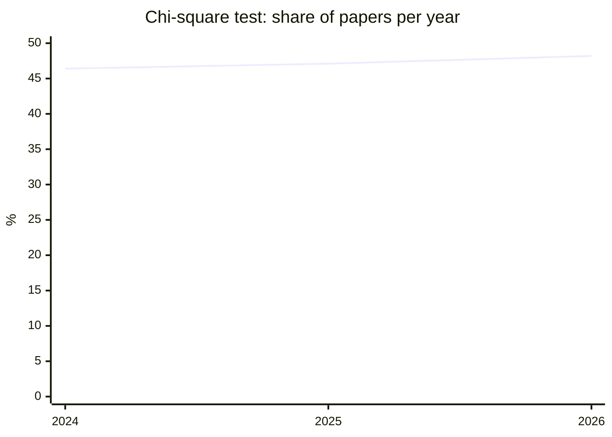
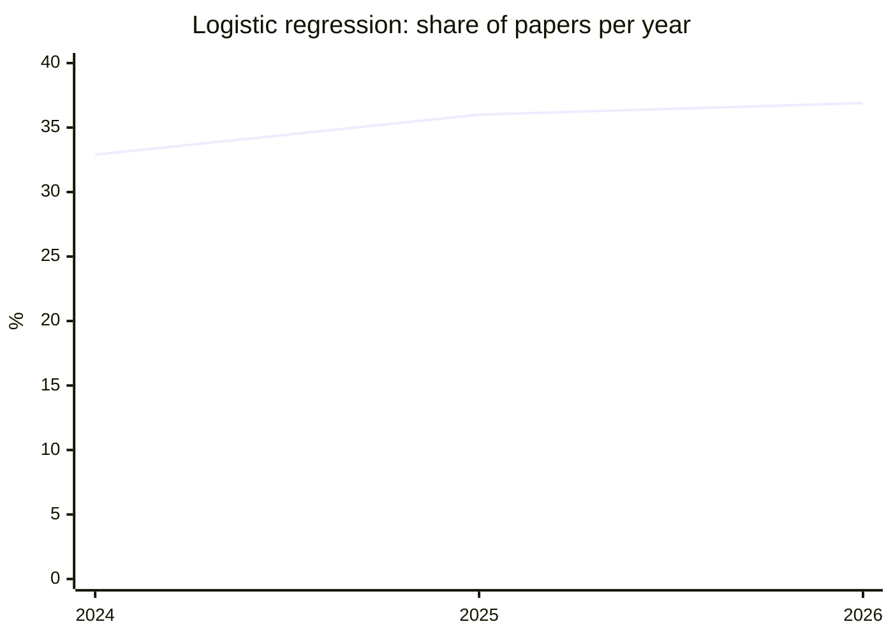
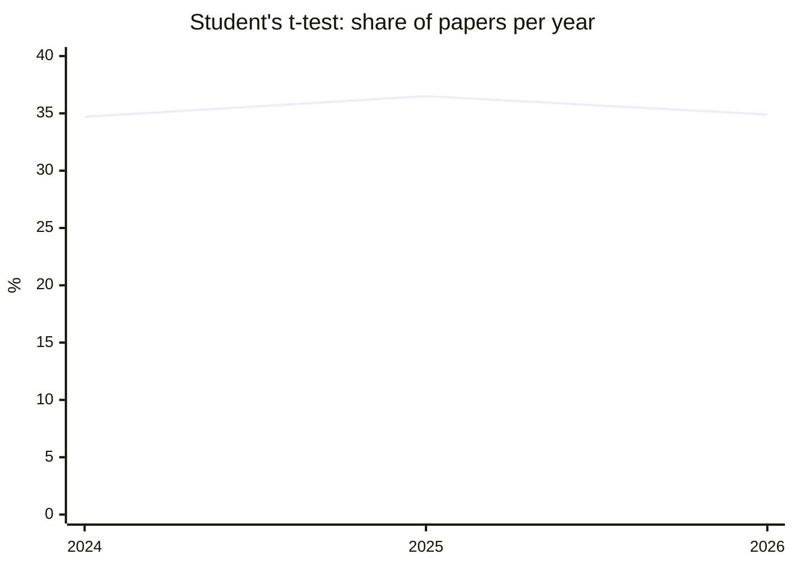
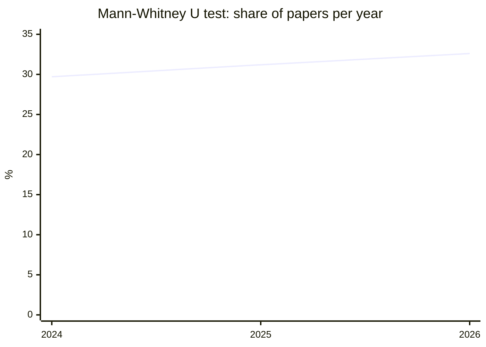
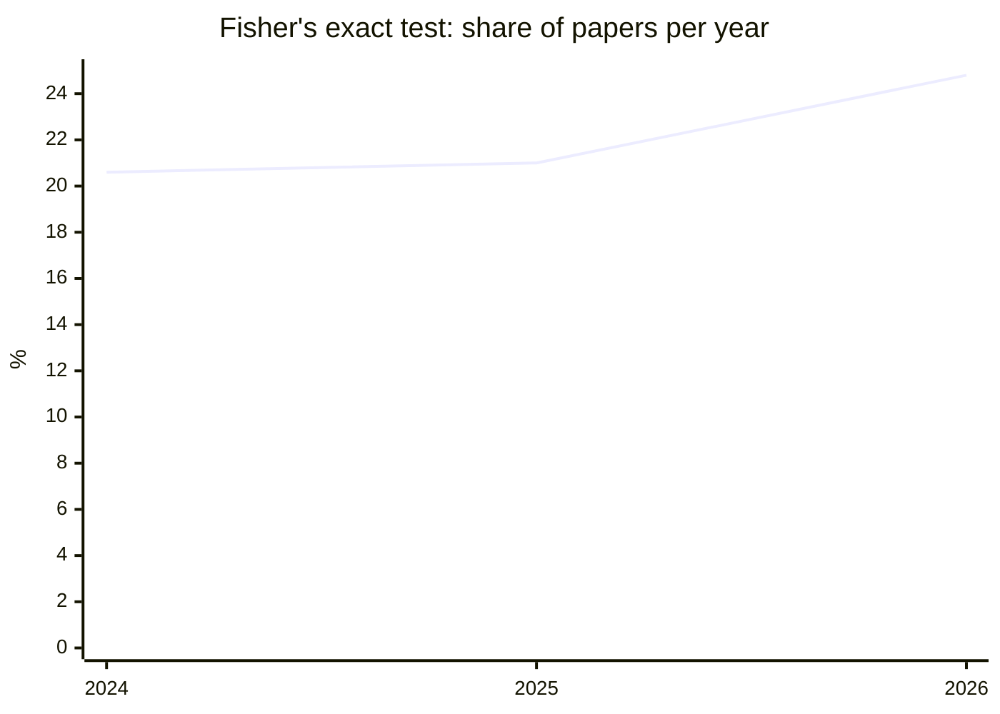

# Literature watch

Updated 2026-11-21. Round: 25 papers per field and publication month, 2016-10 to 2026-09.

Which statistical methods epidemiological research uses, from a random sample of open-access research articles in PubMed and PMC per field and month (no reviews). Claude lists each paper's methods from its abstract and methods section; only IDs, titles and the methods are stored.

## Progress

| Field | Months complete | Papers read |
|---|---|---|
| cardiovascular | 28 / 120 | 700 / 3000 |
| metabolic | 28 / 120 | 700 / 3000 |
| mental-health | 27 / 120 | 687 / 3000 |
| cancer | 27 / 120 | 675 / 3000 |
| respiratory-allergy | 27 / 120 | 675 / 3000 |
| infections | 27 / 120 | 675 / 3000 |
| pregnancy-child | 27 / 120 | 675 / 3000 |
| environment | 27 / 120 | 675 / 3000 |
| nutrition | 27 / 120 | 675 / 3000 |
| omics | 27 / 120 | 675 / 3000 |
| lifestyle | 27 / 120 | 675 / 3000 |
| **all** | 299 / 1320 | 7487 / 33000 |

## All fields

Papers read: 6249, 6145 of them usable (6145 of these in the last 36 months, which the order below is based on).

| Method | Share, last 3 years | Papers | 2016 | 2017 | 2018 | 2019 | 2020 | 2021 | 2022 | 2023 | 2024 | 2025 | 2026 | Trend | In DataSHIELD |
|---|---|---|---|---|---|---|---|---|---|---|---|---|---|---|---|
| Chi-square test | 47% | 2907 | – | – | – | – | – | – | – | – | 46% | 47% | 48% | steady | – |
| Logistic regression | 36% | 2186 | – | – | – | – | – | – | – | – | 33% | 36% | 37% | rising | – |
| Student's t-test | 36% | 2182 | – | – | – | – | – | – | – | – | 35% | 36% | 35% | steady | – |
| Mann-Whitney U test | 31% | 1926 | – | – | – | – | – | – | – | – | 30% | 31% | 33% | steady | – |
| Fisher's exact test | 22% | 1364 | – | – | – | – | – | – | – | – | 21% | 21% | 25% | rising | – |
| Linear regression | 18% | 1126 | – | – | – | – | – | – | – | – | 17% | 17% | 21% | rising | – |
| Cox proportional hazards regression | 16% | 959 | – | – | – | – | – | – | – | – | 16% | 15% | 17% | steady | – |
| Analysis of variance (ANOVA) | 15% | 934 | – | – | – | – | – | – | – | – | 15% | 15% | 15% | steady | – |
| ROC curve analysis | 15% | 911 | – | – | – | – | – | – | – | – | 13% | 16% | 15% | steady | – |
| Spearman's rank correlation | 13% | 770 | – | – | – | – | – | – | – | – | 11% | 13% | 14% | rising | – |
| Kruskal-Wallis test | 12% | 735 | – | – | – | – | – | – | – | – | 12% | 11% | 13% | steady | – |
| Pearson correlation | 12% | 724 | – | – | – | – | – | – | – | – | 11% | 13% | 11% | steady | – |
| Kaplan-Meier estimator | 11% | 702 | – | – | – | – | – | – | – | – | 11% | 11% | 12% | steady | – |
| Shapiro-Wilk test | 11% | 688 | – | – | – | – | – | – | – | – | 9% | 12% | 12% | rising | – |
| Subgroup analysis | 9% | 550 | – | – | – | – | – | – | – | – | 8% | 9% | 9% | steady | – |
| false-discovery-rate-correction | 9% | 538 | – | – | – | – | – | – | – | – | 6% | 7% | 12% | rising | – |
| Log-rank test | 8% | 475 | – | – | – | – | – | – | – | – | 8% | 7% | 8% | steady | – |
| Variance inflation factor | 7% | 426 | – | – | – | – | – | – | – | – | 3% | 6% | 10% | rising | – |
| Restricted cubic splines | 7% | 406 | – | – | – | – | – | – | – | – | 6% | 7% | 7% | steady | – |
| Kolmogorov-Smirnov test | 6% | 394 | – | – | – | – | – | – | – | – | 6% | 7% | 5% | steady | – |
| *papers read* | | | 0 | 0 | 0 | 0 | 0 | 0 | 0 | 0 | 1415 | 2619 | 2111 | | |

**Variants named in at least 2 papers** (DataSHIELD may have the method but not the variant):

| Method | Variant | Papers | In DataSHIELD |
|---|---|---|---|
| Student's t-test | Independent samples | 400 | – |
| Analysis of variance (ANOVA) | One-way ANOVA | 390 | – |
| false-discovery-rate-correction | benjamini-hochberg | 380 | – |
| Student's t-test | Paired samples | 224 | – |
| Multiple imputation | chained equations | 175 | – |
| Logistic regression | survey-weighted | 111 | – |
| Student's t-test | Welch unequal variances | 89 | – |
| Propensity score matching | caliper | 87 | – |
| Analysis of variance (ANOVA) | Analysis of covariance | 85 | – |
| Linear mixed model | random intercept | 82 | – |
| gradient-boosting | xgboost implementation | 80 | – |
| Cox proportional hazards regression | stratified | 78 | – |
| Linear mixed model | random intercepts | 75 | – |
| Poisson regression | robust standard errors | 67 | – |
| Mediation analysis | bootstrap confidence intervals | 66 | – |
| Cox proportional hazards regression | time-varying covariates | 61 | – |
| Analysis of variance (ANOVA) | Repeated measures ANOVA | 59 | – |
| ROC curve analysis | youden optimal cutoff | 55 | – |
| Poisson regression | robust variance | 52 | – |
| Poisson regression | modified | 48 | – |

## cardiovascular

Papers read: 585, 573 of them usable (573 of these in the last 36 months, which the order below is based on).

| Method | Share, last 3 years | Papers | 2016 | 2017 | 2018 | 2019 | 2020 | 2021 | 2022 | 2023 | 2024 | 2025 | 2026 | Trend | In DataSHIELD |
|---|---|---|---|---|---|---|---|---|---|---|---|---|---|---|---|
| Chi-square test | 58% | 330 | – | – | – | – | – | – | – | – | 56% | 56% | 60% | steady | – |
| Mann-Whitney U test | 43% | 249 | – | – | – | – | – | – | – | – | 35% | 47% | 46% | steady | – |
| Logistic regression | 41% | 236 | – | – | – | – | – | – | – | – | 40% | 40% | 44% | steady | – |
| Student's t-test | 41% | 236 | – | – | – | – | – | – | – | – | 38% | 44% | 40% | steady | – |
| Fisher's exact test | 32% | 185 | – | – | – | – | – | – | – | – | 28% | 32% | 36% | steady | – |
| Cox proportional hazards regression | 26% | 150 | – | – | – | – | – | – | – | – | 33% | 21% | 27% | steady | – |
| ROC curve analysis | 21% | 122 | – | – | – | – | – | – | – | – | 22% | 19% | 23% | steady | – |
| Kaplan-Meier estimator | 20% | 117 | – | – | – | – | – | – | – | – | 22% | 21% | 19% | steady | – |
| Analysis of variance (ANOVA) | 16% | 89 | – | – | – | – | – | – | – | – | 19% | 14% | 15% | steady | – |
| Linear regression | 15% | 85 | – | – | – | – | – | – | – | – | 16% | 12% | 17% | steady | – |
| *papers read* | | | 0 | 0 | 0 | 0 | 0 | 0 | 0 | 0 | 144 | 234 | 195 | | |

**Variants named in at least 2 papers** (DataSHIELD may have the method but not the variant):

| Method | Variant | Papers | In DataSHIELD |
|---|---|---|---|
| Analysis of variance (ANOVA) | One-way ANOVA | 35 | – |
| Student's t-test | Independent samples | 34 | – |
| Student's t-test | Paired samples | 30 | – |
| Multiple imputation | chained equations | 23 | – |
| false-discovery-rate-correction | benjamini-hochberg | 15 | – |
| Propensity score matching | caliper | 10 | – |
| Student's t-test | Welch unequal variances | 9 | – |
| Cox proportional hazards regression | time-varying covariates | 8 | – |
| gradient-boosting | xgboost implementation | 8 | – |
| Cox proportional hazards regression | stratified | 7 | – |
| Logistic regression | stepwise selection | 7 | – |
| Analysis of variance (ANOVA) | Analysis of covariance | 6 | – |
| Linear mixed model | random intercepts | 6 | – |
| Subgroup analysis | interaction terms | 6 | – |
| Test for trend | linear | 6 | – |
| Bootstrap | internal model validation | 5 | – |
| Generalized linear mixed model | logistic | 5 | – |
| Generalized linear mixed model | random intercept | 5 | – |
| Linear regression | stepwise | 5 | – |
| Logistic regression | survey weights | 5 | – |

## metabolic

Papers read: 587, 581 of them usable (581 of these in the last 36 months, which the order below is based on).

| Method | Share, last 3 years | Papers | 2016 | 2017 | 2018 | 2019 | 2020 | 2021 | 2022 | 2023 | 2024 | 2025 | 2026 | Trend | In DataSHIELD |
|---|---|---|---|---|---|---|---|---|---|---|---|---|---|---|---|
| Chi-square test | 58% | 335 | – | – | – | – | – | – | – | – | 54% | 59% | 58% | steady | – |
| Student's t-test | 45% | 264 | – | – | – | – | – | – | – | – | 41% | 48% | 46% | steady | – |
| Logistic regression | 41% | 237 | – | – | – | – | – | – | – | – | 39% | 42% | 41% | steady | – |
| Mann-Whitney U test | 34% | 198 | – | – | – | – | – | – | – | – | 33% | 34% | 35% | steady | – |
| Linear regression | 22% | 125 | – | – | – | – | – | – | – | – | 15% | 22% | 25% | rising | – |
| Analysis of variance (ANOVA) | 21% | 123 | – | – | – | – | – | – | – | – | 17% | 23% | 22% | steady | – |
| Fisher's exact test | 21% | 122 | – | – | – | – | – | – | – | – | 21% | 20% | 23% | steady | – |
| Cox proportional hazards regression | 16% | 92 | – | – | – | – | – | – | – | – | 16% | 15% | 16% | steady | – |
| Shapiro-Wilk test | 16% | 92 | – | – | – | – | – | – | – | – | 14% | 17% | 16% | steady | – |
| ROC curve analysis | 15% | 89 | – | – | – | – | – | – | – | – | 12% | 16% | 17% | steady | – |
| *papers read* | | | 0 | 0 | 0 | 0 | 0 | 0 | 0 | 0 | 145 | 246 | 190 | | |

**Variants named in at least 2 papers** (DataSHIELD may have the method but not the variant):

| Method | Variant | Papers | In DataSHIELD |
|---|---|---|---|
| Analysis of variance (ANOVA) | One-way ANOVA | 50 | – |
| Student's t-test | Paired samples | 32 | – |
| Student's t-test | Independent samples | 29 | – |
| false-discovery-rate-correction | benjamini-hochberg | 23 | – |
| Logistic regression | survey-weighted | 23 | – |
| Multiple imputation | chained equations | 19 | – |
| Analysis of variance (ANOVA) | Analysis of covariance | 17 | – |
| Propensity score matching | caliper | 12 | – |
| Linear mixed model | random intercept | 10 | – |
| Poisson regression | robust standard errors | 9 | – |
| Chi-square test | survey-weighted | 8 | – |
| Linear regression | survey-weighted | 8 | – |
| Poisson regression | modified | 8 | – |
| Student's t-test | Survey-weighted | 8 | – |
| Student's t-test | Welch unequal variances | 8 | – |
| Analysis of variance (ANOVA) | Repeated measures ANOVA | 7 | – |
| Logistic regression | stratified | 7 | – |
| Poisson regression | robust variance | 7 | – |
| Linear regression | stratified | 6 | – |
| Logistic regression | interaction terms | 6 | – |

## mental-health

Papers read: 568, 562 of them usable (562 of these in the last 36 months, which the order below is based on).

| Method | Share, last 3 years | Papers | 2016 | 2017 | 2018 | 2019 | 2020 | 2021 | 2022 | 2023 | 2024 | 2025 | 2026 | Trend | In DataSHIELD |
|---|---|---|---|---|---|---|---|---|---|---|---|---|---|---|---|
| Chi-square test | 46% | 260 | – | – | – | – | – | – | – | – | 48% | 45% | 47% | steady | – |
| Student's t-test | 36% | 203 | – | – | – | – | – | – | – | – | 37% | 36% | 36% | steady | – |
| Logistic regression | 31% | 177 | – | – | – | – | – | – | – | – | 28% | 32% | 34% | steady | – |
| Linear regression | 23% | 129 | – | – | – | – | – | – | – | – | 23% | 20% | 26% | steady | – |
| Mann-Whitney U test | 22% | 124 | – | – | – | – | – | – | – | – | 25% | 19% | 24% | steady | – |
| Analysis of variance (ANOVA) | 17% | 98 | – | – | – | – | – | – | – | – | 19% | 19% | 15% | steady | – |
| Pearson correlation | 16% | 92 | – | – | – | – | – | – | – | – | 19% | 18% | 13% | steady | – |
| Fisher's exact test | 14% | 76 | – | – | – | – | – | – | – | – | 12% | 11% | 18% | steady | – |
| ROC curve analysis | 12% | 68 | – | – | – | – | – | – | – | – | 8% | 13% | 13% | steady | – |
| Spearman's rank correlation | 11% | 60 | – | – | – | – | – | – | – | – | 11% | 10% | 12% | steady | – |
| *papers read* | | | 0 | 0 | 0 | 0 | 0 | 0 | 0 | 0 | 128 | 240 | 194 | | |

**Variants named in at least 2 papers** (DataSHIELD may have the method but not the variant):

| Method | Variant | Papers | In DataSHIELD |
|---|---|---|---|
| Student's t-test | Independent samples | 54 | – |
| false-discovery-rate-correction | benjamini-hochberg | 33 | – |
| Analysis of variance (ANOVA) | One-way ANOVA | 32 | – |
| Multiple imputation | chained equations | 23 | – |
| Analysis of variance (ANOVA) | Analysis of covariance | 18 | – |
| Student's t-test | Paired samples | 17 | – |
| Linear mixed model | random slopes | 13 | – |
| Analysis of variance (ANOVA) | Repeated measures ANOVA | 11 | – |
| Linear mixed model | random intercepts | 10 | – |
| Mediation analysis | bootstrap confidence intervals | 10 | – |
| Cox proportional hazards regression | robust standard errors | 9 | – |
| Cox proportional hazards regression | stratified | 9 | – |
| gradient-boosting | xgboost implementation | 9 | – |
| Propensity score matching | caliper | 9 | – |
| Cross-validation | k-fold | 8 | – |
| Poisson regression | robust standard errors | 8 | – |
| Linear mixed model | random intercept | 7 | – |
| Structural equation modeling | path analysis | 7 | – |
| Student's t-test | Welch unequal variances | 7 | – |
| Logistic regression | survey-weighted | 6 | – |

## cancer

Papers read: 559, 544 of them usable (544 of these in the last 36 months, which the order below is based on).

| Method | Share, last 3 years | Papers | 2016 | 2017 | 2018 | 2019 | 2020 | 2021 | 2022 | 2023 | 2024 | 2025 | 2026 | Trend | In DataSHIELD |
|---|---|---|---|---|---|---|---|---|---|---|---|---|---|---|---|
| Chi-square test | 49% | 264 | – | – | – | – | – | – | – | – | 50% | 47% | 50% | steady | – |
| Kaplan-Meier estimator | 36% | 194 | – | – | – | – | – | – | – | – | 41% | 33% | 35% | steady | – |
| Logistic regression | 34% | 184 | – | – | – | – | – | – | – | – | 33% | 35% | 33% | steady | – |
| Mann-Whitney U test | 34% | 183 | – | – | – | – | – | – | – | – | 35% | 31% | 36% | steady | – |
| Fisher's exact test | 31% | 171 | – | – | – | – | – | – | – | – | 34% | 27% | 35% | steady | – |
| Student's t-test | 31% | 167 | – | – | – | – | – | – | – | – | 31% | 31% | 30% | steady | – |
| Cox proportional hazards regression | 31% | 166 | – | – | – | – | – | – | – | – | 32% | 26% | 35% | steady | – |
| Log-rank test | 26% | 142 | – | – | – | – | – | – | – | – | 31% | 25% | 25% | steady | – |
| ROC curve analysis | 22% | 120 | – | – | – | – | – | – | – | – | 19% | 25% | 21% | steady | – |
| Kruskal-Wallis test | 9% | 48 | – | – | – | – | – | – | – | – | 8% | 8% | 11% | steady | – |
| *papers read* | | | 0 | 0 | 0 | 0 | 0 | 0 | 0 | 0 | 118 | 227 | 199 | | |

**Variants named in at least 2 papers** (DataSHIELD may have the method but not the variant):

| Method | Variant | Papers | In DataSHIELD |
|---|---|---|---|
| Student's t-test | Independent samples | 23 | – |
| Analysis of variance (ANOVA) | One-way ANOVA | 21 | – |
| false-discovery-rate-correction | benjamini-hochberg | 19 | – |
| Propensity score matching | caliper | 16 | – |
| Student's t-test | Paired samples | 16 | – |
| ROC curve analysis | youden optimal cutoff | 11 | – |
| Cox proportional hazards regression | stratified | 10 | – |
| gradient-boosting | xgboost implementation | 10 | – |
| Cross-validation | k-fold | 8 | – |
| gradient-boosting | lightgbm | 7 | – |
| Multiple imputation | chained equations | 7 | – |
| Propensity score matching | 1:1 | 6 | – |
| Propensity score matching | nearest neighbor | 6 | – |
| Bootstrap | internal model validation | 5 | – |
| Cox proportional hazards regression | time-varying covariates | 5 | – |
| Generalized estimating equations | exchangeable correlation | 5 | – |
| Kaplan-Meier estimator | reverse (follow-up time) | 5 | – |
| Linear mixed model | random intercept | 5 | – |
| Linear mixed model | random intercepts | 5 | – |
| Stepwise variable selection | backward | 5 | – |

## respiratory-allergy

Papers read: 569, 559 of them usable (559 of these in the last 36 months, which the order below is based on).

| Method | Share, last 3 years | Papers | 2016 | 2017 | 2018 | 2019 | 2020 | 2021 | 2022 | 2023 | 2024 | 2025 | 2026 | Trend | In DataSHIELD |
|---|---|---|---|---|---|---|---|---|---|---|---|---|---|---|---|
| Chi-square test | 53% | 297 | – | – | – | – | – | – | – | – | 52% | 55% | 51% | steady | – |
| Logistic regression | 39% | 219 | – | – | – | – | – | – | – | – | 31% | 41% | 42% | steady | – |
| Student's t-test | 39% | 218 | – | – | – | – | – | – | – | – | 42% | 39% | 38% | steady | – |
| Mann-Whitney U test | 38% | 215 | – | – | – | – | – | – | – | – | 35% | 43% | 35% | steady | – |
| Fisher's exact test | 32% | 177 | – | – | – | – | – | – | – | – | 27% | 31% | 35% | steady | – |
| Kaplan-Meier estimator | 24% | 132 | – | – | – | – | – | – | – | – | 26% | 24% | 21% | steady | – |
| Cox proportional hazards regression | 23% | 127 | – | – | – | – | – | – | – | – | 25% | 22% | 22% | steady | – |
| ROC curve analysis | 22% | 123 | – | – | – | – | – | – | – | – | 19% | 24% | 21% | steady | – |
| Log-rank test | 15% | 86 | – | – | – | – | – | – | – | – | 20% | 15% | 13% | steady | – |
| Analysis of variance (ANOVA) | 13% | 74 | – | – | – | – | – | – | – | – | 8% | 16% | 13% | steady | – |
| *papers read* | | | 0 | 0 | 0 | 0 | 0 | 0 | 0 | 0 | 124 | 238 | 197 | | |

**Variants named in at least 2 papers** (DataSHIELD may have the method but not the variant):

| Method | Variant | Papers | In DataSHIELD |
|---|---|---|---|
| Analysis of variance (ANOVA) | One-way ANOVA | 35 | – |
| Student's t-test | Independent samples | 35 | – |
| Student's t-test | Paired samples | 21 | – |
| gradient-boosting | xgboost implementation | 15 | – |
| Propensity score matching | caliper | 15 | – |
| LASSO regression | penalised (lasso) | 13 | – |
| false-discovery-rate-correction | benjamini-hochberg | 12 | – |
| Logistic regression | stepwise selection | 10 | – |
| Multiple imputation | chained equations | 10 | – |
| Student's t-test | Welch unequal variances | 9 | – |
| Bootstrap | internal model validation | 7 | – |
| Cox proportional hazards regression | stratified | 7 | – |
| LASSO regression | logistic | 6 | – |
| Logistic regression | survey-weighted | 6 | – |
| Analysis of variance (ANOVA) | Factorial multi-way ANOVA | 5 | – |
| Analysis of variance (ANOVA) | Repeated measures ANOVA | 5 | – |
| Cox proportional hazards regression | time-varying covariates | 5 | – |
| Linear mixed model | random intercept | 5 | – |
| ROC curve analysis | youden optimal cutoff | 5 | – |
| Analysis of variance (ANOVA) | Analysis of covariance | 4 | – |

## infections

Papers read: 577, 562 of them usable (562 of these in the last 36 months, which the order below is based on).

| Method | Share, last 3 years | Papers | 2016 | 2017 | 2018 | 2019 | 2020 | 2021 | 2022 | 2023 | 2024 | 2025 | 2026 | Trend | In DataSHIELD |
|---|---|---|---|---|---|---|---|---|---|---|---|---|---|---|---|
| Chi-square test | 51% | 284 | – | – | – | – | – | – | – | – | 46% | 52% | 52% | steady | – |
| Logistic regression | 40% | 225 | – | – | – | – | – | – | – | – | 33% | 41% | 44% | steady | – |
| Mann-Whitney U test | 31% | 176 | – | – | – | – | – | – | – | – | 27% | 30% | 36% | steady | – |
| Fisher's exact test | 31% | 174 | – | – | – | – | – | – | – | – | 22% | 30% | 38% | rising | – |
| Student's t-test | 28% | 158 | – | – | – | – | – | – | – | – | 25% | 30% | 28% | steady | – |
| ROC curve analysis | 13% | 72 | – | – | – | – | – | – | – | – | 10% | 13% | 14% | steady | – |
| Cox proportional hazards regression | 12% | 65 | – | – | – | – | – | – | – | – | 9% | 13% | 11% | steady | – |
| Analysis of variance (ANOVA) | 10% | 59 | – | – | – | – | – | – | – | – | 11% | 10% | 11% | steady | – |
| Linear regression | 10% | 58 | – | – | – | – | – | – | – | – | 7% | 12% | 11% | steady | – |
| Kaplan-Meier estimator | 10% | 56 | – | – | – | – | – | – | – | – | 8% | 10% | 11% | steady | – |
| *papers read* | | | 0 | 0 | 0 | 0 | 0 | 0 | 0 | 0 | 123 | 250 | 189 | | |

**Variants named in at least 2 papers** (DataSHIELD may have the method but not the variant):

| Method | Variant | Papers | In DataSHIELD |
|---|---|---|---|
| Student's t-test | Independent samples | 27 | – |
| Analysis of variance (ANOVA) | One-way ANOVA | 26 | – |
| Student's t-test | Paired samples | 18 | – |
| false-discovery-rate-correction | benjamini-hochberg | 14 | – |
| Multiple imputation | chained equations | 11 | – |
| Poisson regression | robust standard errors | 8 | – |
| ROC curve analysis | youden optimal cutoff | 8 | – |
| Segmented (piecewise) regression | interrupted time series | 8 | – |
| Phylogenetic analysis | maximum likelihood | 7 | – |
| Propensity score matching | caliper | 7 | – |
| gradient-boosting | xgboost implementation | 6 | – |
| Logistic regression | survey-weighted | 6 | – |
| Poisson regression | robust variance | 6 | – |
| Student's t-test | Welch unequal variances | 6 | – |
| Cox proportional hazards regression | time-varying covariates | 5 | – |
| Linear regression | log-transformed outcome | 5 | – |
| Logistic regression | forward stepwise selection | 5 | – |
| Poisson regression | modified | 5 | – |
| Cox proportional hazards regression | stratified | 4 | – |
| Linear mixed model | random intercept | 4 | – |

## pregnancy-child

Papers read: 569, 559 of them usable (559 of these in the last 36 months, which the order below is based on).

| Method | Share, last 3 years | Papers | 2016 | 2017 | 2018 | 2019 | 2020 | 2021 | 2022 | 2023 | 2024 | 2025 | 2026 | Trend | In DataSHIELD |
|---|---|---|---|---|---|---|---|---|---|---|---|---|---|---|---|
| Chi-square test | 45% | 252 | – | – | – | – | – | – | – | – | 42% | 50% | 42% | steady | – |
| Logistic regression | 43% | 238 | – | – | – | – | – | – | – | – | 33% | 44% | 46% | rising | – |
| Student's t-test | 34% | 191 | – | – | – | – | – | – | – | – | 28% | 39% | 32% | steady | – |
| Mann-Whitney U test | 30% | 166 | – | – | – | – | – | – | – | – | 31% | 32% | 26% | steady | – |
| Fisher's exact test | 25% | 141 | – | – | – | – | – | – | – | – | 24% | 27% | 24% | steady | – |
| Linear regression | 17% | 94 | – | – | – | – | – | – | – | – | 21% | 15% | 17% | steady | – |
| Analysis of variance (ANOVA) | 14% | 81 | – | – | – | – | – | – | – | – | 16% | 15% | 13% | steady | – |
| ROC curve analysis | 14% | 79 | – | – | – | – | – | – | – | – | 15% | 16% | 11% | steady | – |
| Kruskal-Wallis test | 11% | 59 | – | – | – | – | – | – | – | – | 9% | 11% | 11% | steady | – |
| Shapiro-Wilk test | 11% | 59 | – | – | – | – | – | – | – | – | 10% | 12% | 9% | steady | – |
| *papers read* | | | 0 | 0 | 0 | 0 | 0 | 0 | 0 | 0 | 123 | 234 | 202 | | |

**Variants named in at least 2 papers** (DataSHIELD may have the method but not the variant):

| Method | Variant | Papers | In DataSHIELD |
|---|---|---|---|
| Analysis of variance (ANOVA) | One-way ANOVA | 43 | – |
| Student's t-test | Independent samples | 38 | – |
| false-discovery-rate-correction | benjamini-hochberg | 20 | – |
| Student's t-test | Paired samples | 15 | – |
| Poisson regression | robust standard errors | 14 | – |
| Multiple imputation | chained equations | 11 | – |
| Poisson regression | modified | 10 | – |
| Poisson regression | robust variance | 8 | – |
| Student's t-test | Welch unequal variances | 8 | – |
| Linear mixed model | random intercepts | 7 | – |
| Logistic regression | stratified | 7 | – |
| Analysis of variance (ANOVA) | Analysis of covariance | 6 | – |
| gradient-boosting | xgboost implementation | 6 | – |
| Propensity score matching | caliper | 6 | – |
| Bootstrap | internal validation | 5 | – |
| Cox proportional hazards regression | robust standard errors | 5 | – |
| Cross-validation | k-fold | 5 | – |
| LASSO regression | penalised (lasso) | 5 | – |
| Logistic regression | stepwise selection | 5 | – |
| Pathway enrichment analysis | gene ontology | 5 | – |

## environment

Papers read: 573, 568 of them usable (568 of these in the last 36 months, which the order below is based on).

| Method | Share, last 3 years | Papers | 2016 | 2017 | 2018 | 2019 | 2020 | 2021 | 2022 | 2023 | 2024 | 2025 | 2026 | Trend | In DataSHIELD |
|---|---|---|---|---|---|---|---|---|---|---|---|---|---|---|---|
| Chi-square test | 34% | 195 | – | – | – | – | – | – | – | – | 33% | 33% | 36% | steady | – |
| Logistic regression | 32% | 183 | – | – | – | – | – | – | – | – | 31% | 30% | 36% | steady | – |
| Student's t-test | 25% | 143 | – | – | – | – | – | – | – | – | 27% | 27% | 22% | steady | – |
| Linear regression | 25% | 140 | – | – | – | – | – | – | – | – | 20% | 24% | 29% | steady | – |
| Mann-Whitney U test | 21% | 121 | – | – | – | – | – | – | – | – | 19% | 22% | 22% | steady | – |
| Spearman's rank correlation | 17% | 95 | – | – | – | – | – | – | – | – | 11% | 18% | 19% | steady | – |
| Subgroup analysis | 17% | 95 | – | – | – | – | – | – | – | – | 18% | 18% | 15% | steady | – |
| Cox proportional hazards regression | 16% | 90 | – | – | – | – | – | – | – | – | 18% | 16% | 15% | steady | – |
| Restricted cubic splines | 14% | 81 | – | – | – | – | – | – | – | – | 15% | 16% | 11% | steady | – |
| Fisher's exact test | 13% | 72 | – | – | – | – | – | – | – | – | 11% | 12% | 14% | steady | – |
| *papers read* | | | 0 | 0 | 0 | 0 | 0 | 0 | 0 | 0 | 131 | 245 | 192 | | |

**Variants named in at least 2 papers** (DataSHIELD may have the method but not the variant):

| Method | Variant | Papers | In DataSHIELD |
|---|---|---|---|
| false-discovery-rate-correction | benjamini-hochberg | 39 | – |
| Multiple imputation | chained equations | 37 | – |
| Student's t-test | Independent samples | 27 | – |
| Analysis of variance (ANOVA) | One-way ANOVA | 22 | – |
| Cox proportional hazards regression | time-varying covariates | 19 | – |
| Cox proportional hazards regression | stratified | 17 | – |
| Student's t-test | Paired samples | 16 | – |
| Logistic regression | survey-weighted | 15 | – |
| Linear mixed model | random intercept | 14 | – |
| Cox proportional hazards regression | age as time scale | 13 | – |
| Linear mixed model | random intercepts | 11 | – |
| Interaction analysis | stratified | 8 | – |
| Interaction analysis | interaction terms | 7 | – |
| Standardized incidence ratio | mortality ratio | 7 | – |
| Generalized linear mixed model | random intercept | 6 | – |
| Generalized linear mixed model | random intercepts | 6 | – |
| Linear regression | survey-weighted | 6 | – |
| Mediation analysis | bootstrap confidence intervals | 6 | – |
| Poisson regression | robust standard errors | 6 | – |
| Logistic regression | stratified | 5 | – |

## nutrition

Papers read: 592, 588 of them usable (588 of these in the last 36 months, which the order below is based on).

| Method | Share, last 3 years | Papers | 2016 | 2017 | 2018 | 2019 | 2020 | 2021 | 2022 | 2023 | 2024 | 2025 | 2026 | Trend | In DataSHIELD |
|---|---|---|---|---|---|---|---|---|---|---|---|---|---|---|---|
| Chi-square test | 56% | 328 | – | – | – | – | – | – | – | – | 55% | 52% | 61% | steady | – |
| Logistic regression | 38% | 226 | – | – | – | – | – | – | – | – | 43% | 39% | 35% | steady | – |
| Student's t-test | 38% | 221 | – | – | – | – | – | – | – | – | 39% | 34% | 41% | steady | – |
| Linear regression | 28% | 164 | – | – | – | – | – | – | – | – | 23% | 26% | 34% | rising | – |
| Mann-Whitney U test | 25% | 149 | – | – | – | – | – | – | – | – | 25% | 24% | 27% | steady | – |
| Analysis of variance (ANOVA) | 21% | 125 | – | – | – | – | – | – | – | – | 18% | 20% | 24% | steady | – |
| Fisher's exact test | 18% | 103 | – | – | – | – | – | – | – | – | 20% | 17% | 17% | steady | – |
| Cox proportional hazards regression | 16% | 95 | – | – | – | – | – | – | – | – | 14% | 17% | 16% | steady | – |
| Shapiro-Wilk test | 15% | 90 | – | – | – | – | – | – | – | – | 12% | 15% | 18% | steady | – |
| Kruskal-Wallis test | 15% | 87 | – | – | – | – | – | – | – | – | 14% | 15% | 15% | steady | – |
| *papers read* | | | 0 | 0 | 0 | 0 | 0 | 0 | 0 | 0 | 130 | 254 | 204 | | |

**Variants named in at least 2 papers** (DataSHIELD may have the method but not the variant):

| Method | Variant | Papers | In DataSHIELD |
|---|---|---|---|
| Student's t-test | Independent samples | 46 | – |
| Analysis of variance (ANOVA) | One-way ANOVA | 43 | – |
| false-discovery-rate-correction | benjamini-hochberg | 27 | – |
| Logistic regression | survey-weighted | 27 | – |
| Student's t-test | Paired samples | 18 | – |
| Analysis of variance (ANOVA) | Analysis of covariance | 15 | – |
| Multiple imputation | chained equations | 14 | – |
| Principal component analysis | varimax rotation | 14 | – |
| Chi-square test | survey-weighted | 11 | – |
| Cox proportional hazards regression | stratified | 10 | – |
| Poisson regression | robust variance | 9 | – |
| Student's t-test | Welch unequal variances | 9 | – |
| Cox proportional hazards regression | time-varying covariates | 8 | – |
| Mediation analysis | bootstrap confidence intervals | 8 | – |
| Analysis of variance (ANOVA) | Repeated measures ANOVA | 7 | – |
| Exploratory factor analysis | varimax rotation | 7 | – |
| Linear mixed model | random intercept | 7 | – |
| Logistic regression | survey weights | 7 | – |
| Student's t-test | Survey-weighted | 7 | – |
| Linear mixed model | random intercepts | 6 | – |

## omics

Papers read: 568, 555 of them usable (555 of these in the last 36 months, which the order below is based on).

| Method | Share, last 3 years | Papers | 2016 | 2017 | 2018 | 2019 | 2020 | 2021 | 2022 | 2023 | 2024 | 2025 | 2026 | Trend | In DataSHIELD |
|---|---|---|---|---|---|---|---|---|---|---|---|---|---|---|---|
| Mann-Whitney U test | 49% | 272 | – | – | – | – | – | – | – | – | 49% | 46% | 53% | steady | – |
| false-discovery-rate-correction | 44% | 242 | – | – | – | – | – | – | – | – | 32% | 42% | 54% | rising | – |
| Student's t-test | 41% | 227 | – | – | – | – | – | – | – | – | 41% | 43% | 38% | steady | – |
| Chi-square test | 33% | 184 | – | – | – | – | – | – | – | – | 33% | 33% | 34% | steady | – |
| PERMANOVA | 30% | 168 | – | – | – | – | – | – | – | – | 29% | 28% | 35% | steady | – |
| Spearman's rank correlation | 30% | 164 | – | – | – | – | – | – | – | – | 24% | 30% | 33% | steady | – |
| ROC curve analysis | 27% | 149 | – | – | – | – | – | – | – | – | 22% | 30% | 27% | steady | – |
| Kruskal-Wallis test | 26% | 146 | – | – | – | – | – | – | – | – | 26% | 26% | 27% | steady | – |
| Principal coordinates analysis | 25% | 141 | – | – | – | – | – | – | – | – | 24% | 25% | 26% | steady | – |
| Principal component analysis | 21% | 119 | – | – | – | – | – | – | – | – | 26% | 19% | 21% | steady | – |
| *papers read* | | | 0 | 0 | 0 | 0 | 0 | 0 | 0 | 0 | 129 | 236 | 190 | | |

**Variants named in at least 2 papers** (DataSHIELD may have the method but not the variant):

| Method | Variant | Papers | In DataSHIELD |
|---|---|---|---|
| false-discovery-rate-correction | benjamini-hochberg | 171 | – |
| Analysis of variance (ANOVA) | One-way ANOVA | 42 | – |
| Student's t-test | Welch unequal variances | 24 | – |
| Student's t-test | Paired samples | 19 | – |
| Alpha diversity analysis | shannon index | 18 | – |
| Student's t-test | Independent samples | 17 | – |
| Linear mixed model | random intercept | 16 | – |
| Principal coordinates analysis | bray-curtis distance | 14 | – |
| gradient-boosting | xgboost implementation | 12 | – |
| Cross-validation | repeated | 10 | – |
| DESeq2 differential expression analysis | differential abundance | 10 | – |
| Pathway enrichment analysis | kegg | 10 | – |
| Cross-validation | leave-one-out | 9 | – |
| Network analysis (graphical models) | co-occurrence | 9 | – |
| Pathway enrichment analysis | hypergeometric test | 9 | – |
| Cross-validation | k-fold | 8 | – |
| Linear mixed model | random intercepts | 8 | – |
| Cross-validation | nested | 7 | – |
| Cross-validation | stratified | 7 | – |
| Logistic regression | survey-weighted | 7 | – |

## lifestyle

Papers read: 585, 575 of them usable (575 of these in the last 36 months, which the order below is based on).

| Method | Share, last 3 years | Papers | 2016 | 2017 | 2018 | 2019 | 2020 | 2021 | 2022 | 2023 | 2024 | 2025 | 2026 | Trend | In DataSHIELD |
|---|---|---|---|---|---|---|---|---|---|---|---|---|---|---|---|
| Chi-square test | 38% | 218 | – | – | – | – | – | – | – | – | 40% | 36% | 39% | steady | – |
| Logistic regression | 33% | 189 | – | – | – | – | – | – | – | – | 33% | 34% | 31% | steady | – |
| Student's t-test | 32% | 184 | – | – | – | – | – | – | – | – | 30% | 31% | 35% | steady | – |
| Linear regression | 24% | 136 | – | – | – | – | – | – | – | – | 24% | 22% | 26% | steady | – |
| Mann-Whitney U test | 18% | 102 | – | – | – | – | – | – | – | – | 13% | 19% | 20% | steady | – |
| Analysis of variance (ANOVA) | 17% | 97 | – | – | – | – | – | – | – | – | 18% | 17% | 16% | steady | – |
| Pearson correlation | 14% | 82 | – | – | – | – | – | – | – | – | 12% | 14% | 16% | steady | – |
| Spearman's rank correlation | 12% | 67 | – | – | – | – | – | – | – | – | 8% | 13% | 13% | steady | – |
| Subgroup analysis | 11% | 64 | – | – | – | – | – | – | – | – | 15% | 10% | 10% | steady | – |
| Shapiro-Wilk test | 11% | 62 | – | – | – | – | – | – | – | – | 6% | 12% | 13% | steady | – |
| *papers read* | | | 0 | 0 | 0 | 0 | 0 | 0 | 0 | 0 | 135 | 251 | 189 | | |

**Variants named in at least 2 papers** (DataSHIELD may have the method but not the variant):

| Method | Variant | Papers | In DataSHIELD |
|---|---|---|---|
| Student's t-test | Independent samples | 73 | – |
| Analysis of variance (ANOVA) | One-way ANOVA | 45 | – |
| Student's t-test | Paired samples | 25 | – |
| Mediation analysis | bootstrap confidence intervals | 20 | – |
| Multiple imputation | chained equations | 16 | – |
| Logistic regression | survey-weighted | 14 | – |
| Linear mixed model | random intercepts | 13 | – |
| false-discovery-rate-correction | benjamini-hochberg | 12 | – |
| Poisson regression | robust variance | 11 | – |
| Analysis of variance (ANOVA) | Repeated measures ANOVA | 10 | – |
| Analysis of variance (ANOVA) | Analysis of covariance | 9 | – |
| Linear mixed model | random intercept | 9 | – |
| Poisson regression | robust standard errors | 9 | – |
| Generalized linear mixed model | random intercept | 8 | – |
| Mediation analysis | bootstrap | 8 | – |
| Segmented (piecewise) regression | threshold effect | 8 | – |
| Cox proportional hazards regression | stratified | 7 | – |
| Linear regression | stratified | 7 | – |
| Poisson regression | modified | 7 | – |
| Structural equation modeling | path analysis | 7 | – |

## Searches

| Field | Version | Search |
|---|---|---|
| cardiovascular | `2b21c0b8` | `"Epidemiologic Studies"[MeSH Terms] AND ("Cardiovascular Diseases"[majr]) AND "pubmed pmc open access"[filter] NOT (review[pt] OR systematic review[pt] OR meta-analysis[pt])` |
| metabolic | `d26e1bd5` | `"Epidemiologic Studies"[MeSH Terms] AND ("Nutritional and Metabolic Diseases"[majr]) AND "pubmed pmc open access"[filter] NOT (review[pt] OR systematic review[pt] OR meta-analysis[pt])` |
| mental-health | `49157751` | `"Epidemiologic Studies"[MeSH Terms] AND ("Mental Disorders"[majr]) AND "pubmed pmc open access"[filter] NOT (review[pt] OR systematic review[pt] OR meta-analysis[pt])` |
| cancer | `3e24eb6c` | `"Epidemiologic Studies"[MeSH Terms] AND ("Neoplasms"[majr]) AND "pubmed pmc open access"[filter] NOT (review[pt] OR systematic review[pt] OR meta-analysis[pt])` |
| respiratory-allergy | `2b88ada3` | `"Epidemiologic Studies"[MeSH Terms] AND (("Respiratory Tract Diseases"[majr] OR "Hypersensitivity"[majr]) NOT "Respiratory Tract Infections"[majr]) AND "pubmed pmc open access"[filter] NOT (review[pt] OR systematic review[pt] OR meta-analysis[pt])` |
| infections | `5ffaa918` | `"Epidemiologic Studies"[MeSH Terms] AND ("Infections"[majr]) AND "pubmed pmc open access"[filter] NOT (review[pt] OR systematic review[pt] OR meta-analysis[pt])` |
| pregnancy-child | `7287be76` | `"Epidemiologic Studies"[MeSH Terms] AND ("Pregnancy Complications"[majr] OR "Prenatal Exposure Delayed Effects"[majr] OR "Child Development"[majr] OR "Infant, Newborn, Diseases"[majr]) AND "pubmed pmc open access"[filter] NOT (review[pt] OR systematic review[pt] OR meta-analysis[pt])` |
| environment | `5e248b92` | `"Epidemiologic Studies"[MeSH Terms] AND ("Environmental Exposure"[majr] OR "Environmental Pollutants"[majr] OR "Air Pollution"[majr] OR "Noise"[majr] OR "Built Environment"[majr]) AND "pubmed pmc open access"[filter] NOT (review[pt] OR systematic review[pt] OR meta-analysis[pt])` |
| nutrition | `e3ba59b3` | `"Epidemiologic Studies"[MeSH Terms] AND ("Diet"[majr] OR "Nutritional Status"[majr] OR "Feeding Behavior"[majr]) AND "pubmed pmc open access"[filter] NOT (review[pt] OR systematic review[pt] OR meta-analysis[pt])` |
| omics | `88c8ab9a` | `"Epidemiologic Studies"[MeSH Terms] AND ("Genomics"[majr] OR "Epigenomics"[majr] OR "Metabolomics"[majr] OR "Proteomics"[majr] OR "Multiomics"[majr] OR "Microbiota"[majr]) AND "pubmed pmc open access"[filter] NOT (review[pt] OR systematic review[pt] OR meta-analysis[pt])` |
| lifestyle | `d8a73a12` | `"Epidemiologic Studies"[MeSH Terms] AND ("Exercise"[majr] OR "Sedentary Behavior"[majr] OR "Smoking"[majr] OR "Alcohol Drinking"[majr] OR "Sleep"[majr]) AND "pubmed pmc open access"[filter] NOT (review[pt] OR systematic review[pt] OR meta-analysis[pt])` |

_Notes: shares are per year of publication; all fields dip in 2022-2023, most likely NLM's switch to automated MeSH indexing, so read changes around those years with care. Method names are merged by the vocabulary (`vocabulary.yml`, Claude); names not classified yet are shown as the papers gave them. "In DataSHIELD" is Claude's verdict against the functions' documentation in the package catalogue, with the function it found; "partly" means the plain method or only some of it, "no (in development)" a match only in a development package, "unconfirmed" an answer whose evidence didn't check out, "–" not checked yet (fewer papers than the threshold)._
